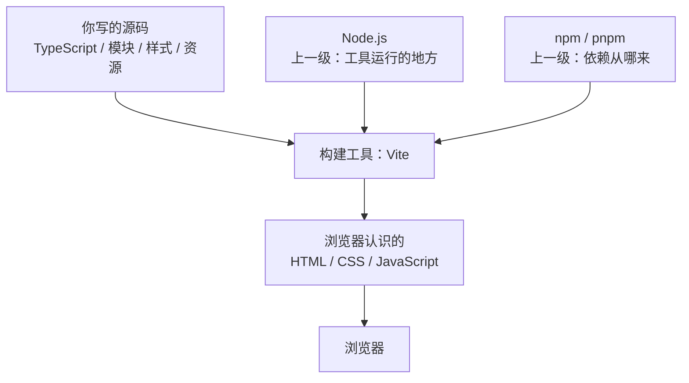
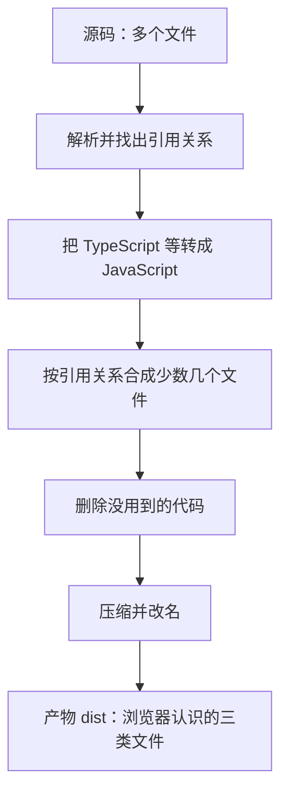
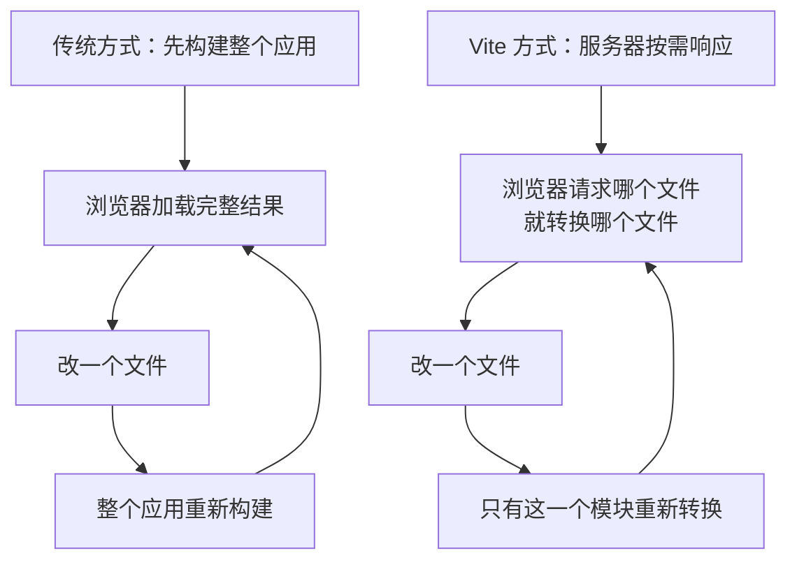
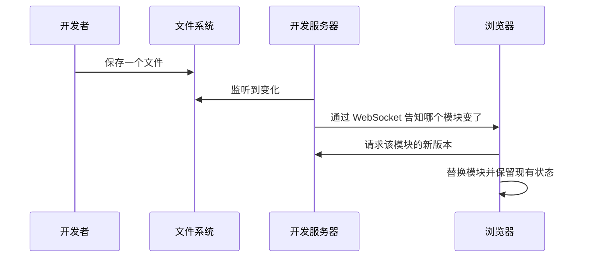
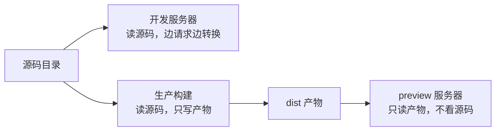
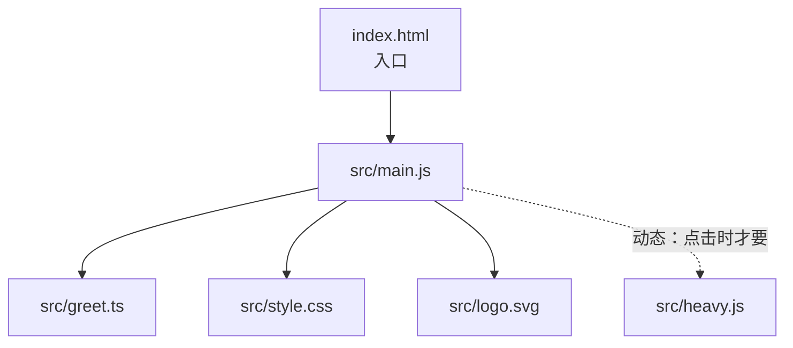
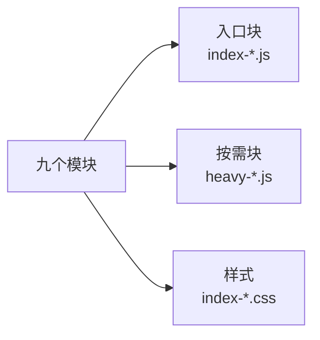
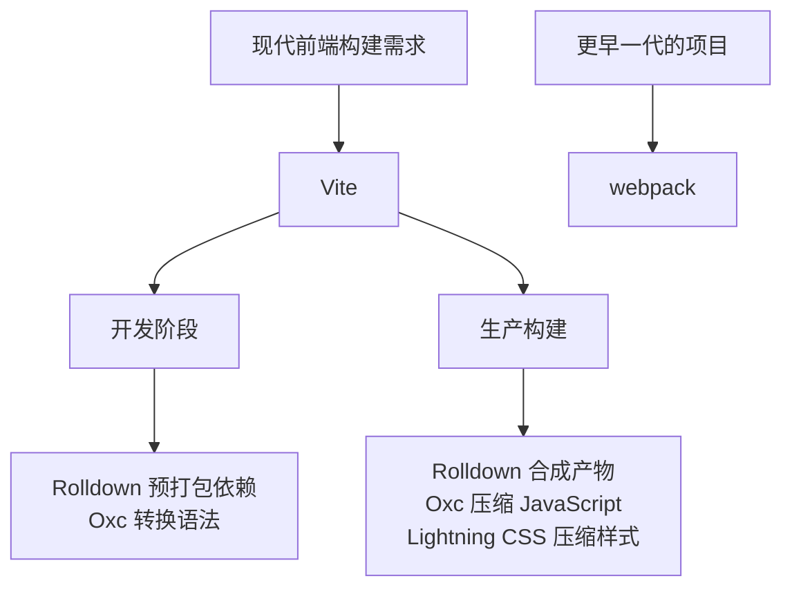
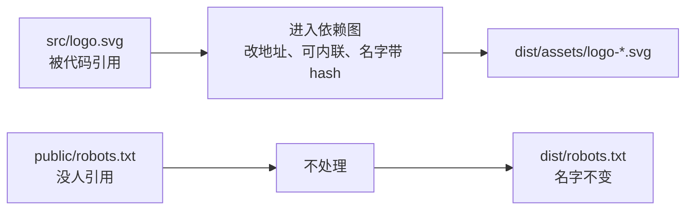
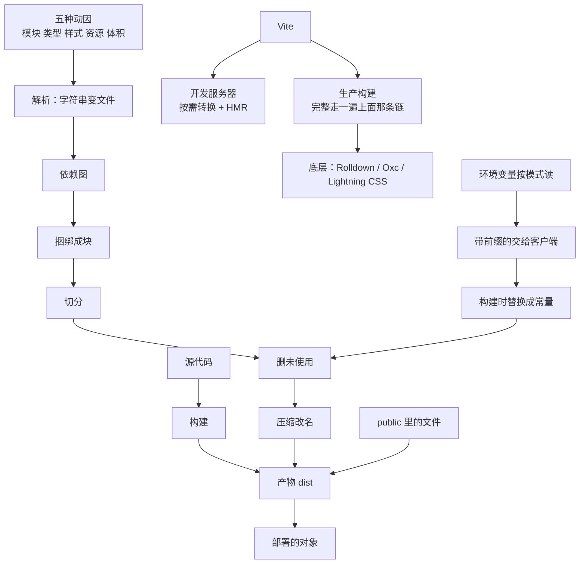

## 本章导读

上一章讲完了开发电脑上的地基：工具需要一个能运行 JavaScript 的地方，项目需要一套把别人的代码拿进来的机制。这两件事跑通之后，现代前端项目还有第三件事一直没人解释过，而它每天都在发生。

最典型的场景是这样的。你让 AI 改一行页面上的文字，它改完让你跑 `npm run dev`，你打开 `localhost:5173`，改一个字页面就变一个字，快得几乎感觉不到中间有什么过程。可等到要发布时，AI 说的是另一句话：`Run the build`。终端里刷出几行字，然后项目目录里多出一个 `dist`，里面的文件名变成了 `index-CB6dolsF.js` 这种带一串乱码后缀的样子，你写的 `greet.ts` 在里面根本找不到。

这两个时刻之间发生了什么？为什么同一个项目有两种「跑起来」，一种是即时响应，另一种要产出一批你不认识的文件？为什么浏览器读得懂你项目里的东西，却读不懂你自己写的那些文件？

这就是本章要回答的问题，它只有一个：**开发者写出来的 TypeScript、模块、组件和资源，怎么变成浏览器最终能够加载的那几个文件。** 这一道工序叫构建（Build），执行这道工序的程序叫构建工具，现代前端项目里最常见的一个是 Vite。

需要说明一件事：这一章不打算重新解释它上游的任何一层。浏览器只认识 HTML、CSS 和 JavaScript（第二章），JavaScript 靠宿主提供的能力才能执行（第三章），类型会在代码离开手边之前被擦掉（第四章），这些工具需要一个运行环境（第五章）——本章把这些当作已知条件，只讲它们之间那条转换的链路。

## 本章在技术栈中的位置



这张图里，第五章讲的是左边两条向上的支撑关系：Vite 本身是一个用 JavaScript 写的程序，它由 Node.js 运行，它依赖的那些包由 npm 或 pnpm 准备好。本章讲的是中间那一格：**源码进去、浏览器认识的文件出来，中间这一转换**。图右边那三样东西是第二章的内容，本章不会改变它们，只会解释它们是怎么被生产出来的。

用一个更容易核对的说法：**构建工具不生产新的网页语言，它只是把你写的东西翻译成浏览器本来就认识的那三种。** 整条 L5 存在的意义是生成 L1，而不是取代 L1。

## 读完本章，你应该能看懂

- “Run `vite build` and check the `dist` folder.”
- “Start the dev server and see if it updates.”
- “Hot reload isn't picking up the change, try restarting.”
- “It gets tree-shaken out of the bundle.”
- “That import can't be resolved.”
- “Add the `VITE_` prefix so the client can read it.”
- “The hashed filename will bust the cache.”
- “Enable source maps to debug the production build.”

这些句子的共同点是：它们都在描述**源码和处理后的源码之间**发生的事。读懂这一章，你应该能判断出 AI 现在是在跑开发服务器、在做生产构建、在改解析规则、还是在选择把哪个值打进包里。

---

## 6.1 什么是 Build

第〇章 0.5.3 已经把最要紧的那个区分交给你了：**你写的文件和浏览器读的文件，通常不是同一批文件**。那一节讲的是这个区分本身，以及它带来的几条推论。

这一节要往下走一步。区分只是起点，真正影响你每天判断的是另外三件事：什么算源码，转换具体做了什么，产出那批文件长什么样。这三件事决定了 AI 说「改一下 `dist` 里的文件」时你该不该听它的，也决定了构建失败时你该去看哪一步。

### 6.1.1 源代码

**源代码（Source Code）** 在你自己看来的定义很宽：项目里所有你写的文件都是。但按构建工具的眼光重新切一遍，这批文件会分成两类，而且这两类走的路完全不同。

第一类是浏览器本来就读得懂的：`.html`、`.css`、`.js`。第二类是读不懂的：`.ts` 和 `.tsx`、从 npm 装进来的那些包、`import` 进来的图片和字体、样式里预处理器的写法、以及框架自己的文件格式。

这个分类有一个很好用的验证方法。第〇章开头问过：为什么现代项目不能像早期网页那样双击 HTML 文件直接打开？原因就在第二类文件上——浏览器看见 `import { greet } from "./greet.ts"` 会照着这个字面路径去请求一个 `.ts` 文件，拿到之后仍然不知道怎么用，因为它不认识类型语法。

```js
import { greet } from "./greet.ts";
import "./style.css";
import logoUrl from "./logo.svg";
```

这三行需要看懂的不是语法，而是**三行都写不出浏览器能直接用的地址**。第一行的目标文件需要转译，第二行需要被人挪进 HTML 的 `<link>`，第三行需要变成一个真实可访问的 URL 或者一段内联数据。它们在你写的时刻都只是「给构建工具看的说明」。

这就是为什么本书反复强调源代码这个概念的边界：**源代码是给人编辑的那一批，不是给浏览器执行的那一批。** 一旦记住这个划分，后面所有关于构建的解释都不再需要重新定义主语。

### 6.1.2 构建过程

把源码变成产物需要一系列动作：解析每个文件、找出它们之间的引用关系、把不认识的东西转成认识的、把碎片合成少数几个文件、把没有用的代码扔掉、把留下的内容压小。这一整串动作合起来叫**构建（Build）**，执行它的程序叫**构建工具（Bundler / Build tool）**。



这条链上有三处最容易混淆。

**转换不是检查。** 图里第三步只是把类型语法擦掉、把新语法降级，它不判断你写的类型对不对。第四章 4.2.3 已经给过这条结论，本章给它落到具体工具：Vite 用 Oxc 的转换器处理 TypeScript，官方明确说这一步比 `tsc` 快，因为它压根不做类型检查。

**合成不是拼接。** 第四步不是把文件按顺序接起来，而是按引用关系重排、去掉重复、把内部名字改成互不冲突的短名。第五步能删代码，靠的也是这里建出来的引用关系——第三章 3.7 说过 `import` 的写法是静态的、必须写在模块顶层，那时留了一句「这正是打包工具能提前分析的基础」，指的就是这一步。

**改名是产物的一部分。** 最后一步给文件起的带校验串的名字不是随手生成的，它同时充当缓存标识，这件事在 6.7.4 展开。

一个真实的生产构建在终端里长这样（本章所有产物截图都来自一个最小 Vite 项目的实际运行）：

```text
vite v8.3.2 building client environment for production...
transforming...
✓ 9 modules transformed.
rendering chunks...
computing gzip size...
dist/index.html                 0.47 kB │ gzip: 0.30 kB
dist/assets/index-CB6dolsF.js   2.63 kB │ gzip: 1.34 kB

✓ built in 64ms
```

需要看懂的有三处。`9 modules transformed` 里的计量单位是**模块**而不是文件：你写的那几个源码文件各算若干模块，其中还包括工具为动态加载自己注入的那些模块。`rendering chunks` 落在第四步和第五步之间：先把内容组成块，再决定每个块叫什么名字。最后两列是产物清单，左列是文件在磁盘上的大小，右列是 gzip 之后的大小——gzip 是一种传输压缩，浏览器实际下载时按右计。

> **AI 可能会说：**
>
> “Run the build, then deploy the `dist` folder.”
>
> **翻译成人话：**
>
> 这句话第〇章 0.4.3 已经翻过。这里要补的是它没说出口的两条承诺：这一步不改你的任何源码，也不判断代码写得对不对——它只负责转换、合成、压缩。
>
> **实际发生的是：**
>
> 构建工具从入口开始逐个读取并转换文件，把 import 关系连成一张图，据此把内容合并成少数几个带校验串文件名的文件，最后把它们连同 `public` 里原样搬过来的东西一起写进输出目录。

### 6.1.3 构建产物

**构建产物（Build Output）** 是这道工序的输出，Vite 默认放在项目根目录的 `dist` 里。第五章 5.9.6 已经给过一份产物目录树，那来自一个带框架的项目。这里补一份不带框架的裸项目，两者形状不同，正好说明「产物」不是一套固定结构。

```text
dist/
├── index.html
├── favicon.ico
├── robots.txt
└── assets/
    ├── index-CB6dolsF.js
    ├── index-CBw-I5So.css
    └── heavy-Cb3AtEXy.js
```

对照本章开头那三行源码，这份树里能读出四件事。

`index.html` 是浏览器请求的那个文件，它和你写的那一份**同名但内容不同**：构建工具把 `<script>` 和样式链接改写成了指向 `assets/` 下那两个带 hash 的文件。`assets/index-CB6dolsF.js` 装着你写的模块和它用到的包。`assets/index-CBw-I5So.css` 说明样式被抽成了一个独立文件，而不是留在脚本里。`favicon.ico` 和 `robots.txt` 保留了原名，它们来自 `public`，构建工具不碰它们。

多出来的 `heavy-Cb3AtEXy.js` 说明了一件事：你只在源码里写了一次「点击时再加载一个模块」，产物里就多了一个单独的文件。**产物里有几个 JS 文件，是被你写的 import 关系决定的**，这件事的机制在 6.5.3。

一个很好用的判断：**看一个项目需不需要构建，看它的产物和源码差多少。** 差得越多，构建那一层承担的工作就越多；如果一个项目的 `dist` 和源码几乎一一对应，那它多半本来就不怎么需要构建。

### 6.1.4 Development 与 Production

同一份源码，可以被构建成两种完全不同的结果。第〇章 0.5.4 已经定义过这两种场合各自追求什么，这里不重复那部分，只回答它没有回答的问题：**同一套工具是怎么把两种结果分开的。**

答案是构建工具带了一个叫**模式（Mode）**的开关。Vite 的默认规则很简单：启动开发服务器时用 `development`，执行构建时用 `production`。这个开关会连带决定三件事。

第一件是**代码里的值**。`import.meta.env.PROD` 和 `import.meta.env.DEV` 这类值会被写进代码，模式不同结果就不同。第二件是**要不要压缩**。生产构建默认压缩，开发服务器不压缩，因为你要能看懂。第三件是**要不要留下对应回源码的线索**，也就是 6.5.6 讲的 Source Map，生产构建默认不开。

用实测的两段输出对照最直观。同一条 `console.log` 语句，在生产构建的产物里已经变成：

```js
console.log(`MODE=`, `production`, `DEV=`, !1, `PROD=`, !0);
```

而在开发服务器返回给浏览器的版本里，它保持原样，只是文件开头多了一行赋值：

```js
import.meta.env = {
	BASE_URL: "/",
	DEV: true,
	MODE: "development",
	PROD: false,
	SSR: false,
};
```

这两段合起来解释了本章最重要的一条差别：**开发时 `import.meta.env` 是一个运行期对象，构建时它是被替换成常量的字面量。** 因为值被写成了常量，工具才可能顺手删掉永远不会执行的那一支——这就是 6.5.4 的 Tree Shaking 与环境变量之间那条隐藏的联系。

还有一层差别对初学者最容易造成误判：**开发时能跑的东西，上线后未必能跑。** 常见的三类原因是模式相关的环境变量缺失、只在某一种模式下存在的 URL 前缀，以及压缩阶段对代码做的假定。这类现象在 AI 嘴里有一句固定说法，第〇章 0.5.4 已经翻译过它。

---

## 6.2 为什么现代前端需要构建工具

先把反事实摆出来：**如果一个项目只有三个 HTML、几个 CSS、几个 JS 文件，浏览器可以直接读它们，不需要任何构建工具。** 网上至今有大量这样的页面，你双击打开也能跑。

那么构建工具是在什么时候变成必需的？答案是当项目同时出现下面这五个条件的时刻。它们不是五件不同的事，而是同一次变化的五个侧面：**项目规模超过了「手工管理引用」能承受的范围。**

这五条构成了本章的因果主线。理解它们之后，6.3 到 6.9 讲的所有机制都只是「怎么把这五件事做好」的具体答案。

### 6.2.1 模块

网页的行为逻辑最初只有一个来源：`<script>` 标签里那段代码，或者它指向的那一个文件。项目小的时候这足够用，大了以后就出现两个绕不过去的问题。

第一个问题是**拆分**。一个功能的表单校验、一段数据的格式化、一份共用的常量，写在同一个文件里能跑，但没人能维护。你想把它们分到不同文件里，可是浏览器只认 URL——第三章 3.7 已经给过这条区分：同一条 `import`，在工具那一侧可以写成相对路径甚至省略扩展名，在浏览器里却必须指向一个真实可访问的地址。

第二个问题是**顺序和名字**。用 `<script>` 标签手工组织几十个文件时，谁必须先加载完全靠标签的先后顺序，而所有顶层变量共享同一个全局作用域，重名就冲突。这不是「写得不讲究」造成的，是这种组织方式本身没有模块边界。

ES Modules 提供了写法和边界：`export` 声明谁可以被外面用，`import` 声明我要用谁的什么。但浏览器只提供了这套语法的一半——它能执行 `import`，却不会替你去猜测一个裸模块名（比如 `import { merge } from "lodash-es"`）到底该映射成哪个文件。

```js
import { merge } from "lodash-es";
```

这行需要看懂的是它的**含糊之处**：字符串里没有路径、没有扩展名、也没有地址。它是写给 Node.js 那套解析规则看的，不是写给浏览器看的。浏览器要的是一个 URL。

于是「让这段代码能跑」这件事需要一个程序来完成，它要在运行之前把每个 `import` 的目标找出来、把这些目标之间的关系连起来、再把结果变成浏览器认识的形式。第三章留下的那句备注在这里落地：因为 `import` 是**静态**的，工具在还没执行任何代码的时候就能把这张图画完整——这是后面 6.4 和 6.5 全部机制成立的前提。

### 6.2.2 TypeScript

第四章已经把这条讲透了，这里只补一句工程上的落点：**浏览器从来没有、短期也不会有执行 TypeScript 的能力。** TypeScript 是 JavaScript 加上一层类型注解，而那层注解在浏览器可执行的那条路径上必须被去掉。

所以只要项目里出现 `.ts` 或 `.tsx` 文件，「谁来擦掉类型」就成了一个必须回答的问题。第四章 4.2.2 说过这不是新语言，那它就不是新运行时；它需要的只是一个转换步骤。

这个步骤由构建工具承担，而不是由类型检查器承担。Vite 用 Oxc 的转换器把 TypeScript 变成 JavaScript，只做两件事：删类型语法、把浏览器还不普及的写法降级。它**不判断类型对不对**。这就是第四章那条结论在工具链里的位置——`构建成功` 和 `类型没问题` 是两次不同的执行，入口不同，失败时看的日志也不同。

有一条限制会造成解释不通的报错：转换是**逐个文件**进行的，工具看到 `greet.ts` 时并不知道别的文件里有什么。所以 TypeScript 里那些需要跨文件才能完成的功能，尤其是「导入一个只用作类型的名字」这类写法，在构建工具里的行为和你在 `tsc` 里看到的不完全一样。本书不展开这部分，因为它不影响你判断 AI 在做什么——你需要知道的只有：转译发生在构建这一步，类型检查发生在另一步。

### 6.2.3 CSS

样式文件的麻烦和 JS 文件几乎同构：一个页面只用一个 `style.css` 时很好办，几十上百个组件各自需要自己的样式时，问题就变成了「多个文件怎么进浏览器」。浏览器的答案是明确的：它只读 `<link>` 指过去的样式表和 HTML 里的 `style` 属性。

于是构建工具在 CSS 上承担三件事，本章只讲它们的**存在**，不讲配置。

**合并与归属。** 组件里写的样式，最后要变成浏览器能读的东西。Vite 把项目用到的样式抽成一个或几个 `.css` 文件，并在 HTML 里插入 `<link>`；只被某个按需加载模块用到的那份样式，也会跟着那个模块单独切出去。

**转换。** 嵌套写法、较新的选择器语法，旧浏览器未必支持。样式里那些需要理解规则本身才能完成的改写，都发生在进入浏览器之前；至于由哪个部件来做、能不能做，取决于配置，那属于第九章。本节只留一个事实：你写的 CSS 有可能被改写过才发出去。

**边界。** 把样式限定在某个组件里，不让它污染全局——这件事有专门的机制，属于第九章的内容，本章不展开。它在本章的位置只是：这类需要预处理的工作，同样发生在构建这一步。

### 6.2.4 静态资源

图片、字体、图标这些文件不由工具链「生成」，但它们仍然是构建的一环。原因和模块一样：**你写在代码里的引用方式，浏览器读不懂。**

```js
import logoUrl from "./logo.svg";
document.getElementById("logo").src = logoUrl;
```

这行 import 一个图片，在任何官方的 JavaScript 语法里都不成立——它不是语言提供的能力，而是构建工具提供的一种约定：「请在处理时告诉我这个文件最终会被放在哪个地址」。

工具确实回答了这个问题，而且答案在两个时刻不一样。实测结果：同一条 import，开发服务器给浏览器的是 `/src/logo.svg`，指向你源码里那个文件；生产构建给的是 `/assets/` 下一个带 hash 的文件名，或者在文件足够小时直接变成一段内联的数据地址。6.7 会把这三条路走完。

除了「给我一个可用地址」，静态资源还有两件常见处理也发生在构建这一步：把小文件内联进代码以减少请求，以及给文件名打上内容校验串。第〇章 0.5.5 那句「图片和字体不由工具链生成，但会一起发布，其中一部分会被压缩、改名」说的就是这里。

### 6.2.5 优化与压缩

这一条是纯粹的利益计算，不是能力问题。上面四条解决「能不能跑」，这一条解决「跑得快不快」。

一个真实项目会往浏览器方向送多少个请求，取决于模块被切成几份。如果每个 `.js` 文件都单独请求一次，页面加载时会有几十上百次网络往返，而每一次往返都有自己的等待成本。官方对这件事的说法很直接：开发模式下那套按需加载的方式之所以只在开发时用，是因为把未捆绑的 ESM 直接送到生产环境仍然低效，嵌套的 import 会带来额外的网络往返。

体积是第二个维度。你写的代码里带着为「人读」而存在的一切：缩进、注释、有意义的变量名、`console.log`。这些东西对机器没有任何作用，却按字节计费。

缓存是第三个维度，也是最容易被忽略的一个：产物文件名里的校验串之所以重要，是因为浏览器和中间那层 CDN 认的是名字而不是内容，名字不变就不会重新取。这件事的机制在 6.7.5。

这三条合起来解释了「同一份源码，为什么要专门为生产环境再构建一次」。本章后面 6.5 讲的 Tree Shaking、Minification、Code Splitting，全部属于这一节的动因，而不是新的需求。

---

## 6.3 Vite

前五节给出了五种需要被处理的理由。现在需要有一个具体的程序来承担它们，本章选 Vite 作为讲解对象，理由有两个：它是当前大多数新建项目的默认选择，而它的设计取向恰好把「为什么要构建」这件事写在了自己的架构里。

需要先给它定位一次，因为它容易被误解成别的东西。Vite 不是一门语言，不是一个框架，也不是编辑器里的插件。它是**一道工序的执行者**，运行在你自己的电脑上，负责把源码变成浏览器认识的文件。框架负责决定页面长什么样、什么时候重新渲染，Vite 负责让这些决定能被浏览器读到。

### 6.3.1 Vite 是什么

从使用者角度看，Vite 只做三件事，而这三件事共用同一套转换规则：

```text
vite                启动开发服务器，边写边看
vite build          执行生产构建，产物写进 dist
vite preview        用本地静态服务器打开 dist，检查产物
```

这三条命令通常不会由你手敲，而是写在 `package.json` 的 `scripts` 里，由 `npm run dev` 这样的别名去执行——那一层是第五章 5.4.5 讲过的机制。本章要接住的是它留下的问题：**别名背后那条命令启动的到底是什么程序，它为什么能让你改完立刻看到。**

三件事里最重要的一个设计决定是：**开发和生产是两套不同的策略，而不是同一套策略的两种参数。** 开发时它尽量不打包，生产时它认真打包。理由很朴素：开发阶段的敌人是等待，生产阶段的敌人是体积和请求数，两种目标不可能同时最优。

Vite 官方把这条差异写成了一句可以直接引用的话：开发服务器提供的是**基于原生 ES 模块**的能力增强，比如极快的 HMR；构建命令则是**用 Rolldown 把代码打包**，输出为生产环境优化好的静态资源。前一句话说的是「不捆绑」，后一句话说的是「捆绑」，同一个工具做两件相反的事，这正是 6.3.2 和 6.3.4 要分开讲的原因。

### 6.3.2 Dev Server

一个项目里几十个文件互相引用。如果每次改动都要把整个应用重新构建一遍，等待时间会随项目变大而变长——这正是早期构建工具在开发阶段的痛点。



右边那条是 Vite 在开发阶段的做法。浏览器发出的每个请求都被当作一次「请给我这个文件处理后的结果」，服务器只对这一个文件做转换，同时把它的 `import` 改写成浏览器可用的地址。你启动服务器时并不需要等整个项目分析完，第一个页面加载只涉及它实际用到的那些模块。

一次真实的启动在终端里长这样：

```text
  VITE v8.3.2  ready in 166 ms

  ➜  Local:   http://localhost:5173/
  ➜  Network: use --host to expose
```

需要看懂的是：`ready in 166 ms` 不是「构建完成」，只是「服务已就绪」；那 166 毫秒里没有编译整个应用。默认端口是 5173，如果端口被占用，Vite 会自动往后找一个可用的，日志会打印 `Port 5173 is in use, trying another one...`——本项目实测时它就落到了 5175。这条行为能解释一类常见困惑：昨天还在 5173，今天变成 5174，并不是项目出了什么问题。

浏览器在开发阶段拿到的东西，和磁盘上你写的那份并不相同。实测抓到的开发服务器返回的 `index.html`，在 `<head>` 最前面多了一行：

```html
<script type="module" src="/@vite/client"></script>
```

这一行在你的源码里不存在，是服务器注入的。它是 HMR 的客户端，也是下一节的主角。请求 `/src/greet.ts` 时拿到的内容同样被改写过：类型已经消失，末尾还附了一段可以把报错映射回源码的信息。

只有一件事是例外：**依赖包不按需处理。** 第三方依赖在第一次启动前会被预先打包一次，缓存进 `node_modules/.vite`。原因见 6.2.1 和 6.4.1——裸模块名浏览器不认识，而且像 `lodash-es` 这样由六百多个小模块组成的包，如果每个模块都单独请求一次，光是排队发请求就会拖慢页面。依赖很少变，所以预打包一次划得来；你的代码天天变，所以它不预打包。

### 6.3.3 HMR

**HMR（Hot Module Replacement，热模块替换）** 解决的是一个非常具体的痛苦：改一行样式或一段逻辑，页面整幅刷新，于是填了一半的表单、滚动到的位置、点开的那一层弹窗全没了。

它的做法是：不把页面重加载，而是告诉浏览器「这个模块换了，请用新的那份替换掉旧的」。Vite 官方给的定义就是这句话——它在原生 ES 模块之上提供一套 HMR 接口，让有热替换能力的框架可以做出即时且精确的更新，**既不刷新页面，也不丢掉应用状态**。

这条通知走的是 WebSocket：服务器与浏览器之间一条保持打开的双向通道，普通 HTTP 请求一问一答就结束，而这条通道一直留着，所以服务器能在你保存文件的那一刻主动说话。



这里有一个层次差别必须看清，因为它决定了「热替换为什么有时候不生效」。图里最后一行「替换模块」对 JavaScript 来说只是拿到新代码，但**拿到新代码不等于页面会自己变好**：真正让 React 组件用新代码重新渲染而不丢状态，需要框架自己那套集成。Vue 单文件组件和 React Fast Refresh 这类能力都由官方集成提供，你不需要手动配置它们。本章只讲到「谁负责哪一层」，框架内部怎样接管页面属于第十章。

如果热替换这条路走不通，Vite 不会让页面卡在半新半旧的状态，而是退回整页刷新。官方列出的原因有两条：变化发生在没有被插件或框架处理过的模块上，或者模块之间形成了循环依赖导致执行顺序无法保证。

所以「改了文件但页面没反应」这句话有两种完全不同的成因：一种是 WebSocket 那条通道断了（页面停在旧代码上），另一种是热替换被降级成了整页刷新（页面闪了一下）。判断这一点很省事——刷新之后新内容出来了，就是后者。

还有一个实测细节和多数人的直觉相反：**改 `.env` 不会热替换，而是让开发服务器重启。** 日志原文是 `.env changed, restarting server...` 然后 `server restarted.`。原因是环境变量在开发阶段是被注入到运行期对象里的（见 6.8.2），改它等于换掉一批常量，只能重来。

> **AI 可能会说：**
>
> “Hot reload isn't picking up the change, try restarting the dev server.”
>
> **翻译成人话：**
>
> 服务器和浏览器之间那条「有文件变了」的通知通道没起作用，重启服务器是最快的修法。这不是代码写错了，是本地开发环境的状态需要重置。

### 6.3.4 Production Build

`vite build` 执行的是另一套策略。这一次它不会「请求一个转换一个」，而是从入口出发把整个应用分析完、捆绑好、压缩好，然后把一批静态文件写进 `dist`。



这张图里值得看的是**三个动作各自面对的对象**。开发服务器和生产构建读的都是源码，preview 读的已经是产物，它不再需要你的源码、也不需要转换这一步参与运行。前面三节讲的是左边那个动作，这一节讲中间那个，6.9 会回到最右边那格。

这一节要回答的是：**这个动作什么时候需要跑，以及跑之前应该期待什么。**

需要跑的时刻很有限但很重要：发布之前；提交给自动化流水线（第十三章会讲）；把产物交给别人复现问题；以及你想确认「生产环境里到底发生了什么」的时候。日常开发不靠它，因为你想要的即时反馈来自开发服务器。

跑之前应该有两条预期。第一，它**只读**：构建不会改你的源码，只会重写输出目录。第二，失败的归属要分开看。Vite 本身不做类型检查，所以这一层的失败通常是某个引用找不到，或者某项配置写错——比如别名给的是相对路径，于是所有用它写下的引用一起解析不到。但如果 `scripts` 里把类型检查串在构建前面，日志里的第一条错误就仍然是代码问题。第四章 4.7 那张「三种错误发生在哪一步」的图在这里继续成立，而这一层失败最典型的样子见 6.4.1。

生产构建完成后，如果你想在不部署的情况下先自己看一眼，`vite preview` 会起一个只服务 `dist` 的静态服务器（默认端口 4173）。这一步值得养成习惯，因为**它服务的是产物而不是源码**，开发和它之间隔了整整一次构建，很多只在生产环境出现的问题只能在这一层看到。

### 6.3.5 Vite 与 Node.js

Vite 自己是一个用 JavaScript 写的程序，它需要 Node.js 才能运行。这条事实有几层实际影响，都能解释你在终端里遇到的现象。

**配置用 JavaScript 写。** `vite.config.js` 不是配置文件语言，它是一个真的会被执行的模块——可以 `import`、可以有函数、可以有条件判断。这带来灵活性，也带来一类风险：配置文件被执行时拥有 Node.js 的全部能力，能读写你的文件、能访问环境里的东西。第五章 5.1.4 谈过的权限边界，在这里最具体。

**它有版本要求。** Vite 的元数据里写着需要的 Node.js 版本范围（当前这一代要求 20.19 以上或 22.12 以上）。如果 AI 说“this needs a newer Node”，它指的就是这条声明和你的运行时之间的冲突，与你的代码无关。

**它只活在开发电脑上。** 这一条最容易记错：Vite 不出现在你的网站里。它的全部工作在产物生成之前就结束了，`dist` 里没有任何「Vite 的东西」需要浏览器去执行。这也是第五章 5.2.5 那条判断标准的出处：这类工具属于开发依赖，删掉它不会让已经发布的网站坏掉。

### 6.3.6 Vite 与浏览器

Vite 与浏览器之间有两种完全不同的关系，把它们混在一起会得出错误的推论。

开发阶段，它是浏览器的**服务端**：浏览器向它请求文件，它返回转换后的结果，并维持一条通知通道。这时它对浏览器有一套假定——Vite 明确说开发时假定你用的是现代浏览器，因此把转换目标设成 `esnext`，尽量不降级语法，让模块尽可能接近你写的原样被送出去。

**这条假定是 Vite 的策略，不是浏览器的规则。** 它意味着一件事：开发时能跑的现代写法，生产环境里未必能跑——生产构建支持的浏览器范围由另一个配置项决定（见 6.1.4 末尾那句提醒）。把「浏览器」当成一个统一的目标，是这一层最省事也最容易出错的想法。

生产阶段，它和浏览器不再有任何直接关系。它交出的是静态文件，之后由托管服务把那些文件送出去。第二章 2.11 说过，后面所有工具的作用都是生成和管理 L1 那一层的东西。这句话在本节得到了字面意义上的验证：**Vite 的产物仍然是 HTML、CSS 和 JavaScript，它没有发明第四种浏览器能执行的文件。**

---

## 6.4 模块解析

上一节把构建拆成了六个步骤，其中第二步「顺引用读遍所有模块」是最容易被忽略、也最容易失败的一步。它做的事情其实是一句话：**把代码里那个字符串，变成一个磁盘上具体的文件。**

这个动作叫解析（Resolution）。它之所以需要专门讲，是因为「字符串到文件」这一步远不如看起来直白：同一个 `import` 语句，在浏览器里、在 Node.js 里、在构建工具里，可能指向三个不同的结果。

### 6.4.1 Import Resolution

代码里写一个 import，来源可能有四种：相对路径（`./utils.js`）、绝对路径（`/src/utils.js`）、裸模块名（`lodash-es`）、带标记的路径（`./logo.svg?raw`）。构建工具对这四种各有一套处理办法，会出问题的是后面两种。

相对路径的处理靠扩展名补全。Vite 默认按 `resolve.extensions` 列表依次尝试：`.mjs`、`.js`、`.mts`、`.ts`、`.jsx`、`.tsx`、`.json`；项目可以修改这份列表。这就是第三章 3.7 那条备注的机制来源——同一条 `import "./greet"`，在工具那一侧能找到 `greet.ts`，在浏览器里则必须写成完整可访问的地址。按默认列表且没有覆盖配置时，这个顺序也解释了一件常见怪事：目录里同时有 `service.js` 和 `service.ts` 时，`import "./service"` 会先匹配 `.js`。

裸模块名的处理靠查表。`import { merge } from "lodash-es"` 里没有任何路径信息，工具要按 Node.js 那一套规则去 `node_modules` 里找这个包，再读它自己的元数据决定入口文件是哪个。这里有两条容易踩的顺序：包描述文件里的 `exports` 字段优先于较老的入口字段；如果 `exports` 已经解析成功，后面那些字段直接被忽略。第五章 5.6 讲过 `node_modules` 的目录形状，那节讲的是「东西装在哪」，这里讲的是「按什么规则被找到」。

解析失败时的报错形状如下。实测里，一个指向不存在文件的 import 会中止构建并打印：

```text
[UNRESOLVED_IMPORT] Could not resolve './does-not-exist.js' in src/main.js
   ╭─[ src/main.js:1:22 ]
   │
 1 │ import { nope } from "./does-not-exist.js";
   │                      ──────────┬──────────
   │                                ╰──────────── Module not found.
```

这框里三处信息合起来构成一个完整的诊断：哪个文件、第几行第几列、哪个字符串没找到。最后一行还会提示这个文件是被谁引进来的——工具把这条路径打印出来，是为了让你知道它是从入口顺着的哪一条引用链走到这里的。

> **AI 可能会说：**
>
> “That import can't be resolved — let me fix the path.”
>
> **翻译成人话：**
>
> 代码里写的某个引用，按现有规则找不到对应的文件。修法通常是改路径、补扩展名、装上缺的那个包，或者调整别名配置。它和你写的逻辑对不对没有关系。

### 6.4.2 Alias

别名（Alias）是在解析规则前面再加一层替换：命中某个前缀时，把它换成另一段路径。最常见用法是给深目录起一个短前缀。

```js
// vite.config.js
export default {
	resolve: {
		alias: { "@": "/abs/path/to/src" },
	},
};
```

这三行需要看懂的是那个绝对路径。别名规则里如果指向文件系统，官方明确要求写绝对路径，相对值会原样使用而不会被解析——这是别名配置了却不生效最常见的原因。另一条同样写在官方文档里的规则是顺序：别名条目按声明顺序匹配，先定义的先生效。

对读者而言，别名层的意义不在于怎么写配置，而在于它能解释一类现象：AI 说「我给路径加个别名就好了」时，它改动的是解析规则，不是你的引用关系。项目里那些 `@/components/Button` 之所以能被找到，靠的是这条配置的存在。配置一丢，所有用它写法的地方会一起失败——这是它比逐个改路径更危险也更省事的原因。

### 6.4.3 Dependency Graph

一条一条解析出来的引用关系，合起来是一张图。构建工具的第二步和第三步，实际上是先在图上走一遍，再按图的形状安排产物。



这张图里有两件事要分开看。

第一，样式和图片也在图里。它们不是 JS 模块，但在「被引用就要被处理」这一点上待遇相同——这正是 6.2.3 和 6.2.4 所说「构建工具承担 CSS 与静态资源」的具体机制：它们出现在引用关系里，于是被纳入了工序。

第二，虚线那条是动态引用。静态 `import` 决定了图的必然部分，动态 `import()` 只标记「这里以后可能要去拿一个模块」。第三章说过的「静态写法让工具能提前分析」在这里体现得很清楚：正因为绝大部分边是静态的，工具才能在没有执行任何代码前就把整张图建起来，进而知道哪些代码从来没人引用（6.5.4）、哪些模块可以合成一块（6.5.1）。

这张图还解释了一种只在开发阶段出现的现象。模块之间如果形成环，HMR 就没法保证执行顺序，Vite 的处理是退回整页刷新（6.3.3）。所以「改一次文件页面就整幅闪一下」有时并不是配置问题，而是这张图里出现了一个环。

### 6.4.4 Entry

一张图必须有一个或多个起点。对构建工具来说，起点叫入口（Entry）。

Vite 在这里做了一个和很多早期工具相反的选择：**入口是 `index.html`，不是某个 JS 文件。** 官方文档明确说，在 Vite 项目里 `index.html` 是被放在项目根目录而不是塞进 `public` 的，这是有意的：开发阶段它是应用被打开的那个地址，构建阶段它是产物清单里那个会被请求的文件。Vite 把它当作源码来读，把它当作图上的一个节点来处理。

这个选择的直接后果在 6.1.3 那份产物树里已经看见了：`dist/index.html` 与你写的那份同名但内容不同，里面的 `<script>` 和 `<link>` 被改写成了指向带 hash 文件名的产物。反过来，如果你的 HTML 完全没有引用任何模块，那它就不会把任何代码拉进图里。

入口可以不止一个。多页面项目把几个 HTML 一起声明为入口，构建时会分别生成对应的产物。更常见的情况是框架替你处理了这件事——路由系统决定有几个页面，入口是框架生成的，你不需要手写成百个 HTML。那套机制属于第七章，本节只需要留下一个判断：**AI 说「这个页面没有进入构建」时，通常是指它没被任何入口的引用链碰到。**

### 6.4.5 Dynamic Import

前面几种引用都必须写在文件顶层。还有一种不是：**用 `import()` 函数在运行时需要时才去加载一个模块。**

```js
const heavy = await import("./heavy.js");
heavy.run();
```

这两行是标准 JavaScript 的能力，不是某个工具的扩展。它带来一种构建工具无法完全静态推断的引用：图里这条边存在，但什么时候走取决于运行时。工具对此的回应是——既然运行时才加载，那就把它单独做成一个文件（6.5.3 讲产物层的后果）。

对判断 AI 的输出而言，这一节要记住的是那条限制。Vite 对「路径带变量的动态导入」定了几条硬要求：必须以 `./`、`../` 或 `#` 开头，必须带扩展名，指向自己所在目录时必须给出文件名模式。官方给出的理由相当严重：没有这些约束，一个变量形式的 import 可能把整个文件系统里的文件都卷进产物。

所以如果 AI 写了一个 `import(someVariable)` 而构建报出解析范围过大的错，问题不在这门语言的语法，而在这一层的安全边界。

---

## 6.5 Bundling

6.2.5 讲的是「为什么要合并和压缩」，那是需求层；这一节讲的是「这件事由谁来做的机制」，那是工序层。两者之间缺的那个环节叫捆绑（Bundling）。

### 6.5.1 Bundle 是什么

一个 bundle 就是**把许多模块合成少数几个文件**之后的结果。它不是压缩包，也不改变代码做了什么，只是改变了它被切成几份、名字叫什么、内部标识怎么称呼。

用实测的那次构建来说明最省事。源码里是六个文件，构建日志报出九个模块，而产物里只有三样和代码有关的东西：一个入口块、一个从 `heavy.js` 单独切出来的块、一个被抽出去的 CSS。九个模块进了三个文件，这个收敛过程就是 bundling。

还有一个容易被忽略的点：产物里那些短名字。实测入口文件里，那个你在源码里叫 `greet` 的函数变成了 `function e(e)`。模块被合进同一个文件后，各自的顶层名字不能再保持原样，否则一定冲突；工具的做法是把它们改写成互不重名的短标识。这就是为什么产物读起来像另一种语言，也是为什么需要 6.5.6 那层对应关系。

### 6.5.2 为什么需要 Bundler

6.2.5 已经把动因摆过一次：嵌套的 import 会变成一串网络往返，捆绑就是把它压回少数几个请求。这一节只讲执行层的问题——**为什么这件事必须由一个专门的程序来做，而不是浏览器顺手完成。**

捆绑器要做的第一件事是替浏览器把图走完。第三章 3.7 讲过浏览器会先把 import 图上的依赖找齐再开始执行，图越深、找齐它需要的往返就越多。捆绑器在开发电脑上一次性走完这张图，把结果写成几个文件，运行时就只剩下取这几个文件。

第二件事是把边界收进一个文件里。6.2.1 讲过几十个文件共享全局作用域时，顺序和重名是持续的痛苦。捆绑之后每个模块都有了确定的位置和确定的内部名字，`lodash-es` 里那六百多个小模块也不会再各自成为一个请求。

第三件事容易被忽略：**只有先建出完整的引用图，才谈得上删掉没人用的代码。** 删除、压缩、切分这些优化都建立在捆绑建好的那张图上，所以它们排在捆绑之后，而不是与它并列的另一套工具。

这也是为什么「用不用 bundler」这个问题在项目到一定规模后不再是一个风格选择。当模块数量、依赖包和样式文件都上到一定量级，浏览器直接读源码这件事本身就变成了性能问题。

### 6.5.3 Code Splitting

捆绑的反面动作同样必要，两者不是矛盾而是同一件事的两端：**先合成，再按需要分开。** 分开这件事叫代码切分（Code Splitting）。



切分的边界从哪儿来？主要来源就是 6.4.5 那种动态 import。工具看到一条动态引用，就把那条边后面的内容单独放一个文件，于是入口块只装首屏需要的东西。实测里那个 `heavy-Cb3AtEXy.js` 只有 64 字节，原因很简单：它只装了你写在 `heavy.js` 里的那一个函数。

除了动态边界，还有一种切分是被动的：同一个模块被两个入口都用到时，它会被单独抽成一块，而不是在两处各复制一份。这个做法的目的是保证 JavaScript 模块在最终产物里是单例的——同一个模块被加载两次会带来状态不一致的麻烦，而这类问题在页面上通常表现为「改了没生效」。

对读者来说，这一层的实用价值在两处判断。一是体积异常：AI 说「产物太大」时，它可能的动作是加动态引用、把某个包换成更小的替代，或者调整切分。二是加载失败：切分越细，运行时要多取的文件就越多，而这些文件的名字带 hash、每次构建都可能变（6.7.4）。这就是为什么发布之后旧页面偶尔会取不到文件，官方给这条现象配了一个专门的事件名 `vite:preloadError`，也明确要求 HTML 本身不要被长期缓存（原因见 6.7.5）。配置项层的细节（指定哪些模块合成一块）本书不展开，因为它属于调优而不是理解。

### 6.5.4 Tree Shaking

Tree Shaking 描述的是构建里那步「删掉没人用的代码」。这个名字听起来像一种保证，但它的成立条件其实非常克制。

工具删除一段代码要求两件事同时成立：这段代码没有被用到；删掉它不会改变程序的行为。第二条是全部难点所在。一段顶层代码看起来没人用，可它可能修改了外部状态、可能在导入时就做了注册、可能读了一个带副作用的取值器。工具会做静态分析去判断这些情况，但静态分析有天生限度，遇到判断不了的模式时它的选择是保守保留，而不是冒险删掉。

这就解释了最容易让人困惑的一类现象：某个包你只用了三个函数，产物却仍然很大。可能的原因之一是这个包顶层代码被判定有副作用，于是整个模块被留在产物里。反过来，一个包如果很小，多半是它把自己声明成没有副作用，让工具敢删。

```json
{
	"name": "some-library",
	"sideEffects": false
}
```

这段声明需要看懂的性质：它是**给打包器的一句话**，不改变包的运行时行为。库的作者写它，意思是「我的文件里没有副作用，没人用的可以直接扔」。也可以写成白名单，把确实有副作用的几个文件列出来，其余部分仍然允许删。CSS 常被列进去，因为样式被删掉会真的改变页面表现。

> **AI 可能会说：**
>
> “That code gets tree-shaken out of the bundle.”
>
> **翻译成人话：**
>
> 那段代码不会出现在最终产物里，因为没有任何入口用到它，而删掉它也不影响程序行为。这句话的另一种说法是：你写了一个函数，但忘了在页面里调用它。

还有一条与 6.1.4 直接相关的联系：模式相关的值在构建时被写成常量，`if (import.meta.env.PROD) { ... }` 这样的分支在 `PROD` 被替换成 `true` 之后，另一支就成了永远不可能执行的代码，于是可以被安全删掉。这就是官方那句「静态替换，以便 tree-shaking 生效」的实际含义。

### 6.5.5 Minification

压缩（Minification）是最后一道工序上的两个动作：把体积缩小，把给人读的痕迹去掉。缩进、注释、换行、长变量名全部被压掉，语义保持不变。

它的价值按字节计费。上面那次实测里，入口文件在磁盘上是 2,634 字节，浏览器传输时经 gzip 约 1,340 字节——这两个数字来自两件不同的事，前者是压缩后的文本长度，后者是传输编码后的长度，但它们都在同一方向上做功。真实项目里这一层省下的是几百 kB 的量级。压缩由 Oxc 的压缩器负责，CSS 的压缩由 Lightning CSS 负责（见 6.6.3）。

同一处逻辑的两种形态放在一起，最能说明这一步做了什么：

```js
// 源码 src/greet.ts
export function greet(name: string): string {
  return `hello, ${name}`;
}

// 产物 assets/index-*.js 里的同一处
function e(e) {
  return `hello, ${e}`;
}
```

需要看懂的是两段之间的对应关系：导出、函数名、参数名、类型注解和换行全部消失了，`return` 后面那句模板字符串一字未动。压缩改变的是形状，不是行为——这也是它比转译更容易让人误判的原因，形状变到你认不出来，而行为其实没变。

这里有一个概念边界必须划清，因为它会造成一类典型的误判：**压缩和转译是两件不同的事。** 转译改变的是语言的写法（类型语法去掉、新语法降级），压缩改变的是文本的形状。一段代码被压缩后仍然执行同样的操作，只是你看不懂了。

正因为看不懂，压缩也是排查线上问题时的第一道障碍。同一个报错，在开发服务器上会告诉你「第 12 行有个变量是 undefined」，在生产产物里可能变成“e is not a function”。这不是逻辑变了，而是名字被改了。把线上报错翻译回源码那一层的工作交给 6.5.6。

### 6.5.6 Source Map

压缩和改写让产物不再可读，Source Map 负责把这层可读性补回来。它是一份独立的对应记录，说明产物里的这一段来自源码的哪一行，因此开发工具可以在你看到的是产物、执行的是产物的情况下，仍然把错误指回你写的那一行。

这一节只回答一个问题：为什么报错位置还能对应源码。答案分两个时刻。

开发阶段不需要你做任何事。实测里开发服务器返回给浏览器的每个转换后的模块，末尾都跟着一行 `//# sourceMappingURL=data:application/json;base64,...`，这段内联数据里直接包含了你写的原始文本。这就是为什么在开发时点进报错，浏览器打开的是你的源码而不是转换后的结果。

生产阶段是另一种默认。Vite 的生产构建默认不生成 source map——它要求一个显式的配置。这个默认值透露了取舍：map 文件会躺在产物目录里随站点一起被下载，而它里面装的正是源码的结构。也就是说，**打开 source map 是在「线上可调试」和「把源码结构交出去」之间做选择。** 这个选择该由谁做、什么时候做，本章只需要你意识到它是一个选择。

还有一条常见误判要提前挡掉：source map 不参与执行。删掉它页面照常工作，只是报错时再也对不回源码。所以如果 AI 说「我加了 source map 来修复这个错误」，那句话里其实有两件事——加 map 是为了看清楚，修复是另一回事。

---

## 6.6 Vite 的底层工具

前面所有解释都写成「Vite 做了这件事」，这是一种简化。真实的分工是：Vite 负责把整道工序组织起来，而其中最耗时的几步分别交给了三个独立的程序。

理解这一层对你只有一个用处：**当 AI 提到这些名字时，你知道它说的是工序里的哪一步。** 它们不是并列的竞品，也不需要通过你来配置。

### 6.6.1 Rolldown

一个打包器（bundler）。它的职责对应 6.5：按依赖图把模块合成块、决定哪些内容进哪个文件、给产物起名。

它用 Rust 写成，官方给自己的描述是「面向 JavaScript 的 Rust 打包器，插件接口与 Rollup 兼容、功能对标 esbuild」，并且明确写着它是为 Vite 设计的——从 Vite 8 起，它是唯一的捆绑器：生产构建用它，开发阶段的依赖预打包（6.3.2 末尾那条例外）也用它。

这一层最容易被读者误会的点是「换掉打包器意味着什么」。答案是没有意味着什么：它换掉的是工序内部谁来做，不是你项目的结构。配置文件里那个叫 `build.rollupOptions` 的字段仍然存在，只是官方已经把它标成了另一个字段的别名——名字留在原地，实际接手的是新工具。这类「名字还留着但干活的人换了」的情况，正是下一节要解释的困惑来源。

### 6.6.2 Oxc

一组处理 JavaScript 源码的工具：读语法结构、解析模块路径、做转译、做压缩。它和 Rolldown 的关系是后者建在它上面，Oxc 自己的文档写得很直白——「它驱动 Rolldown（Vite 8 的打包器）」。

在 Vite 里，Oxc 出现在三个位置：把 TypeScript 和 JSX 转成 JavaScript（6.2.2）、把 `import.meta.env` 这类值替换成常量（6.1.4）、以及在生产构建末尾做 JavaScript 压缩（6.5.5）。三件事的共同点是它们都只处理语法和文本，不判断业务逻辑对不对。

这套转换还有一条适用边界：Vite 默认只对 `.ts`、`.jsx`、`.tsx` 这几类文件做，普通 `.js` 文件不在它的处理范围里。这条差异要分两个时刻看。开发阶段本来就不做语法降级——那时假定现代浏览器，目标是让模块尽可能接近原样送出去，所以你在 `.js` 里写一个新语法，浏览器可能直接报语法错误，这与它是不是 `.js` 无关。到了生产构建，差异才显出来：`.ts` 会按设定的目标降级，`.js` 因为没进这套转换而原样留在产物里。

### 6.6.3 Lightning CSS

CSS 一侧对应的角色。它是一个 Rust 写的 CSS 处理器，官方强调的性能点在于压缩速度，也支持把新语法降级到旧浏览器能识别的写法。

但这一层有一个容易被讲错的地方，涉及两个部件的分工。Vite 处理 CSS 时，默认的**处理引擎仍然是 PostCSS**——那类需要理解规则本身的转换由它完成；Lightning CSS 默认接管的是**压缩**这一步，顺序在 PostCSS 之后。换句话说，这不是「一次替换」而是「接手了一件事」。

这个区分有实际影响：如果 AI 说「用 Lightning CSS 处理样式」，它可能指的是两件事中的一件，而这两件事在项目里的配置位置完全不同。对读者的要求只有一条：听到工具名时，先问它做的是处理还是压缩。

### 6.6.4 为什么通常不需要直接操作它们

上面三个名字有一个共同点：你在项目里几乎看不到它们。你写的每一条命令、配置的每一项内容都指向 Vite，而它们躲在 Vite 后面。分工是：你负责说「要什么」，Vite 负责决定「派谁去做」。

之所以要把这层写出来，是因为你在真实项目里更常遇到的是它们的**前任**。这三个名字仍然高频出现在 AI 的话里、旧项目的依赖清单里和网上搜到的资料里：

| 名字    | 读者需要知道什么                                                           |
| ------- | -------------------------------------------------------------------------- |
| esbuild | 一个高性能构建工具，常用于快速转换和预构建依赖                             |
| Rollup  | 偏向库打包与生产构建优化，在 Vite 的生产构建生态中长期出现                 |
| webpack | 更早一代项目里最常见的模块打包工具，配置文件厚重，旧项目和旧资料中高频出现 |

必须补上的一条限定是：从 Vite 8 开始，这几样工作已经由 6.6.1 到 6.6.3 那三个工具接手，官方迁移指南的原话是「Vite 8 使用基于 Rolldown 和 Oxc 的工具，取代 esbuild 和 Rollup」，esbuild 在 Vite 里已经降成可选依赖。



这张图的右边三格是当前的分工。它还有一个历史版本，形状几乎相同但叶子不一样：开发阶段交给 esbuild、生产构建交给 Rollup。那套配置在 Vite 7 以及更早的版本里成立，也仍然是海量现存资料里在讲的那一套。

于是就有了一个非常具体的判断：**当 AI 说「Vite 用 esbuild 预打包所以快」时，这句话的结论仍然对，而归属已经过时。** 它大概是从旧资料里读来的，也可能你项目里装的确实是旧版本的 Vite。两种情况的修法完全不同——前者什么都不用改，后者要动的依赖清单。分辨方式很简单：看项目里 Vite 的版本号，再决定要不要跟着这句话改配置。

同一句判断反过来也成立。工具的名字会换，工序不会消失：只要一个项目仍然要把 TypeScript、裸模块名和 import 进来的图片变成浏览器能读的东西，就总得有个程序来做 6.5 那件事。它现在叫 Rolldown，之前叫 Rollup，再往前是 webpack 的核心。

理解到这一层就该停了。这三个工具各自怎么实现、它们的插件接口怎么对接，属于进阶内容，也不会出现在你与 AI 的日常工作里——你几乎不需要直接操作它们，需要的是听懂别人提到它们时说的是哪一步。

---

## 6.7 静态资源

图片、字体、图标、PDF 这些文件，本章前面已经出现过三次：6.2.4 说明它们为什么需要被处理，6.4.3 显示它们在依赖图里占据节点，6.5.1 提到它们的最终地址由构建改写。这一节把它们合并成一个完整的说法，顺带回答一个每天都会碰到的问题：同一个图片，到底应该放进 `src` 还是 `public`。

### 6.7.1 Asset

在构建工具的语言里，asset 指「被引用但不作为代码执行的文件」。它进入工序的方式和模块一样——通过一条引用，但待遇完全不同：不解析它内部的依赖，不转译它的内容。

工具对它做的处理只有四种，认全这四种就足够听懂 AI 的话了。

改地址：把源码里那个开发时才成立的路径，换成产物里那个真实可访问的地址。内联：小文件可以直接编成一段数据写进代码，省掉一次请求（6.7.3 给具体边界）。起名：给内容算出一个校验串并放进文件名（6.7.4）。搬运：不需要处理的文件原样复制到输出目录（6.7.2）。

这四种待遇的差异，就是「放进 `src`」和「放进 `public`」这两个选择的全部区别所在。

### 6.7.2 public

第五章 5.9.2 已经给过这一节的结论：`public` 里的东西被原样搬到输出目录，不改内容、不改文件名，你在代码里用什么路径写它，最终网站上就是那个地址。它没有回答的是另一个问题：既然处理是好事，为什么还要留一个不处理的口子。

官方的判据是三条，对照起来很直接：这个文件从来没有在源码里被引用过（比如 `robots.txt`）；它必须保留完全一样的文件名（比如浏览器约定的图标位置、某些按固定地址取用的第三方文件）；或者你只是不想为了拿到一个地址而先写一条 import。三条里中了任何一条，就放进 `public`。



这张图右边两条路径的形状，和本章 6.1.3 那份实测目录树一致：进过依赖图的被改名放进 `assets/`，`public` 里的那两个在根目录保持原名。只有图片那一支在本次实测里走了内联，所以那棵目录树上找不到 `logo` 这个名字。

不处理同时意味着拿不到处理带来的三项好处：不会被内联、名字不随内容变化、也不会有人检查它是否真的被用到。官方因此给了一条明确倾向：能用 import 就用 import，除非你确实需要 `public` 提供的这几条保证。

这里有一个高频误判。把一张页面里要显示的图片放进 `public`，然后按 `/images/hero.png` 硬写地址，看起来一切正常。但它从此脱离了依赖图：改了内容名字不变，浏览器和 CDN 就可能继续用缓存里那一份旧的；文件重命名或删掉时，没有任何工序能发现那条写死的地址已经指空。**这类问题只在生产环境暴露，因为开发阶段这两个路径都恰好取得到东西。**

### 6.7.3 import 图片

6.1.1 那三行 import 里最后那条是最需要解释的：把图片当一个模块来导入，得到的不是图片本身，而是一个地址。

```js
import logoUrl from "./logo.svg";
```

这一行在三个时刻有三种结果，实测值如下。源码里它是一个相对路径；开发服务器上浏览器拿到的是 `/src/logo.svg`，指向你磁盘那个文件；生产构建里它变成 `/assets/` 下一个带 hash 的文件名，或者干脆不再是一个文件——那次实测用的图片是 137 字节，低于 4 KiB 那条阈值，于是直接以数据地址的形式被写进了产物里。

最后那种情况有一个默认阈值：小于 4 KiB 的资源会被内联。它的用意是省掉一次请求；反过来也说明，为什么大图片不应该指望被内联——一段几十 kB 的数据地址会拖累整个文件的下载。

如果想要的不是地址而是内容本身，工具留了显式的写法：在路径后面加一个查询标记，指定要哪一种待遇。

```js
import text from "./notice.txt?raw"; // 文件内容，一个字符串
import url from "./figure.svg?url"; // 明确要地址，不要内容
```

这两行需要看懂的是后缀的作用对象：它们不是在修改路径，而是在改「这个文件按哪种方式处理」。它们的存在意义也在于此——当你看到 AI 写出带 `?raw`、`?url` 的 import，那不是拼错了路径，是在指定一种待遇。

### 6.7.4 Hash 文件名

产物文件名里那一串看起来无意义的字符，是内容算出来的校验值。本章的实测里那个入口文件叫 `index-CB6dolsF.js`，中间那一段就是这么来的。

它遵循一条很朴素的对应关系：内容不变，名字不变；内容变一个字节，名字变一串。这个性质把两件本来困难的事变得可办：让浏览器放心地长期缓存那些不会变的东西，以及让变更过的东西自动换一个新地址。

需要提醒的是它的不稳定性来自另一个方向。同一份源码，改动引用关系、换依赖版本、甚至换一次构建工具版本，都可能让不相关的文件也改名。所以那些 hash 不应该被写进你手写的任何地方——`dist` 里的文件名是工具的输出，不是你可以依赖的约定。

这一点在检查线上问题时很有用。如果你在 `dist` 里发现某个文件名字又变回去了，那不代表构建出了问题，而很可能只是那个文件的内容真的没变。

### 6.7.5 Cache Busting

**缓存清除（Cache Busting）** 不是一个开关，而是 6.7.4 那套命名方式与 HTTP 缓存规则配合产生的效果。理解它需要同时看到两方。

浏览器和它中间的 CDN 按地址来记住一个文件。对不会自己变的东西，最经济的做法是让它们被记住足够久，久到用户第二次访问时根本不发请求。带 hash 的文件名恰好提供了这个条件：既然内容变了名字就变，那么某个名字对应的内容就一定永远不变，可以放心地让它长期缓存。

而被引用的那个入口 HTML 必须反过来处理。它的内容会变（新的 hash 出现在里面），但它的地址不会变——用户就是按那个地址来的。第一章 1.3.5 讲过浏览器靠 `Cache-Control` 决定一个文件能被记住多久，这里要的正是把它调到不被长期缓存。官方对此给了一条明确的部署要求：HTML 文件不要强缓存，否则旧的 HTML 会一直引用上一批产物。

这条规则能解释一类真实事故：站点发布了新版本，部分用户看到的仍然是旧页面；而当他们刷新第二次时才跳出来。旧的那份 HTML 里引用了一批已经被删除的 hash 文件，取不到就报错，这就是 6.5.3 提到的那个加载失败事件最常见的触发场景。

> **AI 可能会说：**
>
> “The hashed filename busts the cache.”
>
> **翻译成人话：**
>
> 内容变化会让文件名跟着变，因此浏览器会把新文件当成一个从未见过的资源重新下载，不会拿旧的缓存顶替。你说「我改了但线上没生效」时，先分清是这个名字没变（HTML 被缓存住了），还是名字变了但还有别的东西停在旧版本上。

---

## 6.8 环境变量

第一章 1.1.6 已经把环境变量是什么交代过了：操作系统层面的一组键值对，程序启动时能读到，用来把不该写死在代码里的东西放到代码外面。那一节还留下一句「这个角度在后面还会反复用到」，用到的地方就是这里。

构建工具与环境变量之间的关系比一般的程序更紧，原因来自 6.1.4 那条机制：**模式相关的值在构建时会被定成常量。** 一旦写进产物，它就再也不能改了。于是「什么时候读、读到哪里、谁能看见」这三件事在构建这一层变得格外要紧。

### 6.8.1 Environment Variable

一个现代前端项目里同时存在两套环境变量，共用同一个名字，但读者不同。

第一套给工具看。Vite 自己是一个运行在 Node.js 上的程序，它读**进程环境**里的 `NODE_ENV` 这类值来决定按什么方式工作。这里有一处边界很容易被踩到：`.env` 文件里的值并不会在配置文件求值期间出现在进程环境里。官方明确说过这个顺序是有意安排的——要先知道项目根定在哪、环境文件放在哪个目录、这一轮用的是哪个模式，才知道该读哪几个 `.env` 文件，而这些答案本身就来自配置。于是有一个反直觉的结果：你在 `.env` 里写了一个值，然后在 `vite.config.js` 里按名字去读进程环境，读到的是空。

要在配置里用到这些值，得把这一步显式写出来：

```js
import { defineConfig, loadEnv } from "vite";

export default defineConfig(({ mode }) => {
	const env = loadEnv(mode, process.cwd());
	return {/* 用 env 里的值做后面的决定 */};
});
```

这段需要看懂的是三件事。`loadEnv` 把「配置求值」和「`.env` 加载」这两段时间接上了，少了它直接读进程环境只会拿到空，而且不报错。`mode` 用的是当前正在求值的那个模式而不是写死某一个——写死成 `production`，开发服务器上也会去读 `.env.production`。还有，这个函数默认只带回带 `VITE_` 前缀的那几个键，想要全部值得再传一个参数过去，这一点与 6.8.4 的前缀规则是同一件事的两端。

第二套给你的应用代码看——它们最终会变成产物里的一段值。

这两套的边界很容易被搞混，而搞混的代价很实在：你以为放在环境里的东西只有服务器能看到，其实它已经被打进了发给所有人的文件里。本章后面几节就是把这条边界一遍遍画清楚。

6.1.4 引入过的那个开关在这里继续管用：模式决定这一轮读哪些文件、注入哪些值。本节要处理的是它与 `NODE_ENV` 的关系，而不是重新定义它——两者的区别在 6.8.3。

### 6.8.2 `.env`

`.env` 是项目根目录下一个普通文本文件，由 Vite 在启动时读取。第一章已经说过它不是操作系统的机制，这一条在这里继续成立：是工具在读它，把它里面的键值对当作环境变量来用。

Vite 按模式读一组同族文件，四个文件的名字已经把各自的适用场合写明了：

```text
.env                    任何情况下都读
.env.local              任何情况下都读，不入库
.env.production         只在 production 模式读
.env.production.local   只在 production 模式读，不入库
```

这套命名的意图很清楚：把「所有人共用的默认值」和「只属于我这台机器的值」分开，把「开发用」和「生产用」分开。被点名要排除在版本管理之外的只有带 `.local` 的那两个：官方原话就是让你把 `*.local` 加进忽略清单，而官方脚手架生成的 `.gitignore` 里关于这套文件的只有这一条，没有 `.env`，其余条目管的是依赖目录和构建产物。不带 `.local` 的那两个官方没有禁止提交，判断仍按第五章 5.6.3 那条走——里面装的是所有人共用的默认值，提交才有意义；装的是本机专属值或者密钥，就不该提交。

它注入应用代码的方式在 6.1.4 已经实测过一次，这里补上另一处容易被忽略的落点：这些值不只进 JavaScript，也进 HTML。本章的实测里，源码写着 `<h1>%VITE_APP_NAME%</h1>`，开发服务器上浏览器拿到的是 `<h1>lab-app</h1>`，生产构建写进 `dist/index.html` 的是 `<h1>lab-app-from-production-file</h1>`。同一段占位符在两种模式下被替换成了两个不同的值，这就是「值在构建时定死」最直观的样子。

还有一条操作层面的提示来自实测：改 `.env` 之后开发服务器会自己重启，日志里打的是 `.env changed, restarting server...`。它不像改代码那样热替换，因为改它等于换一批常量。

### 6.8.3 开发与生产环境变量

模式与文件的对应关系，是这一层最容易出问题的地方，因为它有几条优先级叠在一起。

`.env` 和 `.env.local` 总会被读；模式特定的文件比通用文件优先，也就是说 `.env.production` 里的值压过 `.env` 里同名的值——实测里那个 `lab-app-from-production-file` 就是这条规则的产物。同时，一个已经被设进进程的值优先级最高，文件不会覆盖它：如果你在命令前面写了一个值，那它说了算。

这里必须处理一个容易混淆的点，而它正是第一章那条「约定不等于机制」的延伸。`NODE_ENV` 和模式是两个概念，官方文档专门用一张表把它们分开：同一条构建命令，模式可以改，而 `NODE_ENV` 是另一回事；两者取值不一致时，代码里那些运行期判断读的是 `NODE_ENV`，构建流程选的却是模式。

所以当你看到 AI 说「先设 `NODE_ENV=production` 再构建」，需要知道的是：它在动一个社区约定的值，而这个值和模式不是同一个旋钮。多数情况下 Vite 自己会设对，手动的动作只用于排查某些只在特定取值下出现的问题。

> **AI 可能会说：**
>
> “Set `NODE_ENV=production` before building so it minifies properly.”
>
> **翻译成人话：**
>
> 它想让构建走「生产」那一套处理，包括压缩。这句话本身通常无害，因为构建命令本来就用生产模式；但要注意它调的是约定，不是某个语言机制，改错了不会报错，只会让产物和预期不一致。

### 6.8.4 客户端环境变量

一个变量躺在 `.env` 里，并不代表你的应用代码就能读到它。Vite 有一条前缀规则：默认只有名字以 `VITE_` 开头的变量会被暴露给客户端代码，其余的要显式配置才进得去。

这条限制在代码里体现为读法。应用代码通过 `import.meta.env` 这个对象取值，前面带 `VITE_` 的键会出现在里面。实测里那条对比很干净：源码同时读了 `import.meta.env.VITE_APP_NAME` 和 `import.meta.env.SECRET_KEY`，前者拿到了值，后者拿到的是「没有这个值」。在产物全文里检索，那个密钥本身一次都没出现，但**变量名本身作为日志文本留在了压缩后的文件里**。这一层区别很重要：不进包的是值，不是名字——你的代码里写了什么变量、读过什么配置，产物仍然会透露出来。

> **AI 可能会说：**
>
> “Add the `VITE_` prefix so the client can read it.”
>
> **翻译成人话：**
>
> 你的代码读不到这个值，因为构建工具默认没把它交给浏览器。加上前缀就是告诉工具：这个变量允许出现在客户端。

有两处细节会让人在这里踩坑。第一，读到的值一律是字符串——你写 `VITE_PORT=3000`，代码里拿到的是 `"3000"`，不是数字，也不是布尔。这类「值明明在却判断不成立」的错常常出在这里。第二，前缀这个名字本身是工具的规则，换一个框架可能整个换掉，所以不要在项目之间照抄前缀；看到某个变量在某处读得到、在另一处读不到，先怀疑这条规则，而不是怀疑代码逻辑。

### 6.8.5 为什么不能把秘密放进前端代码

这一节是全章对判断力最有直接用处的一节，因为它涉及一个 AI 会犯、而且犯得很有理由的错。

先把机制串起来，结论就从机制里出来：`.env` 里带前缀的值在构建时被写成常量（6.1.4），常量进入产物文件（6.5.5），产物文件被发给每一个访问页面的人。所以**任何一个能被客户端读到的值，都等于对全世界公开**。这不是某个工具的偏好，是这一层结构的必然结果。

官方文档对此有一段明确的提示，可以直接引用：`VITE_*` 变量不应该包含 API key 这类敏感信息，这些变量的值在构建时会被打包进你的源代码；需要保密的东西应该交给后端，或者交给靠近用户那一侧的运行时去持有——这两个位置是什么，第十三章会讲。

危险的地方在于，把密钥写进前端配置常常「能用」。请求确实发出去了，功能确实跑通了，AI 也确实在它看到的上下文里证明了这条路走得通。要判断它错在哪里，靠的不是看到报错，而是本章反复强调的那个视角：**产物是公开的。** 同一份代码在开发环境里读密钥和在生产环境里把密钥印到所有人面前，是两个性质完全不同的动作。

由此得到几条可以直接用的判断。需要保密的值不该出现在能被客户端读到的位置，无论它来自 `.env`、写死的字符串还是一个第三方接口返回的字段。把装密钥的那个文件加进忽略列表，只解决「不要提交上去」这一件事，它不解决「不要打进包」。当 AI 建议新增一个客户端可读的变量来完成某个功能时，应该先问一句这个值最终会被谁读到。

反过来，那些确实需要在客户端使用、但不是秘密的值——站点标识、公开接口地址、分析统计的编号——放在带前缀的环境变量里正合适。它们让同一份产物在不同环境下有不同行为，而不用重新构建，这正是这一整套机制存在的目的。

---

## 6.9 Build Output

本章讲的所有工序，最后都落在一个目录上。这一节把那个目录说清楚：它是怎么被写出来的、为什么不应该碰它，以及它和「把网站放上网」之间那一层关系到底在哪里断开。

### 6.9.1 dist

`dist` 是 Vite 默认的构建输出目录，名字来自 distribution。它的身份只有一句话可以说准：**它是工具的输出，不是项目的内容。**

这条身份判断有一整套实际后果，前面几节已经分别讲过一部分：它不入库（第五章 5.6.3 那条「能不能由仓库里的其它文件重新生成」的判断标准在这里同样成立），它的文件名可以被工具随意改写（6.7.4），它的内容完全由源码、配置和依赖决定。换句话说，`dist` 是这份项目的一个可重算结果，把它删掉不会损失任何信息。

### 6.9.2 为什么不能直接修改 dist

第〇章 0.5.3 已经给过这条告诫和它的理由——下一次构建会把它覆盖掉，所以直接改生成出来的文件只是一时的。这里补上那条理由背后的机制，以及一个更省事的判断方法。

机制是：构建在写入之前会清空输出目录。只要 `dist` 位于项目内部，这个清空动作就是默认行为，不需要谁去配置。所以你手工改进去的那一处，不是「被新版本盖住」，而是在下一次构建开始时就被整个删掉，然后按源码重新生成一份不含你那次修改的文件。

由此得到一个可以直接用的判断：AI 说「先改一下产物文件顶过去」时，它做的是临时遮罩，那个改动活不过下一次构建。这不是经验之谈，而是上一条机制的直接后果。

这一节还有一个更常见的坑。有人为了让线上立刻好起来去改产物，改的往往也不是错误的地方——他改的是那个已经被改写过的地址、那批压缩后的名字（6.5.5）。产物里的文本和你的源码之间隔着一整条转换链，凭肉眼在压缩后的文件里定位一处逻辑，成本高到不值得。确实需要理解产物内部结构时，正确工具是 6.5.6 那层对应关系，而不是手工编辑。

### 6.9.3 从 src 到 dist

把本章串起来看，一次构建里两类目录的对应关系可以用一张对照表收完。下表来自本章那份实测项目。

| 源码里的东西                   | 经过什么处理               | 产物里的样子                          |
| ------------------------------ | -------------------------- | ------------------------------------- |
| `index.html`                   | 引用被改写成产物地址       | 同名文件，内容不同                    |
| `src/main.js` + `src/greet.ts` | 转译、解析、合成、压缩     | `assets/index-*.js`                   |
| `src/style.css`                | 处理、抽出、压缩           | `assets/index-*.css`                  |
| `src/heavy.js`（动态引用）     | 单独成块                   | `assets/heavy-*.js`                   |
| `src/logo.svg`                 | 进依赖图、按大小内联或改名 | 数据地址或 `assets/` 下带 hash 的文件 |
| `public/robots.txt`            | 不处理                     | 根目录原名文件                        |

这张表里最应该被记住的不是行与行的对应，而是**列与列之间那种「不是一一对应」的关系**：两个源码文件可以合成一个产物，一个源码文件可以哪儿都不出现（如果没人引用它），一个目录里的东西可以原地不动。把 `dist` 当成源码的镜像去看，是理解失败的起点。

### 6.9.4 静态部署真正部署的是什么

到这里可以回答一个从第〇章就一直挂着的问题：把网站放上网，具体是把什么东西放上去。

对这一类项目，答案是：`dist` 里的那批静态文件。构建完成后，网站的全部内容已经以 HTML、CSS 和 JavaScript 的形式存在于这个目录里，不需要任何程序在旁边替它生成页面。Vite 自带的那个本地静态服务器就说明了这一点：它只读 `dist`，不需要源码参与，也不需要构建这一步在场（6.3.4）。

这一层的边界要划清楚。本章负责的是「部署的对象是产物」，而怎么把文件送上去、送到哪里、域名和缓存策略怎么配，属于第十三章的内容。这两个问题看起来连着，实际上中间隔着一条清晰的分界：一边是构建工具写出的结果，一边是那个结果离开你的电脑之后发生的事。

有一个现象恰好落在这条分界上，值得先认识它：**部署之后旧页面引用不到新文件。** 原因是 HTML 被缓存住了，而它引用的那批带 hash 的文件已经换了一批名字（6.7.5）。这一类问题的根源在 L5 这一层，症状却出现在线上，所以它常常被误当成部署配置错误。

---

## 6.10 L5 知识地图



这张图有三条线，分别对应本章回答的三个问题。上面一条是身份线：源码经过构建变成可以交付的那批文件——第〇章那个「你写的文件和浏览器读的文件不是同一批」在这里走完。中间一条是工序线：五种动因促使解析发生，解析建出依赖图，图决定合成、切分和删除，最后压缩改名落成产物。下面三组是具体承担者与一条支线：Vite 用两套策略服务开发和生产两个时刻，把最重的几步分派给三个你不必直接操作的程序；环境变量那条支线一路走到删除未使用代码那一步，因为静态替换让分支可判——这条边是本章两个概念之间最实在的连接。

## 6.11 本章小结

这一章最重要的一条认知是：**构建不是一种可选择的讲究，而是「你写的东西」和「浏览器能执行的东西」之间那条语法鸿沟的桥。** 只要项目里有 TypeScript、有裸模块名、有被 import 进来的图片，就一定有某个程序要在开发电脑上把这些东西换成浏览器认识的形式。它可以叫 Vite、webpack，也可以由框架自带，但这一层职责不会因为工具更换而消失。

第二条认知关于两个时刻的差别。开发阶段的目标是即时反馈，所以工具尽量不预先做什么：按需转换、只处理用到的模块、保留可读的文本、把值留在运行期对象里。生产阶段的目标是快速可靠，所以它必须把整张图分析完、合成少数几个文件、删掉没人用的代码、压缩内容、给文件起出与内容绑定的名字。**两套策略不是快慢之分，而是相反取向**，这也是同一个工具看起来做了两件矛盾事情的原因。

第三条认知是全章最实用的一条：**产物是公开的。** 打进包里的每一个值、每一个文件名、每一段被压缩过的代码，任何访问页面的人都能拿到。环境变量为什么要加前缀、秘密为什么不能进前端代码、文件名为什么带 hash、HTML 为什么不能被强缓存——这四件事在同一条结构上，理解了「构建时定死、公开分发」，它们就不再是四条需要背的规则。

回到本章开头那个场景。现在你应该能分别说清：改一个字立刻看到效果，是开发服务器按需转换加上一条 WebSocket 通知；`Run the build` 之后出现的 `dist`，是整张依赖图被合成、切分、删除、压缩后的落点；而你写的 `greet.ts` 之所以在里面找不到，是因为它已经变成 `assets/index-CB6dolsF.js` 里一个名字被改短过的函数。

把这些合起来，本章其实在回答同一个问题：**这道工序到底改变了什么。** 答案是它改变形式、改变数量、改变名字，唯独不改变网页由 HTML、CSS 和 JavaScript 构成这件事。

---

## 6.12 AI 黑话速查

| AI 常说的话                      | 实际意思                                                   |
| -------------------------------- | ---------------------------------------------------------- |
| `Run vite build`                 | 把源码整批转换、合成、压缩，结果写进产物目录；不改你的源码 |
| `Start the dev server`           | 起一个按需转换文件的本地服务器，让改动立刻能在浏览器里看到 |
| `Hot reload isn't picking it up` | 通知通道没起作用或改动被降级成整页刷新，重启服务器最快     |
| `That import can't be resolved`  | 有个引用按现有规则找不到对应文件，跟逻辑对不对无关         |
| `Add the VITE_ prefix`           | 这个值默认不会被交给客户端，加上前缀才会写进产物           |

L5 到这里就走完了：源码怎么变成浏览器认识的文件，变完之后那个目录是什么，都讲清楚了。可是这一章里出现的所有文件，仍然是一个一个孤立存在的东西——一个入口 HTML、几个模块、几张图片。而一个真实的网站还需要回答另一件事：几十个页面从哪里来，同一个导航和页脚怎么在每个页面出现，访问 `/blog/xxx` 时该返回哪个文件。这些是把「一批文件」组织成「一个网站」的问题，属于下一层。
