## 本章导读

你让 AI 做一个个人博客。几分钟后它说项目建好了，让你运行 `npm run dev`，然后打开 `http://localhost:4321`。浏览器里确实出现了首页、文章列表、文章页、关于页。

于是你去项目里找那些页面，却找不到一个 HTML 文件。目录里躺着的是 `src/pages/index.astro`、`src/layouts/BlogPost.astro`、`src/components/Header.astro`、`src/content/` 下面一批 `.md`。你写了半天的那个导航条，在整个项目里只出现一次，可是每个页面上都有它。AI 说「新增一个页面」的时候，它做的事是在 `src/pages` 下放一个文件；说「把这个组件改成服务端渲染」的时候，它动的是另一个地方。

上一章结尾留下的正是这个缺口。第六章讲完了一批文件怎么被构建成浏览器认识的产物，但那批文件之间没有关系：没有「哪些页面存在」，没有「每个页面共用同一副骨架」，也没有「访问 `/blog/xxx` 时该返回哪个文件」。这些是另一个问题——**怎么把一批文件组织成一个网站**。

承担这件事的那一层，在本章里由 Astro 代表。Astro 是目前新建内容型网站时最常见的选择之一，也是 AI 最常替你选定的那个框架。本章不教你用它写页面，只回答三个问题：它为什么存在，它把网站的哪几样东西组织了起来，以及 AI 改动这个框架项目里的某个文件时，它到底动了什么。

有一件事要先说清楚，免得这一章被读歪：Astro 不生产新的网页语言。它最后交出去的东西仍然是第二章讲过的 HTML、CSS 和 JavaScript。这一点和 6.3.6 的结论完全一致：构建工具不生产新的网页语言，框架也不生产。它改变的是这些文件**怎么被组织、什么时候被生成**，不是它们是什么。

## 本章在技术栈中的位置

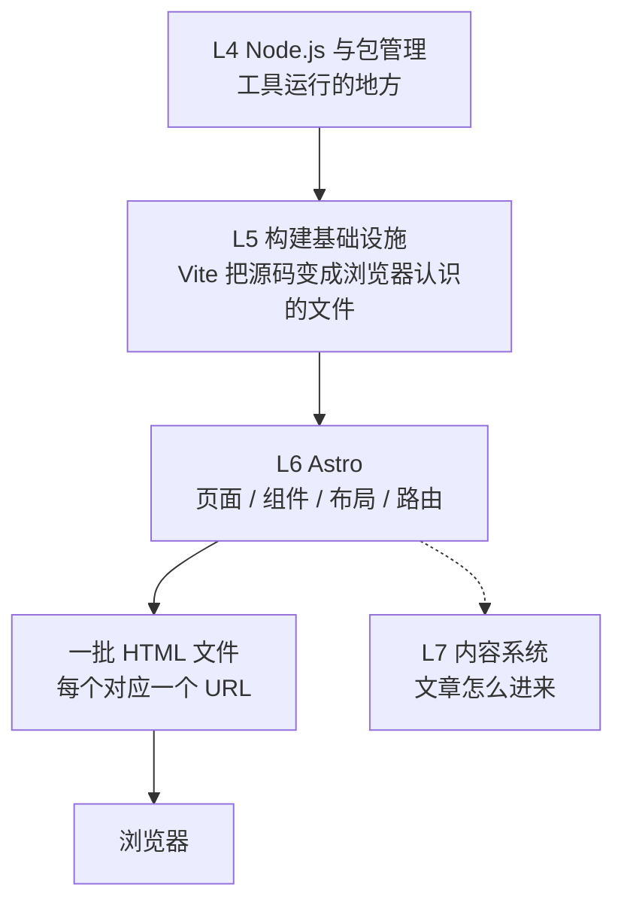

这张图里，最上面两格是已经讲过的层：Node.js 提供运行环境，Vite 提供那道转换工序。本章的格子在中间那一格——**Astro 把「这个网站有哪些页面」这个问题变成了目录结构和几个配置文件**。虚线那一格属于下一章：内容本身（文章、数据）怎么进入页面，本章只把它作为一个位置摆在那里。

再往下是结果：一批 HTML 文件，每个文件对应一个可访问的地址。这批文件之间谁引用谁、样式怎么抽出来、产物名为什么带 hash，仍然是第六章那套机制在处理。这一章新增的部分只有一件事：**谁决定要生成哪些页面，以及每个页面的内容从哪些零件拼出来。**

## 读完本章，你应该能看懂

- “Add a new page at `src/pages/about.astro`.”
- “Move the header and footer into a layout component.”
- “This is an Astro component, so it can't take a `client:` directive.”
- “Add `client:idle` so the widget doesn't block the first paint.”
- “Import the React component into your Astro page.”
- “Astro prerenders this at build time; use server rendering if you need the session.”
- “Install the React integration and add it to `astro.config.mjs`.”
- “There are no `.astro` files in `dist` — everything is already HTML.”

这八句的共同点是：它们都在动**一个网站的骨架**，而不是在动某一行逻辑。读懂这一章之后，你应该能判断出 AI 现在是在新增一个地址、在改一副共享的页面骨架、在决定某个部件要不要加载 JavaScript，还是在换整个项目的生成方式。这几件事的代价差别很大，但在 AI 的输出口吻里听起来一样轻。

---

## 7.1 为什么需要 Web Framework

上一章把构建工具讲完了，此时你手里有一个能跑的项目：入口 HTML 在根目录，源码在 `src` 里，样式和图片被引用着，`npm run build` 之后 `dist` 里躺着产物。

这一套能工作，但它隐含了一个假设：**项目的页面数量是你能手工管住的。** 一个页面、两个页面没问题。等到网站有几十个页面，而且它们长得一样、导航一致、内容还要定期更新时，那个假设就破了。

框架这一层就是来补这个假设的。它不是让「构建」变得更方便，而是回答构建工具不管的四件事：页面怎么复用、地址从哪来、界面上的零件怎么组织、内容怎么进到页面里。接下来的五个小节里，第一个摆问题，其余四个各摆一件事——它们合起来解释了 Astro 为什么长成本章后面那个样子，而不是随便哪个模板引擎。

这四件事还有一个共同特点：**它们互相牵连。** 地址规则决定了一个页面要写成什么形状，页面形状又决定了哪部分适合抽成骨架，骨架要能接收内容就得留出入口，而内容能不能被批量地接进来，取决于有没有一套组织内容的办法。任何一处改动都会牵到另外三处——这正是「手工管理」最先崩溃的地方，也是为什么这四件事需要由一个统一的机制承担，而不是由四个各自独立的小工具。

### 7.1.1 从网页到网站

早期网页的组织方式只有一个：**一个地址对应一个文件**。你在服务器上放一个 `about.html`，别人访问 `/about.html` 就拿到它。第一章 1.5.5 讲过 URL 里那段路径，那里同时提醒过一句：Path 看起来像磁盘路径，可页面由程序生成时它通常并不对应某个现成的文件。这一节要讲的是它确实对应文件的最初那种做法。

一个十几页的小站也照这个办法做，做法是把首页复制十几份再改内容。这时候会出现第一类具体的麻烦：导航条里有六个链接，你新增了一个页面，就得把十二个文件里的导航都改一遍——漏掉一个，那个页面上的导航就少一项，而且通常没人会发现，因为它不影响那个页面自己显示。

于是「改一处，处处跟着变」变成了一件需要专门机制来保证的事。而这件事还没有完，因为网站的内容不是一次写完的：文章会新增，商品会下架。文件与地址一一对应的做法在这里第二次撑不住——**每新增一篇文章都要新增一个文件、改一次列表页、改一次导航**。

到这一步，一个网站需要的东西已经很清楚了：一副共享的骨架、一份会随内容自动更新的列表、一套不用手工维护的地址规则。框架就是这三件事的执行者。

### 7.1.2 页面复用

复用最早解决的问题是导航条和页脚。最直接的三种办法各有问题：复制粘贴会漂移；把公共部分做成一个字符串常量拼进 HTML，等于在 JavaScript 里手写模板，改起来仍然危险；服务器端的 include 指令能解决，但它只对某一种服务器有效。

框架给出的答案是把公共部分做成一个**完整的页面骨架**，让每个页面把自己的内容填进去。这个骨架在 Astro 里叫 Layout，本章 7.5.5 会专门讲它。这里要留下的只有分工上的区别：**复用管的是「整副骨架只有一份」，而不是「某个按钮只有一份」。**

这条区别有实际后果。骨架级复用改变了项目的文件构成：几十个页面文件里，每个都只剩下内容本身和它特有的部分。你在真实项目里看到的 `src/pages` 目录之所以能放二十几个很短的文件，是因为长的那部分不在里面。

复用也不是只有好处，它的代价要一起说：改一处会同时改变多处。一副骨架里删掉一个导航项，二十几个页面同时跟着变——这正是复用的目的，但也意味着一次改动的影响面比看起来大。这条性质对读 AI 的输出很实用：当 AI 说「我把导航统一了一下」，它动的文件可能只有一个，而实际被改写的页面有几十个。这类改动值得抽查，不是因为它危险，而是因为影响面和改动量不成比例，光看改了哪几个文件看不出到底改了什么。

### 7.1.3 路由

路由这个词描述的对象很朴素：**地址和页面之间的对应关系**。

在纯文件的世界里，这层关系由服务器和目录结构维持——路径 `/blog/2024/note.html` 就是磁盘上那个位置。一旦页面开始由程序生成，这条关系就没人维持了：产物在 `dist` 里，名字可能带 hash（第六章 6.7.4 讲过这件事），而且内容每次构建都会重新算。于是需要有一个地方明确回答「哪些地址存在」。

框架把这个回答变成了一条规则。规则一旦定下来，新增一个页面就变成了「按规则新增一个文件」，不再需要改配置、不需要登记地址、不需要在别处补一个映射。

这件事对读者的价值在于：当 AI 说 “add a route for `/pricing`” 时，它并不是要去某个路由表里加一行：在 Astro 这类基于文件的路由里，它只是要在某个目录里建一个文件。反过来，当 AI 说「这个地址访问不到」时，需要查的第一件事也回到了文件在不在、名字对不对。本章 7.6 讲 Astro 具体怎么做这件事。

### 7.1.4 组件

复用还有一层比页面骨架小的：一块界面，加上它自己的行为。一张卡片、一个评论区、一个搜索框。

它们不适合用「复制 HTML」来管理，原因和导航条一样，但多了一个障碍：**它们每次出现时要显示不同的东西**。同一个卡片组件，在这页显示文章标题，在那页显示另一篇的。也就是说，一个组件需要的不只是「内容能复用」，而是「内容能作为输入传进来」。

这个输入在几乎所有框架里都叫 **props**。它在 Astro 里的具体写法见 7.5.2，这里只需要抓住概念：**组件是一个带参数的小函数，参数进来，一段 HTML 出去。**

还要提前摆清一件容易混淆的事：组件是前端界的通用想法，不是某一个框架的专利。Astro 有自己的组件（`.astro` 文件，见 7.4.5），React、Svelte、Vue 也各自有自己的组件，而 Astro 允许你把后者的组件放进自己的页面里。这两类组件在职责上不是一回事——它们的区别是本章 7.8 和 7.9 的主题，也是第十章要展开的内容。

### 7.1.5 内容组织

第四件事最容易被忽略，但对本书这个博客类的网站最关键：**内容不是代码**。

文章是一段文字加几张图，它不该以「一段 HTML 写在某个文件里」的形式存在。它应该存在另一个地方，由构建过程把它取出来、套上骨架、生成页面和列表。

这层需求在技术栈上被切成两半。**怎么把内容组织好、怎么把它读出来，属于下一层**（第〇章 0.5.1 给 L7 的说法是「处理文章这类内容如何变成网页」）。而框架提供的是接入点：一个放内容的目录、一套在页面里取内容的写法。Astro 的接入点在 7.3.5 只用一句话交代位置，具体机制留给下一章。

这里先记住一件事就够了：框架负责的是「内容怎么被接到页面上」，而不是「内容怎么被写出来」。AI 说 “content collection”、“frontmatter schema” 这类词的时候，它说的是下一层的事，但它在动的文件通常就在这一层的目录里。

---

## 7.2 Astro 是什么

上一节的四条需求是框架级的，任何框架都会以自己的方式回答它们。这一节开始讲 Astro 具体怎么答。

需要先提醒一次本章的取向：**学会用 Astro 建站不是这一章的目标，要的是在它改动你的项目时看懂它在做什么。** 所以下面五节讲的都不是用法，而是它是什么、和谁相邻、边界在哪。

这个顺序也有讲究。框架类的东西最容易讲成「功能清单」，而清单对判断 AI 的话没什么帮助——你需要的是一个坐标：**这个决定是谁做的、它在项目的哪一层。** 所以第一节先给它本身定性，后面四节把它钉在四个相邻关系上：它服务什么类型的网站（7.2.2）、它默认在什么时候生成（7.2.3）、它和下面那层构建工具怎么分工（7.2.4）、它和上面的运行环境怎么相处（7.2.5）。这四条界线清楚了，后面讲目录、文件、组件、路由时才不需要反复解释「为什么这里要这么放」。

### 7.2.1 Astro 的定位

Astro 官方给自己的说法是一句话：“Astro is a JavaScript web framework optimized for building fast, content-driven websites.”（一个为构建快速的、内容驱动的网站而优化的 JavaScript Web 框架。）

这句话里有三个词需要拆开看。

**框架（Framework）** 意味着它不是库。库是你去调用的东西，框架是替你规定项目结构、并反过来调用你的代码的东西。这个区别在实践中很直白：用哪个库由你决定，而项目里页面放在哪个目录、地址怎么形成，Astro 已经定好了——你写的是它规定的形状，它跑起来执行的是你写的内容。

**优化（optimized for）** 意味着这是一条有代价的取舍。Astro 优化的方向是「首屏拿到的是已经写好的 HTML」，代价是内容变了要重新生成（这正是 7.2.3 那条限制的来源）。

**网站（websites）** 这个词限定了射程。Astro 的目标不是一个交互密集的界面应用，而是一组有地址、有导航、有内容的页面。这一点直接决定了下一个小节的主题。

顺带接住 0.5.1 埋的那句话：「L6 的 Astro 负责把整个站点的结构组织好」。「组织」这个动词的落点是三样东西——一副骨架（Layout）、一份地址规则（Routing）、一套内容接入点（Content）。本章余下的节就是把这三样分开。

### 7.2.2 Content-driven Website

内容驱动是这一类网站的特征：**页面的主体是给人读的东西，交互是配角。** 博客、文档站、官网、帮助中心、作品集、商品详情都属于这一类。它们的共同点是内容的价值远大于操作的价值——读者来看文章，顺手点一下搜索。

反面例子同样清楚：一个后台管理系统、一个在线编辑器、一个看板工具。这些地方的核心资产是交互本身，页面结构是次要的。

为什么这个区分重要到要单开一节？因为**框架的默认策略就是从这个判断推出来的**。既然绝大多数页面上用户主要是「读」，那默认就不该为每个部件都加载 JavaScript；既然内容比操作重要，那内容就该独立存放、由程序拼进页面。Astro 后来那些看起来奇怪的选择——默认产物是静态 HTML、组件要显式声明才接管、内容目录另起一处——都能从「这是一个内容型网站」这个前提推出来。

这也是 AI 替一个博客项目选中 Astro 的理由。看到 AI 为你的博客建了一个 Astro 项目，可以判断它做的选择是：以生成静态页面为主，只在必要处放交互。这个判断是否成立取决于你的网站究竟是不是内容驱动，而不是取决于 Astro 本身好不好。

### 7.2.3 Static Site Generation

第一章 1.4.6 讲过三种做法：静态文件在磁盘上、动态页面在请求时算、以及第三种——**构建时生成**：内容由程序在你发布之前一次性算好，产出一批静态文件。那一节末尾明说要回到这里，现在回到。

这一套做法有个正式名字：**静态站点生成（Static Site Generation，简称 SSG）**。它的过程与第六章那条链严丝合缝地接上：构建工具从入口出发解析引用、转换、打包、压缩、写产物；SSG 说的是在这条链的更前面一步——**页面已经在构建过程中被渲染成了 HTML 文件**。

Astro 在这里的默认值非常明确，官方原话是：“By default, your entire Astro site will be prerendered.”（默认整个站点都会被预先渲染。）本章 7.7.1 会用一个真实项目的构建日志把这件事摆出来。

代价有两条，都必须说清楚，否则后面会误判。第一条：**内容变了要重新构建。** 改一篇文章不是改数据库里一行字然后立刻生效，而是那次构建的输入变了，产物要重新生成一次。第二条：**依赖访问者身份的内容不能这么生成。** 一个显示「你好，某某」的页面如果在构建时定死，那所有人的页面上都是同一个名字。这类页面得走另一条路，也就是 7.7.3 讲的按需渲染（有人访问时，这一页才由服务器上的程序算出来）。

### 7.2.4 Astro 与 Vite

这两个名字经常被放在一起说，也经常被说成互相替代关系。两者都不对。

先说分工。Vite 回答的是**「这份源码怎么变成浏览器认识的 HTML、CSS 和 JavaScript」**——这是第六章整章的主题。Astro 回答的是**「这个网站有哪些页面、每个页面由哪些零件组成、它们什么时候被生成」**——这是本章的主题。前者的产物是一批文件，后者的产物是「哪些文件该存在」这个决定。

再说为什么不能把这条界线画干净：**Astro 内部跑的就是 Vite。** 官方升级指南写得直接——“Astro v7.0 upgrades to Vite 8 as the development server and production bundler.”（Astro 7.0 把 Vite 8 作为开发服务器和生产打包器。）配置项里甚至专门留了一项 `vite`，官方说明是 “Pass additional configuration options to Vite.”，意思是你可以把自己的 Vite 配置塞进去。

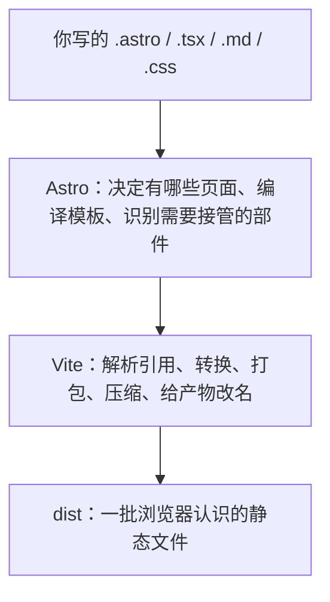

这张图里第三格那件事，第六章讲过细节，本章不重讲。需要留下的判断只有一条：Astro 做的那些看起来像构建的工作（把 `.astro` 变成 HTML、给样式加作用域、把岛的处理接上），最后仍然要走 Vite 那条链。框架不是绕开构建工具，而是站在它上面，把构建的输入变成框架的形状。

这条界线对读者有一处很实际的作用。Vite 报的错通常指向某个引用找不到、某项配置写错（第六章 6.4.1 那张报错框）；Astro 报的错通常指向页面本身——文件名不对、路由参数没提供、页面渲染时报错。同一句「构建失败了」，先分清报错的措辞来自哪一层，能省掉很多无用排查。

还有一处旧口径要挡在这里：网上大量资料在讲 Astro 时会提「Vite 用 esbuild 和 Rollup」。这个说法在 Vite 8 之前成立，现在做这几件事的工具已经换了名字，第六章 6.6 到 6.6.4 已经把当前分工和分辨方法讲过一遍——看项目里的版本号，再决定要不要跟着改配置。

### 7.2.5 Astro 与 Node.js

Astro 的命令行程序本身是一个 JavaScript 程序，靠 Node.js 运行，这一点和 Vite 与 Node.js 的关系同形（第六章 6.3.5 讲过那一组后果）。三条实际影响。

**它有版本要求。** 当前这一代 Astro 的元数据里写着 Node 22.12 以上，并要求 npm 9.6.5 或 pnpm 7.1 以上。AI 说“your Node version is too old for Astro”时，它指的是这条声明和你机器上那个运行时之间的冲突，与你的代码无关。

**开发时它是一个跑在你电脑上的进程。** 本章实测的那次启动打了三行有用的信息：

```text
12:45:41 [vite] Port 4321 is in use, trying another one...
 astro  v7.3.5 ready in 1747 ms
┃ Local    http://localhost:4324/
```

这段同时印证了第一章 1.6.6 说过的两件事：默认端口是 4321；它被占用时 Astro 不报错，而是自动往后找一个能用的。那次实测里 4321、4322、4323 都被别的程序占着，于是落到了 4324。你昨天在 4321、今天变成别的端口，不是项目出了问题。

**静态产物不需要 Node 在场。** 这一条是最容易记错的。默认配置下 Astro 交付的就是一批 HTML/CSS/JS 文件，交付之后没有任何 Node 进程在替它们工作——这仍然是 6.3.5 那条判断的用法：这类只在开发电脑上出现的东西属于开发依赖，删掉它不会让已经发布的网站坏掉。

需要 Node 进程在场的是另一种情况：按需渲染。那时产物里会多出一份服务端模块，运行时得有个程序在跑（7.7.3、7.10.6 分别讲概念和开关）。

> **AI 可能会说：**
>
> “Run `npm run dev` in the project root and open localhost:4321.”
>
> **翻译成人话：**
>
> 项目清单的 `scripts` 里那条别名（5.4.5 讲过这个机制）会启动 Astro 的开发服务器。它是一个 Node 程序，会在你电脑上占一个端口，把页面按需渲染好送到浏览器。端口号如果打不开，先看终端里那行 `Local:`，它才是现在真正在用的地址。

---

## 7.3 Astro 项目结构

前两节把 Astro 放在技术栈里定了位。这一节换个角度看：打开一个真实的 Astro 项目，目录里有什么。

下面这棵树来自本章 lab 里那个实测项目，它故意做得很小，但形状和真实项目一致：

```text
astro-min/
├── astro.config.mjs        框架配置
├── package.json            项目清单（第五章）
├── node_modules/           依赖（生成物，不入库）
├── public/
│   └── robots.txt          原样搬运的文件
├── src/
│   ├── pages/              页面：地址由这里的文件决定
│   │   ├── index.astro
│   │   ├── about.astro
│   │   ├── 404.astro
│   │   ├── blog/[slug].astro
│   │   └── docs/[...path].astro
│   ├── layouts/Base.astro  页面骨架
│   └── components/         可复用零件
│       ├── Header.astro
│       ├── StaticCard.astro
│       └── Counter.tsx     一个 React 组件
└── dist/                   构建产物（生成物，不入库）
```

第五章 5.9 已经把「哪些是你写的、哪些是生成的」这条线画过一次，那张图在这里继续成立。Astro 项目新增的东西几乎都集中在 `src` 下面，而且分成三种角色：`pages` 决定有哪些地址，`layouts` 是一副骨架，`components` 是可复用的零件。这一节的七个小节里，`pages`、`layouts`、`components` 各占一个，`src`、`content`、`public`、`astro.config` 再各占一个——前三个是本章的新内容，后四个多半第五章已经见过。

### 7.3.1 src

`src` 是你自己写的源码所在，5.9.1 已经定义过这一点；Astro 项目里没有变化——官方对它的说法也一样：“The `src/` folder is where most of your project source code lives.”

变化发生在里面怎么切。裸项目（只有 Vite 的那类）里 `src` 通常只有一个入口脚本加几个模块；框架项目里它按角色分成几叠目录，而且**这种分法带有约束**：不是「建议放这里」，而是「放在这里才会被这样处理」。`src/pages` 里的文件会变成地址，放在别处的同名文件不会。

这一条约束正是本章后面几节的落点。看到 AI 在 `src` 下面新建目录时，可以先问一句它建的是不是有特殊含义的那几个。

### 7.3.2 pages

`src/pages` 是整个框架项目里唯一有魔法的目录——**这里的文件决定你的网站有哪些地址。** 官方原话：“Pages routes are created for your site by adding supported file types to this directory.”（往这个目录里添加受支持的文件类型，就会为你的网站创建页面路由。）

1.1.2 那次举例说「`src/pages/index.astro` 表示 `index.astro` 这个文件在 `src` 下的 `pages` 里」，并且引用过 AI 常说的那句 “create a new file at `src/pages/about.astro`”。现在那句话的含义可以补全了：它不是在说「多一个文件」，它是在说**多一个页面**。机制在 7.6。

受支持的文件类型不止 `.astro`。`.md` 可以直接作为页面；`.mdx` 则需要安装并配置 MDX 集成后才会作为页面类型被识别。这样使用时，内容层和页面层就叠在同一个文件里。这一点本章不展开，它属于下一章。

### 7.3.3 components

`src/components` 放可复用的零件：页眉、卡片、侧栏、按钮。官方给的定义是“Components are reusable units of code for your HTML pages.”

只有一点要注意：这个目录名不是必需的。Astro 认识的是 `src/pages`，而不认识 `src/components`——把零件放在 `src/ui` 或者 `src/bits` 也能正常工作，只是没有按约定命名的好处。这是一条很容易混淆的界线：项目里有些目录名是规则，有些是习惯。

目录里的文件也可能不是 `.astro`。本章那棵实测树里就有一个 `Counter.tsx`——那是 React 的组件文件，它能被 Astro 使用，条件是装上对应的集成（7.9.2）。当你看到项目里同时存在 `.astro`、`.tsx`、`.svelte` 时，那个项目不是「混用了几种框架」，而是主框架是 Astro、局部借用了别的组件。

### 7.3.4 layouts

`src/layouts` 放页面骨架。官方的定义很简短：“Layouts are Astro components that define the UI structure shared by one or more pages.”（布局是定义了多个页面共享的界面结构的 Astro 组件。）

这句话里最重要的一半是前半句的 **“are Astro components”**：布局没有任何特殊身份，它就是一个 `.astro` 文件，只是被用来当骨架。7.5.5 会讲它具体怎么把页面的内容接进去。

和 `components` 一样，这个目录名也是约定而非规则。区别只在于：读过这个项目的人会在 `layouts` 里找骨架，而不会在 `components` 里找。

这条界线要单独留一句，因为它经常出现在 AI 的解释里。它说「这是 Astro 要求的目录」时，可能只是在陈述一个社区约定。分辨办法很简单：翻到官方项目结构那一页，被说明的目录就那么几个，剩下的都是习惯。约定也有价值，因为它让下一个人不用重新猜东西放在哪儿。

### 7.3.5 content

`src/content` 放内容类的文件——文章、数据、条目。你在这类目录里看到的通常是一批 `.md` 文件，每个文件带一小段头部元数据（标题、日期、标签）。

本章对它只有一个任务：让你认出**这个目录不是页面**。里面的 `.md` 不会因为躺在项目里就自动成为某个 URL 上的页面，它需要经过组织、被读取、被某个页面模板接住，才会变成一个网页。

这条链正是下一章的主题：内容怎么被定义成集合、字段怎么有类型、页面怎么查内容。本章只需要你在看到 AI 说「把这篇文章加进 collection」时知道它在动 `content` 那一带，而不会以为它改了一个页面文件。

### 7.3.6 public

`public` 的角色在这里没有变化，官方说法仍是“Files in this folder will be copied into the build folder untouched”——不处理、不改名，你在代码里用什么路径写它，最终网站上就是那个地址。第五章 5.9.2 和第六章 6.7.2 已经讲过它的判据，此处不重复。

实测里它的表现正好印证这一点：lab 项目只有一个 `public/robots.txt`，它在 `dist` 里仍以原名字出现在根目录，而所有从 `src` 里出来的东西都已经变成了别的形状。

框架项目里它仍然有用，而且用途和裸项目一样：那些**必须保持原名的东西**。浏览器按固定地址去找的那些约定文件，以及被外部按固定地址取用的东西，都只能走这里——因为它们的名字本身就是接口的一部分，一旦被改名（6.7.4 讲过产物名带校验串这件事），对方就取不到了。

### 7.3.7 astro.config

项目根目录那个 `astro.config.mjs`，第五章 5.9.4 归过类：它不是你写的业务代码，但决定工具怎么跑。那一节还留了一句「框架自己的配置在第七章」，现在兑现。

官方对这个文件的说明是“generated in every starter template and includes configuration options for your Astro project”，并明确推荐使用 `.mjs` 这个扩展名。它和 `vite.config.js` 是同一类东西：**会被执行的模块**，所以能 `import`、能写函数、也有第五章 5.1.4 谈过的那层权限边界。

里面能配哪些项，本章 7.10 单开一节讲五个真正影响判断的字段，另有一节讲这个文件本身。这里只留一个定位：**这个文件是「这个网站怎么被组织」的总开关，也是 AI 改动整个项目行为时最常动的一个文件。** 它改动的是项目的行为，不是某个页面的外观。

---

## 7.4 `.astro` 文件

`.astro` 是这个框架自己的文件类型。第一章 1.1.5 讲扩展名时说过一句话：不同的工具会按扩展名决定怎么处理一个文件，TypeScript 编译器处理 `.ts`，Astro 处理 `.astro`。这一节把那句话展开——它到底怎么处理，处理完之后你写的东西分别去了哪里。

第一次打开一个 `.astro` 文件的人通常会得出两种相反的结论：要么觉得「这就是 HTML，没什么新东西」，要么觉得「这是一门新语言」。两种都不准。它是**一段带输入输出的 HTML 模板，加上一小块只在服务端跑的代码**，总共两样东西，中间用一行 `---` 分开。

本章 lab 里那个导航条组件完整如下，它足够小，可以整份看完：

```astro
---
const { siteName } = Astro.props;
---

<header>
	<strong>{siteName}</strong>
	<nav>
		<a href="/">首页</a>
		<a href="/about">关于</a>
	</nav>
</header>

<style>
	header {
		display: flex;
		gap: 1rem;
	}
</style>
```

需要看懂的是四件事的分工：第一块（`---` 之间）在服务器上运行；第二块（模板）变成 HTML 文本；`<style>` 变成带作用域标记的样式；如果这里再写一个 `<script>`，它会去浏览器。前四节各讲其中一块，第五节把整个文件当一个组件来看。

### 7.4.1 Frontmatter

`---` 夹起来的那块区域官方称为**组件脚本**，习惯上也常被叫作 frontmatter（前置区）。它是一段 JavaScript，运行在**服务端**：构建时或请求时，取决于这个页面走哪条路（7.7）。

它能做的事比模板区宽得多——导入模块、调用函数、发起数据请求、算出一个值——因为它是真代码，而模板只是往 HTML 里填值。这段能力也带来一个容易误判的性质：它写的内容不会到达用户。官方说法是组件脚本里的东西 “all of it will be stripped from the final page sent to your users' browsers”（全部会从发给浏览器的页面里剥掉）。

本章实测里这一点被专门验证过一次。页面脚本里放了一个变量，值是一串带标记的文本，并且只把它算出的长度渲染到页面上：

```text
grep -rIl "FRONTMATTER-ONLY-abc123" dist
grep exit=1（一次都没有）
dist/index.html …  <p>脚本区算出来的数字：23</p>
```

那段字符串在整个产物里检索不到，而它算出的那个数字出现在 HTML 里。这就是「服务端代码不下浏览器」的字面含义：**留下的是结果，不是过程。**

因为这块区域可以写 TypeScript，第四章讲过的那条规则在这里同样成立——类型会在产物生成之前被擦掉，它不进浏览器，也不参与运行时判断。

这里要挡一个同名混淆。`.astro` 文件开头这段 `---` 区域，和下一章要讲的 Markdown 头部元数据**名字相近、用途完全不同**：这里是一段会执行的代码；那里是一组描述文章的字段（标题、日期、标签），写给程序读，不是拿来跑的。两者只是碰巧都用了同一对分隔线。

> **AI 可能会说：**
>
> “This part runs on the server at build time, so it won't be sent to the browser.”
>
> **翻译成人话：**
>
> 它说的是 `---` 之间那块区域。这句话的实际含义有两层：可以在里面取数据、算东西；同时不要在里面放只该在浏览器里做的事（比如操作页面元素），也最好不要在这里放任何不能被公开的东西。组件脚本本身不发到浏览器，但它读到的数据一旦被填进 HTML，就等于发出去了——这一点和那一页是构建时生成还是请求时生成无关。

### 7.4.2 Template

`---` 之后那一整块是**模板**，它写起来几乎就是 HTML，只多了两样东西：用花括号往里填一个值，以及可以写 Astro 组件和别的框架组件的标签。

```astro
<p>脚本区算出来的数字：{noteLength}</p>
{showCard && <StaticCard label="卡片一" />}
```

这两行的关键不在语法，而在**它们的运行时刻**。花括号里的东西在服务端就被算完，浏览器收到的是数字本身；条件判断在服务端决定要不要生成那段 HTML——不是先生成再藏起来。这一点和第三章讲的浏览器里改 DOM 是两条完全不同的路径：那里是页面已经在了、脚本再修改它；这里是页面还没生成、判断先做完。

模板区不是 JSX。它不需要 `return`、不是函数调用、外层标签也不需要写成组件，更接近「HTML 加一个插值语法」。但也别把它当成纯 HTML：Astro 的编译器会检查模板结构。这件事在 v7 上有一个具体变化。官方升级指南说，旧编译器对未闭合标签是默默容错的（“The previous compiler silently accepted unclosed HTML and component tags.”），而新版本会让这些模板直接构建失败：“Templates that previously built without errors may now fail.”如果你在旧资料或旧项目里抄来一段少写了闭合标签的代码，它现在会在构建阶段报错，而不是带着问题上线。

模板最终变成什么？变成 HTML 文本。实测里那个导航条组件产出的是这段（连同 7.4.4 要解释的那个作用域属性）：

```html
<header data-astro-cid-nen7h5rs>
	<strong data-astro-cid-nen7h5rs>astro-min-lab</strong>…
</header>
```

这一行是本章最重要的一张对照：上面那个带 `---` 的 `.astro` 文件，和这个 `data-astro-cid-*` 属性，是同一件东西的两端。中间发生的所有事都不改变浏览器读到的仍然是 HTML 这个事实。

### 7.4.3 Script

写在 `.astro` 文件里的 `<script>` 标签和上面两块去向不同——**它去浏览器**。样式也会发给浏览器，但脚本是唯一一块默认交由浏览器执行的东西。

Astro 对不带任何属性的 `<script>` 做四件处理，官方逐项写明：脚本可以写 TypeScript；里面的 `import`（本地文件与 npm 包）会被打包进来；处理后的脚本会自动带上 `type="module"`；**同一个组件被一页用到多次时，那段脚本只会进一次**。另外如果脚本足够小，Astro 会直接把它内联进 HTML。

最后两条在本章实测里同时得到验证。`StaticCard` 这个组件在首页上被用了两次，它带一段给卡片绑定点击效果的脚本：

```js
// 源码（写在 .astro 的 <script> 里，带 TypeScript 标注）
const cards: NodeListOf<HTMLElement> = document.querySelectorAll("[data-card]");
cards.forEach((card: HTMLElement) => {
  card.addEventListener("click", () => card.style.opacity = "0.5");
});
```

`opacity` 这个关键字在首页 HTML 里只出现一次（另有几次，全部落在 `dist/_astro/client.<hash>.js` 那份框架代码里，与这里无关），那段脚本以内联形式挂在两个卡片之间：

```html
<script type="module">
	document.querySelectorAll(`[data-card]`).forEach((e) => {
		e.addEventListener(`click`, () => (e.style.opacity = `0.5`));
	});
</script>
```

这行需要看懂三处：类型标注已经不见了（第四章那条结论在这里再兑现一次）；`type="module"` 是被自动加上的；出现一次而不是两次，是因为那两个卡片用的是同一个组件。

如果不想让 Astro 动这个脚本——想直接引用 CDN 上的库、或者依赖全局变量——可以在标签上写 `is:inline`，官方说明它会原样留在 HTML 里，代价是不支持相对路径和 npm 包的 import。

### 7.4.4 Style

`.astro` 里的 `<style>` 默认**只作用于当前这个组件**。官方有两句话可以说准这件事：样式规则 “are automatically scoped by default”，而编译后的结果 “don't leak and won't impact the rest of your site”（不会漏出去，也不影响站点其余部分）。

实现方式一眼能看懂。编译时每个组件会分到一个属于它自己的标记，这个组件产出的 HTML 标签都带上它，多数样式选择器也跟着带上它。本章实测的三个组件拿到了三个不同的标记：

```text
data-astro-cid-hkbrpulz   ← 布局 Base.astro
data-astro-cid-nen7h5rs   ← 组件 Header.astro
data-astro-cid-2plpkasj   ← 组件 StaticCard.astro

header[data-astro-cid-nen7h5rs]{gap:1rem;display:flex}
.card[data-astro-cid-2plpkasj]{border:1px solid #ccc;…}
```

于是两个组件里都写 `.card { border: … }` 也不会互相影响——它们其实变成了两个不同的选择器。这是「把样式限定在某个组件里」这件事的一种具体做法；这个机制本身为什么需要、有哪些别的做法，属于第九章。本节只留一条事实：**你在 `.astro` 里写的样式，有可能不是按你写的样子发出去的。**

实测里还能看见一个例外：布局里那条 `body{…}` 规则并没有带上标记，而同一个 `<style>` 块里另外两条规则（属于另外两个组件）都带着。本章只报这个现象，不解释为什么它被区别对待——要判断的是「产物里的选择器不完全是你写的那一句」，而不是给标记规律建模。

产物位置上它也未必是一个独立文件。实测那个项目里，三个组件的样式被合进了 `dist/index.html` 的 `<style>` 里，整个 `dist` 找不到一个 `.css` 文件。换个规模更大的项目结果就不同——这仍然在第六章 6.2.3 讲过的范围内（样式被抽出、合并、压缩），本章不重讲。

### 7.4.5 Astro Component

把前三块合起来，就是 **Astro 组件（Astro Component）**：一个 `.astro` 文件整体就是一个组件。

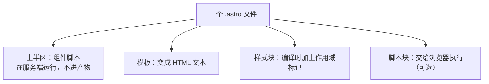

这张图要说明的关系只有一个：**同一个文件里的四块东西去了三个地方。** 这解释了为什么 `.astro` 文件既像 HTML 又像脚本——它不是「另一门编程语言」，而是一个把三种职责装进一个文件的容器。

它和普通 HTML 片段的区别在于它有输入。`Astro.props` 让一个组件在每处使用时都能显示不同的东西（7.5.2）；`<slot />` 让它能接收一段被塞进来的节点（7.5.3）。没有这两样，复用就只能靠复制。

它还有一条限制必须写在最显眼的位置，因为后面几节都依赖它：**Astro 组件不渲染在客户端。** 官方原话是这些组件 “render to HTML either at build-time or on-demand”，并且明确说 “They don't render on the client.”。换句话说，Astro 组件的工作在 HTML 生成完就结束了；页面之后发生的一切交互都不归它管。这是 7.8 里那条「不能给水合指令」的根因。

---

## 7.5 Component

上一节看的是一个组件文件的内部。这一节把它们放回项目里：组件之间的关系——怎么传值进去、怎么往里塞内容、怎么互相组合、以及页面骨架那一层怎么单独拿出来。

五节讲的是同一个模型的五个方向，核心只有一条：**组件是网站的可复用单位，而可复用意味着它有明确的输入和输出。**

### 7.5.1 组件是什么

组件（Component）在前端语境里的定义不需要任何框架知识就能说明白：**一段可以被反复使用的界面，加上了它自己的样式和行为。**

它解决的问题和本章 7.1.2 讲的复用是同一条，但粒度更小：布局管的是整副骨架，组件管的是骨架里的一块。它替代的不是「少写几行 HTML」，而是三种具体的麻烦：改一处要改几十处；每处写法逐渐不一致；一个部件的样式和脚本会污染整个页面。

实测那份 `dist/index.html` 里能看到它的效果：导航条在项目里只有一个文件，产物里出现的是一段已经填好内容的 HTML——`<header data-astro-cid-nen7h5rs><strong …>astro-min-lab</strong>…`。组件不是运行时才展开的模板，它在生成阶段就展开完了；浏览器读到的是结果，看不到「这里曾经有一个组件」。

这也是它和「把 HTML 拆成几份再拼起来」的根本区别：**拆分文件只是把劳动分开，组件把边界分开。** 边界意味着输入（props）、样式的作用范围、脚本的重复计算，这些是拼文件拼不出来的。

### 7.5.2 Props

**Props** 是组件的输入。父级在使用组件时以 HTML 属性的形式写下来，组件在服务端从 `Astro.props` 这个对象里取。

```astro
---
const { siteName } = Astro.props;
---

<strong>{siteName}</strong>
```

三行需要看懂的是取法而不是写法：`Astro.props` 是一个普通对象，所以可以解构、可以给默认值、可以加类型标注（`const { label }: { label: string } = Astro.props`，本章实测的 `StaticCard` 就是这么写的）。

它还有两条边界，都很容易在 AI 的输出里被忽视。

第一条是**方向**：props 只从使用处流向被使用的组件，而且 `.astro` 组件没有水合，也就不存在「组件自己改状态、再通知父级」这条回路。界面要跟着用户操作变化，在 Astro 组件里有三条路：重新生成整页、交给一个框架组件（7.8），或者干脆自己写一段 `<script>` 直接改 DOM——7.4.3 实测那个卡片点一下就变暗，走的就是第三条。做不到的只是「组件自己维护状态、再通知父级」那套回路。看到 AI 在 `.astro` 里写「双向绑定」之类的东西，先问一句它在动什么。

第二条是**值不会自动生效**：props 只是传进来的参数，模板里不引用它就等于什么都没发生。这类问题不会报错——组件会正常渲染，只是显示的还是默认值或者空。

实测里有一条更具体的性质。Astro 组件的 props 在服务端就被消费掉了；而框架组件（React/Svelte 那一类）的 props 会被序列化进产物，作为接管时的输入：

```html
<astro-island … props='{"start":[0,1]}' client="load" …></astro-island>
```

这行是本章 7.8 的关键证据之一，这里只需要看出一点：**同一个 props，在两种组件里去了不同的地方。** 前者只活在生成阶段，后者要一路坐进浏览器。

### 7.5.3 Slot

`<slot />` 解决的是 props 解决不了的那类输入：**要塞进去的是一段节点，不是一个值。**

一张卡片组件，标题和标签适合用 props 传，而卡片正文可能是一段带链接、带图片的内容，用字符串传既难看也不安全。Slot 的做法是：在组件里留一个位置，把使用它时写在标签中间的内容放进去。

```astro
<!-- Card.astro -->
<aside class="card"><slot /></aside>

<!-- 使用处 -->
<Card><p>这里的内容会被放进那个 <code>&lt;slot /&gt;</code> 的位置</p></Card>
```

官方还给了另外两种写法：`<slot name="footer" />` 配合使用处的 `slot="footer"`，用来把内容分到多个位置；以及给 slot 写默认内容——没有东西塞进来时才用它。

props 与 slot 的区分是本章需要主动澄清的一条，因为 AI 说 “pass content into the component” 时两种实现都可能：

```text
props  → 传值：字符串、数字、对象，在脚本区取用
slot   → 传节点：一段 HTML 结构，在模板里放到某个位置
```

判断依据很实际：组件需要看懂这个输入就用 props；只需要摆在某个位置就用 slot。

### 7.5.4 组件组合

真实项目里组件不是一个个平铺在页面上，而是一棵树。页面用布局，布局用导航条，导航条可能再用一个链接组件。

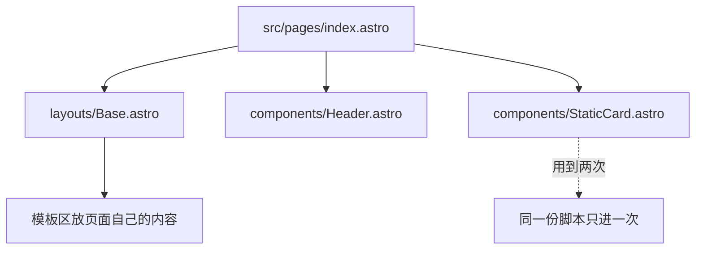

这张图想说的关系是：**组合靠 import，不靠目录。** 谁使用谁，就在谁的组件脚本里 `import`；因此组件之间形成的那层引用关系，最后也是第六章那张依赖图（6.4.3）的一部分。这带来两个可观察的后果：一个从没被任何页面 import 的组件文件，不会出现在产物里；一个被很多页面共用的组件，其脚本会被合并成一份。

组合还有一处和「复制粘贴」最容易混的地方：把一段 HTML 拆出来单独放一个文件，如果没有 props、没有 slot、也没被 import，那只是分了个文件，不是组件。判断方法很简单——问它有没有输入。

### 7.5.5 Layout

**Layout（布局）** 是本章唯一有专门目录、却没有专门语法的角色。官方那句“there is nothing special about a layout component!”说的就是这个：布局就是一个 Astro 组件，只是它承担了一个特定用途——提供 “common UI elements shared across pages such as headers, navigation bars, and footers”（多个页面共享的页眉、导航、页脚这些部件）。

它的形状由上一节的 slot 撑起来：布局里写好 `<head>`、导航、页脚，中间留一个 `<slot />`，页面把自己那段内容填进去。

```astro
---
import Base from "../layouts/Base.astro";
---

<Base title="lab 首页">
	<h1>首页</h1>
	<p>页面自己的内容</p>
</Base>
```

这段就是实测那个首页的骨架。它需要看懂两处：`title` 走的是 props，而 `<h1>` 那两行走的是 slot——**同一份代码里两种输入同时出现**，这也是 7.5.2 那条区分为什么重要。

现在可以说清「布局不只是复制一份 HTML」这句话了。复制一份骨架的问题是，当第 37 个页面需要多一个 `<meta>`、或者导航里要加一项时，你要改 37 个文件。布局把「共同的骨架只有一份」变成结构上的保证，而页面之间的差异通过 props 表达（标题、是否显示侧栏），通过 slot 表达（正文）。

实测的产物能直接印证这件事：`dist` 里生成的七个 HTML 文件，从首页到 404 页，开头那一行都是 `<html lang="zh-CN" data-astro-cid-hkbrpulz>`。那个属性是布局的作用域标记，它出现在每一个页面上，因为每个页面都套在同一副骨架里。

> **AI 可能会说：**
>
> “Move the header and footer into a layout component.”
>
> **翻译成人话：**
>
> 现在每个页面文件里都写着同一段页头和页脚。它要做的是新建一个 `src/layouts/*.astro`，把那段搬进去、留一个 slot，然后把所有页面改成引用这个布局。改动会涉及很多文件，但目的是让「改一次导航」这件事真的只改一次。

---

## 7.6 Routing

路由这个词在第六章出现过一次：那一节讲入口时说「路由系统决定有几个页面，入口是框架生成的，你不需要手写成百个 HTML」，并且把这套机制交给了本章。现在它落地。

这一节要回答三个问题，它们对应三种日常判断：地址从哪来（决定了新增页面该怎么做）、这份对应关系由谁维持（决定了「改文件名」为什么不像「改地址」那么轻）、以及一个地址不存在时会发生什么（决定了「访问不到」该查哪里）。

### 7.6.1 File-based Routing

Astro 采用的规则叫**基于文件的路由（File-based Routing）**。官方有两句原话可以直接引。第一句：“Astro leverages a routing strategy called file-based routing.” 第二句：“Every supported page file located within the special `src/pages/` directory creates a route.”，意思是放在 `src/pages` 这个目录里的每一个受支持的页面文件，都会创建一条路由。

这条规则把「新增一个页面」变成了「在某个目录下新增一个文件」，而且不需要在别处登记。它的形状可以画成一张对照：

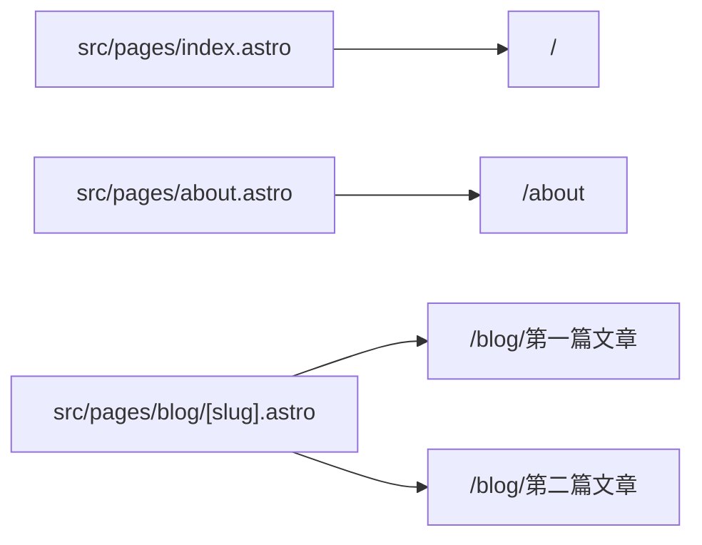

前两条是一对一，第三条是多对一——文件名里带参数时，一个文件可以生成很多个页面。这一条差别就是 7.6.3 的主题。

实测那个只有五个页面文件的项目，构建日志打印出的地址是七个：

```text
├─ /404.html (+28ms)
├─ /about/index.html (+10ms)
├─ /blog/first/index.html (+7ms)
├─ /blog/second/index.html (+4ms)
├─ /docs/a/index.html (+5ms)
├─ /docs/a/b/index.html (+4ms)
└─ /index.html (+21ms)
```

五个文件、七个地址，而 6.4.4 那句话在这里得到了字面验证：**你不需要手写成百个 HTML，但那批 HTML 确实一个一个被生成了。**

这里要挡一个常见的想当然：**文件存在不等于地址就能访问。** 名字得是受支持的页面类型、得在 `src/pages` 那棵树里、得和已有地址不冲突（配置里那个同名冲突的默认策略是警告而不是失败）。「我加了个页面但访问不到」这类问题的答案，通常就落在这三条中的某一条上。

### 7.6.2 静态路由

不带参数的文件就是静态路由：一个文件对应一个地址，写在什么位置就是什么地址。实测里 `about.astro` 变成 `/about`，`index.astro` 变成根地址 `/`。

有一处细节容易被误判，因为它和直觉不一致：产物里 `about` 那一页不是 `dist/about.html`，而是 `dist/about/index.html`。这是默认的产物格式决定的——配置项 `build.format` 的默认值是 `'directory'`，每个页面各自占一个目录，里面放一个 `index.html`。

这个形状有两条实际推论。一是地址末尾的斜杠不是多余的：`/about/` 正好指向那个目录里的 `index.html`。二是**改文件名就是改地址**——`about.astro` 改名成 `about-us.astro`，地址立刻变成 `/about-us`，而站点里所有写死指向 `/about` 的链接不会跟着变。这类改名是 AI 会做的操作之一，看到它改文件名时要意识到代价在链接上，不在文件里。

### 7.6.3 动态路由

官方对这件事的说法是：“When the file name contains a parameter, a route can create multiple pages dynamically”（文件名里包含参数时，一个路由可以动态创建多个页面）。写法是把文件名里的一段用方括号包起来：`[slug].astro`、`[id].astro`。

```astro
---
export function getStaticPaths() {
	return [
		{ params: { slug: "first" }, props: { heading: "第一篇文章" } },
		{ params: { slug: "second" }, props: { heading: "第二篇文章" } },
	];
}
const { heading } = Astro.props;
---

<Base title={heading}>
	<h1>{heading}</h1>
</Base>
```

这段是实测那个文件的核心，它需要看懂两件事。第一，`getStaticPaths()` 是一份**清单**：这个文件要生成哪些地址，由这个函数回答。方括号里那个名字必须和清单里 `params` 的键对上。第二，清单还能捎带 `props`，把每页不同的数据直接交给模板，省得在页面里再按 slug 去查。

为什么非要一份清单？因为这是 7.2.3 那条默认的必然结果：既然页面要在构建时就变成静态文件，那么构建过程就得**提前知道有哪些地址**。清单也是这一层和内容层交接的地方——真实项目里这份清单通常由内容自己生成（有多少篇文章就有多少个地址），这件事的具体机制属于下一章。

```text
blog/[slug].astro + getStaticPaths() → /blog/first/ 和 /blog/second/
```

这里必须补一条实测到的边界，因为它会让一个看起来正确的做法完全失效：**清单只在预先渲染时起作用。** 把项目切成按需渲染（7.7.3）之后再构建，Astro 会对这类页面打印一句警告：

```text
[WARN] [router] getStaticPaths() ignored in dynamic page /src/pages/blog/[slug].astro.
Add `export const prerender = true;` to prerender the page as static HTML during the build process.
```

意思是：运行时才生成页面的项目不需要一份「有哪些地址」的清单，因为地址是请求时才匹配的。这条警告同时挡掉一个误解——**动态路由不等于服务端渲染**。带参数的文件照样可以是构建时批量生成的静态页面。

> **AI 可能会说：**
>
> “Create a dynamic route for blog posts with `getStaticPaths()`.”
>
> **翻译成人话：**
>
> 它要新建一个 `src/pages/blog/[slug].astro`，让一个文件生成很多篇文章页。这个函数决定生成哪几页，所以要先问的是那几页从哪来——手工列出来，还是从内容目录里读出来。

### 7.6.4 参数

方括号里的名字就是**路由参数（route parameter）**，它在组件里通过 `Astro.params` 取用。

还有一种参数要吃掉多段路径，写法是三个点：`[...path].astro`。官方举的例子配合分页助手 `paginate()` 使用：`/posts/[...page].astro` 生成 `/posts`、`/posts/2` 这样一页一页的地址序列。它的取值是一个字符串，段与段之间用斜杠分隔（本节末尾那条实测报错就是把它写成了数组）。

这里有一个实测踩到的坑，直接写下来：给 rest 参数在清单里写成数组会直接被拒绝，构建报的是——

```text
[GetStaticPathsInvalidRouteParam] Invalid `getStaticPaths()` route parameter for `path`.
Expected a string or undefined, received `object` (`a,b`).
```

正确的写法是把整段路径写成一个字符串：`{ params: { path: "a/b" } }`。这条区分很有实用价值，因为「参数就该是数组」是很自然的猜测，而这个猜测会让构建停下来。

参数和 7.5.2 那个 props 需要分清楚，它们是两条不同的来路：

```text
Astro.params  → 来自地址，访问者在 URL 里给你的东西
Astro.props   → 来自清单或使用处，构建时你自己给页面的东西
```

这条边界有安全含义：**params 属于外部输入**，它来自用户地址栏；props 是你自己项目里的数据。AI 如果直接把 params 拿去查询或渲染而不做任何校验，那是另一回事（本书不展开校验的写法，但要知道两者可信度不同）。

### 7.6.5 404 页面

404 是一种特殊的地址处理。官方给的做法很简短：“For a custom 404 error page, you can create a `404.astro` or `404.md` file in `src/pages`. This will build to a `404.html` page.”

实测结果与那句话逐字对上：`dist` 里那个 404 是唯一一个不带目录的 HTML 文件——其他页面都是 `…/index.html`，而它是 `404.html`。

它为什么单开一节，是因为这条规则的解释权不完全在 Astro 手里。框架能做的是**生成一个 404.html 文件**；当有人访问一个不存在的地址时，由托管这个站点的那一层决定要不要把那个文件递出去、并配上 404 状态码。第一章 1.7.8 讲过 404 本来就是服务器给出的响应，不是页面自己写出来的。

本章实测能确证的只有两件事：开发服务器上访问一个不存在的地址会返回 404 状态码，构建产物里确实有 `404.html` 这个文件。至于线上那个不存在的地址会不会显示你这个页面，取决于托管环境那边的约定，这一层属于第十三章。本章只需要留下一条判断：AI 说「我加了 404 页面」时，它做的只是新建 `src/pages/404.astro`，这件事**不保证**线上那个不存在的地址就会显示你的页面。

---

## 7.7 Astro 的渲染方式

到这里为止，本章讲的都还是「页面由什么组成」。这一节换一个角度问同一批页面：**它是在什么时候变成 HTML 的？**

这个问题听起来抽象，但它决定了很具体的事情：为什么改一篇文章要重新构建，为什么有的页面能长期缓存而有的不能，为什么 AI 会说「这个页面要走服务端渲染」，以及那句 “this page is statically generated” 到底在陈述什么。第一章 1.4.6 摆过那三种做法，这一节把它们对齐到框架上。

对齐之后会发现，这一节讲的其实不是三种「模式」，而是**同一个问题的三个答案**：这段 HTML 在什么时候、由谁生成。框架把它做成一个配置项和一行页面级声明，所以它可以从文件里读出来，不需要猜。这也是为什么这一节放在组件和路由之后——先有「页面由什么组成」，才谈得上「页面什么时候生成」。

### 7.7.1 Build Time

**构建时（Build Time）** 是第六章整章都在工作的那个时刻：命令跑完之前，程序把该算的都算完，产物落盘，进程退出。

Astro 把页面生成放在这个时刻里。构建时它会执行每个页面的组件脚本、跑完模板、把结果作为 HTML 文本写进 `dist`。本章实测那个项目的构建日志把这件事打印得很清楚——日志里七个页面七行，下面截四行，括号里是这一页自己花了多久：

```text
 generating static routes
12:42:04   ├─ /404.html (+28ms)
12:42:04   ├─ /about/index.html (+10ms)
12:42:04   ├─ /blog/first/index.html (+7ms)
12:42:04   ├─ /index.html (+21ms)
12:42:04 [build] 7 page(s) built in 1.72s
```

需要看懂的是：**「有哪些页面」这件事在构建时就变成了一个有限的清单。** 七个页面各自落成一个 HTML 文件，谁都没有等到有人访问才去算。

围绕这个时刻有三个词容易混在一起，先把它们钉住：

```text
Build Time   构建时    程序算一遍，结果写进文件
Request Time 请求时    有人访问才算，每次都可能不同
Runtime      运行期    代码正在被执行的那段时间（4.7.2 讲运行期报错时用的就是这一刻）
```

Astro 项目里默认只有第一个。看到 AI 在讨论「build time 还是 runtime」时，它其实是在问：**这段逻辑在哪台机器上、哪一个时刻被执行。**

### 7.7.2 SSG

**静态站点生成（Static Site Generation，SSG）** 就是把所有页面都放在构建时生成的那套做法。7.2.3 已经讲过它的动因和代价，这里只把它摆进「什么时候生成」这条坐标上，并补两条只有框架语境才看得见的性质。

第一条：Astro 的默认值就是它。官方说法是 “By default, your entire Astro site will be prerendered.”——整个站点默认全部预先渲染。项目里不需要写任何配置，你在 `dist` 里看到的那批 HTML 文件就是这条默认的产物。

第二条容易在这里被误读，必须写清楚：**SSG 不等于页面里没有 JavaScript。** 本章实测那个静态构建的 `dist` 里，除了七个 HTML，还有三个 JS 文件，其中最大的一块 212,922 字节——那是那个 React 岛带来的渲染器块，里面装的主要是框架自己的运行时代码（7.8 会讲它为什么这么大）。

准确的表述是这样分的：**页面结构在构建时生成，交互能力按部件另行加载。** 这两件事互不干扰，因为它们是不同时刻、不同文件的两种产物。把 SSG 理解成「一个纯 HTML 的站，没有脚本」，会在看到 `dist/_astro` 那一刻失去解释能力。

### 7.7.3 SSR 的基本概念

**服务端渲染（Server-Side Rendering，SSR）** 把生成时刻挪到了请求上：有人访问那个地址时，服务器上的程序才算出这段 HTML 递回去。Astro 文档给这条路起的名字是 on-demand rendering，并直接写明了两者的关系：“On-demand rendering on the server at request time is also known as server-side rendering (SSR).” 本章把它译作**按需渲染**，指的就是上面这一格——SSR 在 Astro 里的落地形状。SSR 这个词本身比它宽：别的框架里同样叫服务端渲染的做法，未必长成 `output` 加页面级 `prerender` 加 adapter 这套开关的样子，所以「按需渲染」只在 Astro 语境里可以当成 SSR 的同义词来读。

它解决的问题很具体。第一章 1.4.6 说依赖访问者身份的内容不能用构建时生成——同一次构建只能算出一个结果，而「你好，某某」对每个登录者都不同。此外还有两类常见情况：页面数量多到不值得全部预生成；内容改动频繁到每次发布都要重构建代价太大。这三种情况下，让页面在请求时生成更划算。

代价同样明确：**访问者拿到的不再是磁盘上那个文件，而是一次计算的结果。** 这就意味着必须有一个正在运行的程序替你做这件事，还要有人把请求交给它。Astro 把后一件事交给 adapter：官方说法是 “To render any page on demand, you need to add an adapter.”

这不是可以绕过的要求。本章实测里把配置改成按需渲染而没有装任何 adapter，构建直接失败，报的是：

```text
[NoAdapterInstalled] Cannot use server-rendered pages without an adapter.
Please install and configure the appropriate server adapter for your final deployment.
```

装上一个 Node 平台的 adapter 再构建，产物形状就变了：`dist` 不再是一批静态页面，而是分成两份：

```text
dist/
├── client/     浏览器要的东西：岛的 JS、被预先渲染的那一页、原样搬来的 robots.txt
│   ├── _astro/Counter.aqD7t9It.js
│   ├── about/index.html
│   └── robots.txt
└── server/     服务器上跑的那份程序
    ├── chunks/…（一堆 .mjs）
    └── entry.mjs
```

这份树里有两行信息比表面上重要。第一，`server/` 里那些 `.mjs` 也是构建出来的模块：按需渲染并不会取消构建这一步，它只是另外产出了一份要跑在服务上的代码。第二，`client/about/index.html` 还在：那个页面写了 `export const prerender = true`，于是即使在按需渲染的项目里，它仍然在构建时被生成成了静态文件。

后面这条推翻了两个常被说反的等式，值得各写一句：**SSR 不意味着整个站点都是动态的**（可以逐页拉回静态），**SSR 也不意味着这是一个后端项目**（页面之外的事，比如接口、鉴权、数据层，Astro 只是留了接入点，本书不展开）。

> **AI 可能会说：**
>
> “This page needs the logged-in user, so switch it to server rendering.”
>
> **翻译成人话：**
>
> 它要把这一页从「构建时生成一次」改成「每次访问时生成」。这个动作通常同时涉及三处：项目配置里的输出方式、一个平台 adapter、以及这一页自己的一行声明。这一页要走按需渲染，缺了 adapter 就会出现上面那条报错；反过来只配 adapter 而不改输出方式并不报错，官方甚至说纯静态站点也可以带着它。第三处那行声明方向相反：它是在按需渲染的项目里把某一页拉回静态时才写的。上线之后，这一页的响应不再来自缓存里那个文件，而是每次都要算。

### 7.7.4 Client-side Rendering 的基本概念

**客户端渲染（Client-Side Rendering，CSR）** 是第三个位置：页面的那部分结构不是在服务器上算好的，而是浏览器里的脚本执行之后才出现的。

这个概念本书不是第一次讲。第二章 2.8.4 讲 `history` 时已经给过它的典型形态：单页应用只加载一次页面，之后内容切换全部由脚本完成，地址栏跟着变，服务器并不知道用户「换了一页」。那里也讲过这类做法最容易带来的故障——直接访问一个新地址会 404，因为服务器那边不认这个地址。

Astro 语境里 CSR 的范围小得多。默认情况下 Astro 已经把 HTML 生成好了，只有一种情况会把结构交给浏览器：**用 `client:only` 明确声明某个部件只在客户端渲染。** 官方对它的描述是 “skips HTML server rendering, and renders only on the client”——跳过服务端渲染，只在客户端渲染。这时产物里那个位置只留一个占位，内容要等脚本跑起来。

两条边界要挡在这里。一是 **CSR 不等于 SPA**：CSR 说的是「这段结构由谁生成」，SPA 说的是「整个站点怎么在页面之间切换」，一个组件用客户端渲染并不把整站变成单页应用。二是 Astro 里绝大多数看起来「像客户端渲染」的现象，其实只是页面加载后脚本修改了 DOM（3.5 讲过的那件事），而不是初始 HTML 由脚本生成。这两者的区别会在加载速度、白屏时间和抓取表现上体现出来。

### 7.7.5 三种方式的区别

三个词回答的是同一个问题的三个答案——**这段 HTML 在什么时候、由谁生成。**

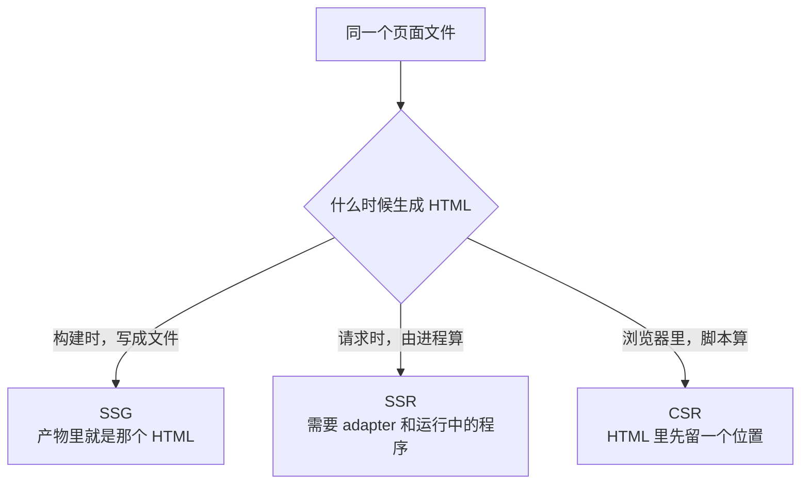

三者各自的责任和位置：

|     | 谁生成 HTML    | 产物里有什么                | 访问时需要什么在场 | 什么时候重新算           |
| --- | -------------- | --------------------------- | ------------------ | ------------------------ |
| SSG | 构建过程       | 一批 HTML 文件              | 只需要把文件递出去 | 下一次构建               |
| SSR | 服务器上的程序 | 一份服务端程序 + 客户端资源 | 一个正在运行的进程 | 每次访问（或按缓存策略） |
| CSR | 浏览器里的脚本 | HTML 里的一段占位 + JS      | 脚本能跑起来       | 每次渲染该部件           |

三条不许绝对化的边界，是这一节要留下的东西：**SSR ≠ 一定是动态网站**（部分页面可以预先渲染），**SSG ≠ 完全没有 JavaScript**（岛照样发 JS），**CSR ≠ SPA**（一个部件在客户端渲染，不等于整站导航靠脚本）。

有了这张坐标，AI 那些关于渲染方式的说法就能被还原成一个具体动作。听到 “make this page dynamic”、「需要 SSR」、「客户端渲染」，先问：它想把生成时刻从哪一格挪到哪一格，为此要动哪几个文件。从静态挪到按需，代价是一个必须运行、必须维护的服务；从按需挪回静态，代价是这一页不能再关心谁在访问。

---

## 7.8 Astro Islands

上一节把「页面什么时候生成」讲清楚了：默认在构建时。可是任何真实网站都要有能点的东西——展开、切换、搜索、播放。静态产物和交互需求之间那道张力，就是这一节的主题。

这是本章最需要小心的部分，因为围绕它有一句流传很广的错误说法：**「Astro 不用 JavaScript。」** 这句话错得很具体，而它的正确版本要长一些：**Astro 默认不为每个部件都加载 JavaScript，需要交互的部件由你逐个决定什么时候加载。** 下面八节就是把这句话拆开。

拆开的顺序是：先看这套结构叫什么（7.8.1），再看它在产物里的真实形状（7.8.2），然后才给那个难懂的词下定义（7.8.3），接着是目录单列的四个时机选项各一节（7.8.4 到 7.8.7，另一种时机 `client:media` 在 7.8.7 末尾一并交代），最后回到最实用那一问：**这个部件到底需不需要被接管**（7.8.8）。前三节那三种时机只改变「什么时候开始接管」，各占一节是因为它们的差别就在这一格上；`client:only` 不同，它连内容什么时候出现都改了，代价与前三者不在一个量级，这一点在 7.8.7 里单独说。

### 7.8.1 Island Architecture

官方对岛的定义只有一句，但把结构讲完了：“an enhanced UI component on an otherwise static page of HTML”：**在一页本来静态的 HTML 里，被增强过的一个界面部件。**

这个名字的意象可以保留：页面主体是一整片静态 HTML，交互部件像海上的一个个岛，各自独立。它反对的是另一种整页模型：一屏空白 HTML 加上一大包脚本，由脚本把整个界面画出来（第二章 2.8.4 那种单页应用形态）。

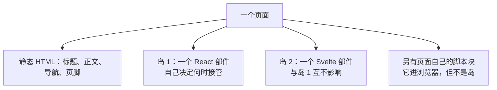

这张图里有一条性质是这套架构的核心：**每个岛是独立的。** 它自己决定什么时候加载、什么时候开始工作，挂了也只影响那一块；两个岛可以用不同的框架，因为它们之间不共享一个渲染过程。

顺带看图里最下面那一格：组件自己写的脚本也会进浏览器，但它没有 `astro-island` 包装、不被任何指令接管，所以**它不是岛**。实测里那段 140 字节的脚本就是这个形状——它出现在页面上，却不属于任何一次接管。7.8.8 会再用到这条区别。

要理解「增强」这个词，只需要看它前后的差别：岛在被接管之前，在 HTML 里已经是可见、可读、可复制的——按钮已经画在那里，只是点了没反应。所谓接管，就是给它补上「能响应」这件事。

这里要把客户端指令的适用范围说完整。指令用于 UI 框架组件，而且该组件必须在使用它的文件里直接 import：这一点适用于 `.astro` 组件；安装 MDX 集成后，在 `.mdx` 文件里直接 import 的 UI 框架组件也能使用 `client:*`。动态标签和通过 `components` prop 传入的自定义组件不支持水合指令。这里的 **client island**，指满足这些条件并带有 `client:*` 指令的 UI 框架组件。

但官方还有另一种岛。**server island** 用 `server:defer` 标在 Astro 组件上——它不在浏览器里接管任何东西，而是把那一小块内容的渲染推迟到请求时、单独取回，用来处理每次都不同的动态片段（官方举的例子是电商店面这一类站点）。本章实测把 `server:defer` 写在一个 Astro 组件上构建，得到的是一条独立的报错：

```text
[NoAdapterInstalledServerIslands] Cannot use server islands without an adapter.
```

两条路方向相反：client island 是给已经画好的静态页面补上交互，server island 是把动态的那一小块从静态页面里摘出去、等有人来了再算。本章按目录集中讲前者，后者点明到此为止，它的写法属于按需渲染那一档的内容。

### 7.8.2 静态 HTML 与交互组件

「静态与交互怎么共存」这件事，看产物最省事。本章实测那个首页上放了同一个 React 组件两次，唯一区别是第一次写了 `client:load`，第二次什么也没写。产物里长这样：

```html
<h2>带 client:load 的岛</h2>
<astro-island
	uid="Xw3Hl"
	component-url="/_astro/Counter.aqD7t9It.js"
	component-export="default"
	renderer-url="/_astro/client.CLhIxG29.js"
	props='{"start":[0,1]}'
	ssr
	client="load"
	await-children
>
	<button type="button">
		clicked
		<!-- -->1
	</button>
</astro-island>

<h2>不带任何 client 指令的同一种组件</h2>
<button type="button">
	clicked
	<!-- -->2
</button>
```

这两段是同一份组件的两种结果，差别全在那层包装上。

被标记为岛的那个部件，HTML 里已经装着渲染好的按钮（`clicked 1`），外面套的 `<astro-island>` 标签里写着三件事（下面这段引文做了折行，并略去了 `prefix`、`opts` 等属性）：组件代码在哪个文件（`component-url`）、用哪个渲染器接管（`renderer-url`）、初始化参数是什么（`props`，值被序列化进了属性）。

没写指令的那个只剩一段裸 HTML——没有包装标签、没有 props，也没有任何指向它的 JS。**这一次使用没有带出任何客户端代码。**（同一个组件的代码仍然在产物里，因为另一个被指派为岛的实例要用它——这正说明岛的决定是按使用点做的，不是按文件做的。）官方对这件事的原话是：“Astro will automatically render every UI component to just HTML & CSS, stripping out all client-side JavaScript automatically.”

这就是那句被说错的话的正解：不是 Astro 不发 JavaScript，而是**没被指派接管的组件不发**。一个部件在 HTML 里的样子和它在浏览器里的能力，是两件可以被分开决定的事。

### 7.8.3 Hydration

**水合（Hydration）** 这个词在 0.4.4 已经就地翻译过一次，那里给的说明是「页面结构与交互能力由不同环节补齐」，本章把它落到一次具体的动作上。

先说为什么需要它。构建时生成的那段 HTML 是静态文本：`<button>clicked 1</button>` 里的那个数字是当时算出来的，按钮本身不知道「点击」是什么。第三章讲过，让一个元素响应事件需要有人在浏览器里执行 `addEventListener`——这件事发生在页面已经到达之后，构建过程做不了。

**Hydration 指的就是这第二段：浏览器把已经存在的 HTML 接过来，补上事件绑定和内部状态，让它从一张图片变成活的部件。**

它不是「重新渲染一遍」这么简单，「增强」这个词，中间那次衔接要看清。实测产物里那两个内联脚本就是衔接机制本体：一段告诉页面「现在开始加载岛」，另一段定义 `<astro-island>` 这个自定义元素，它负责读标签上那几个属性、把组件代码和渲染器取回来、调用接管。整条链可以画成：

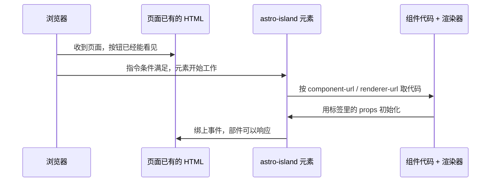

接管之前，页面上那块内容已经是可读的 HTML；接管之后，它才有点击行为。**「页面先能用起来，交互再补上」这条时间差，就是 Astro 默认策略的全部收益所在。**

Hydration 只发生在框架组件上。Astro 组件在 HTML 生成完的那一刻就已经结束了它的工作，没有任何东西需要被补上，所以它不存在水合这一步。这不是实现上的限制，而是它本来就没有那部分职责（7.4.5）。

还有一条边界要说在前面：**这一层只讲到「哪个部件被接管、什么时候接管」。** 一个框架接管之后具体怎么维护自己的状态、怎么复用 DOM、怎么做到改代码不丢页面状态，属于交互框架那一层，第十章展开。把这两层混在一起，就会出现「Astro 的 hydration 和 React 的 hydration 是不是一回事」这种没有答案的问题——它们同名，问的是不同层。

### 7.8.4 client:load

`client:load` 是最直接的那一档，官方描述是“Load and hydrate the component JavaScript immediately on page load”：页面加载时立刻加载并接管。

它的取舍很朴素：**这个部件的交互重要到值得为它延后整页可用。** 代价不在「卡住页面解析」——2.9.6 那一节说得很清楚，只有不带 `async`/`defer` 的普通脚本才会让解析停下来等；本章实测产物里那个岛走的是模块脚本，组件代码是异步取回来的。代价在另一头：**下载、解析、执行框架代码要占网络和主线程**，而它做的是「让已经画出来的按钮变得能按」这件事。所以首屏放一个又大又慢的岛用 `client:load`，用户看到的就是按钮在、按不动，页面进入可交互的时间也被它一起拖后。

它适合什么情况：用户一进页面就大概率为它而来的交互。一个播放页上的播放控件、一个工具页上的输入框，属于这一类。

实测能直接看到它的产物落点：那个岛之外多出一段派发动作的内联脚本，以及 `client="load"` 这个属性——接管时机被写在了 HTML 里，而不是藏在配置里。所以如果你在浏览器「查看源代码」里看到 `client="idle"`，那说明这个岛被安排等页面闲下来，而不是它坏了。

### 7.8.5 client:idle

`client:idle` 把接管推到「这一页自己的活干完之后」。官方说明是加载并接管发生在初始加载完成、`requestIdleCallback` 触发时；如果浏览器不支持这个接口，它退回用 `document` 的 load 事件；还可以传一个以毫秒计的截止时间。

它和上一档的区别只在时机，代价结构相同：JS 照样要下载、照样要执行，只是不再抢在首屏之前。适合「用户不会在第一秒就用到，但很快会用到」的东西——分享按钮、订阅入口、图表控件。

有一条容易被误解的性质要写清：`idle` **不等于「很久以后」**。空闲是相对于当前任务而言的，网络快、页面轻的时候它几乎是紧接着发生的。看到 AI 把 `client:load` 换成 `client:idle` 并宣称「这样就不会阻塞首屏」，需要知道的是它降低的是抢占风险，而不是那个岛自身的体积。

### 7.8.6 client:visible

`client:visible` 把接管交给滚动位置：官方描述是组件进入视口才加载并接管，并且可以给底层的观察接口传一个提前量（`rootMargin`）。

这是三档里唯一「由用户行为决定要不要花这笔钱」的。它适合页面下方那些内容：评论区、相关推荐、需要点开才出现的折叠面板。如果用户根本不往下滚，这份 JS 永远不下载。

它同样有一个反直觉的风险，正好和上一档相反：**别把它用在首屏可见的东西上。** 观察接口判定「进入视口」依赖布局已经算完，而首屏元素本来就在视口里，写起来感觉没问题，实际却多绕了一次判定，白白延后了本来最早该发生的接管。

还有一个容易混的对照：第二章 2.2.3 讲过图片的 `loading="lazy"`，那是**资源什么时候下载**的开关；`client:visible` 管的是**代码什么时候开始工作**。两者都按滚动位置触发，看起来很像，但一个决定字节数，一个决定页面能不能响应。所以在同一个部件上同时看见这两种写法并不重复——它们各解决一半问题。

### 7.8.7 client:only

`client:only` 是前面三档的例外：那三档都建立在服务端已经算好 HTML 的前提上，它直接跳过这一步。官方的说法是 “skips HTML server rendering, and renders only on the client”，并且有一条硬性要求：“You must pass the component's correct framework as a value!”（必须给出这个组件所属的框架名。）

这条要求本身很说明问题：HTML 里已经没有任何服务端算好的内容可以当作起点，接管者必须知道自己该用哪种方式从零把这段结构造出来。

代价因此和前几档不同量级。前面是「能力延后到达」，这里是**内容延后到达**：HTML 里那个位置在脚本跑起来之前是空的。它影响首屏可见性，也影响任何不执行 JavaScript 的读取方看到什么。

它只在少数情况下才合理：这段界面完全依赖浏览器才存在的东西（依赖窗口尺寸、依赖只在浏览器里可用的库），或者服务端渲染这段的成本高到不如交给用户设备。这是本章里最接近 7.7.4 那个 CSR 的一档——如果要说「Astro 项目里什么时候真的走了客户端渲染」，答案就是这一条。

目录里没单列的还有 **`client:media`**：官方描述是组件的代码在某个 CSS 媒体查询命中时才加载并接管。它和 `client:visible` 属于同一类思路——都由条件决定什么时候花钱，只是一个的条件是滚动位置，另一个是屏幕尺寸这类环境条件。所以这一层一共是五种时机：目录给其中四种各留了一节，第五种在这里点到为止。

```text
五种时机的排序（按"什么时候开始花钱"）：

client:load     页面一开始就花
client:idle     页面自己忙完再花
client:visible  用户看到它才花
client:media    某个屏幕条件满足才花
client:only     先空着，等它自己长出来
```

### 7.8.8 为什么不是所有组件都需要 Hydration

把前五档合起来看，它们其实都在回答同一个问题，而这个问题可以先由你来答：**这个部件需要响应什么？**

判断链很短，但每一步都能省钱：

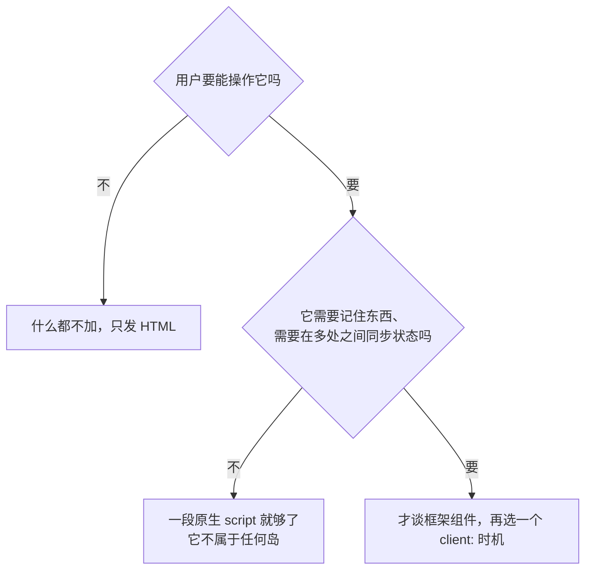

这条链上每一格都能在实测里找到对应物。那个卡片组件的点击高亮走的是中间那格——它只需要一个 `addEventListener`，所以写成了 `.astro` 组件的 `<script>`，产物里就是一段一百多字节的模块脚本（实测连标签 140 字节），没有任何框架运行时。而那个 React 的计数器走的是最后一格，代价是实测里那三个 JS 文件：组件自己 529 字节；`renderer-url` 指向的那块 212,922 字节，里面是渲染器和 React 的 DOM 实现；另有一个被前两块共同引用的共享块 7,899 字节，装的是 React 本体那部分。

**岛的代价不由你写的代码决定，由它背后那个框架决定。** 这是这一节最实用的一条判断：一个 500 字节的交互，可能背上 200 KB 的运行时。

Astro 组件不能被客户端接管，这条限制在这里落地了。实测里给一个 `.astro` 组件写上 `client:load` 之后，构建并没有失败，它只是打印了一句然后继续：

```text
You are attempting to render <StaticCard client:load />, but StaticCard is an Astro
component. Astro components do not render in the client and should not have a
hydration directive. Please use a framework component for client rendering.
```

这句话有两个可用信息。一是行为：**指令被忽略，那个组件仍然只发 HTML**。它不会报错停下，所以很容易在没人注意警告的情况下线上出现「按了没反应」。二是它把本章一条重要边界写在了官方实现里：`.astro` 组件没有客户端形态，要浏览器接管就得换成框架组件；想让这一小块改成请求时再算，走的是 7.8.1 说的 `server:defer`，那是另一条路。

> **AI 可能会说：**
>
> “Add `client:visible` to the search widget so it hydrates when needed.”
>
> **翻译成人话：**
>
> 它给一个框架组件加上了接管时机：这个部件的代码要下载，只是被推到了用户滚动到它附近的时候。判断这句话对不对，要看两件事：这个部件是不是真需要框架的状态（还是一段一百多字节的原生脚本就能解决），以及它在页面上的位置是不是真的在首屏之外。

---

## 7.9 Astro Integration

本章前面出现过两次「框架组件」这个说法：7.1.4 说组件不是某个框架的专利，7.8.1 说能被客户端指令接管的是框架组件。这里就出现一个必须回答的问题：**Astro 自己已经是框架了，为什么它里面还能跑 React 和 Svelte 的组件？**

答案是 Astro 并不自己实现这些框架的渲染过程，它通过一种叫 Integration 的机制把别的框架接进来。这一节讲这个机制本身，因为它同时解释了另一件事：AI 说“add the React integration”时，它到底往项目里加了什么。

需要先说清这一节的射程。React 和 Svelte 本身属于交互框架那一层，MDX 和它背后的内容系统属于下一章。本章只讲到「接入」这一格：一个集成让 Astro 多认识一种文件、多一个渲染器，于是别的框架的组件能出现在这个项目的页面里。至于那些组件内部怎么写、怎么维护状态，本章一律不碰——把它们当成「已经存在、被引进来的一块」就够了。

### 7.9.1 Integration 是什么

官方的定义是：“Astro integrations add new functionality and behaviors for your project with only a few lines of code.”（只需几行代码，就为你的项目增加新的功能和行为。）

功能上的分类也很直白：一类是把 UI 框架接进来——“Unlock React, Vue, Svelte, Solid, and other popular UI frameworks with a renderer.”（用渲染器解锁这些框架）；另一类是把别的工具能力接进来，官方举的例子包括 MDX。

一个 Integration 在项目中起的作用可以画成三个接入点：

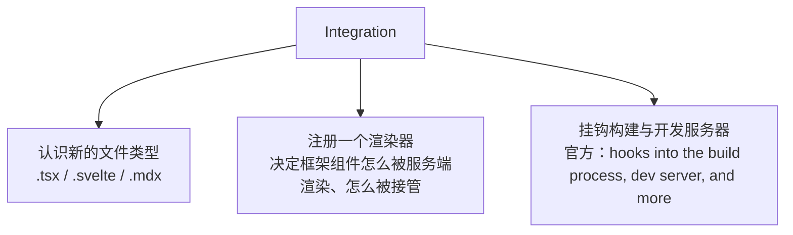

这里第三条最要留意，因为它解释了 Integration 和「装个包」的区别：它会改变构建过程本身的行为。官方对写集成的人的说法是 “Write custom code that hooks into the build process, dev server, and more.”——能挂进构建和开发服务器，正说明它在框架这一层有插手的位置。

安装这一步有两条路径。官方给了一条龙命令 `npx astro add react`，它同时改依赖和配置；也可以手工来。手工装时要一次列全，以 React 为例，除了集成本体还要有 React 自己：

```text
pnpm add @astrojs/react
pnpm add react react-dom @types/react @types/react-dom
```

官方 React 集成页给的命令是 `pnpm add react react-dom @types/react @types/react-dom`——一次把本体和类型定义都装上。它还给出一个判断信号：启动 Astro 时出现 `Cannot find package 'react'` 一类的警告，就说明这一步没做。

官方留了一句留着余地的提醒：“your package manager **may not** have installed peer dependencies for you”——有的包管理器不会替你装上对等依赖。所以看到 AI 只装了一个 `@astrojs/react` 就宣称接好了，不必断言它一定报错，但该回头确认 `react` 和 `react-dom` 到底在不在依赖清单里。**这条判断不需要运行任何命令就能查：** 打开依赖清单，`react` 和 `react-dom` 在不在里面。

> **AI 可能会说：**
>
> “Install the React integration and add it to your Astro config.”
>
> **翻译成人话：**
>
> 它要做两件事：装上让 Astro 能渲染 React 组件的那个包（连带 React 本体），然后在 `astro.config.mjs` 的 `integrations` 数组里登记它。两步都完成后，项目里的 `.tsx` 文件才能既被识别、又能真的渲染出来。

### 7.9.2 React Integration

这个集成带来的具体能力有三条：项目里的 `.jsx` / `.tsx` 文件成为可被识别的组件；这些组件可以在 `.astro` 页面里被 import 和渲染；它们可以被指派为岛，用 7.8 那几种客户端指令之一接管。

有两条它**不**负责，而这两条恰恰是 AI 表述里最容易被含混带过的地方。

第一，它不替你决定要不要客户端接管。把 `<Counter />` 写进 `.astro` 页面而没有任何指令，产物里就只有一段 HTML（7.8.2 实测那个「没有指令的 Counter」就是这个状态）。集成只是让「能接管」成为可能。

第二，它不改变 React 本身的用法。你在这个文件里怎么写组件、状态怎么管，仍然按 React 那一套——那部分内容属于第十章。本章只需要一个认知：**这个 `.tsx` 文件在 Astro 项目里的身份是「一个可以被引入的框架组件」，而不是「这个项目的入口」。**

顺带一条与 6.3.3 对上的事实：开发阶段的即时刷新（改代码后组件不丢状态地更新）也是由这个集成提供的，不是 Astro 自带的。那一节说过「热替换生效需要框架自己的集成配合」，这里那条话的落点找到了。

### 7.9.3 Svelte Integration

机制与上一节完全同形：装集成、登记进 `integrations`、项目里的 `.svelte` 文件成为可引入的框架组件、可以当岛。

这一节的作用是提供一个对照：**同一个项目可以同时装着 React 和 Svelte 两个集成。** 这不是配错了，而是岛架构的直接后果（7.8.1）——每个岛独立渲染、独立接管，所以它们不需要共用同一套渲染机制。

于是你在真实项目里看到 `.astro`、`.tsx`、`.svelte` 三种后缀混在一起时，可以这样读：**主框架是 Astro，个别部件借用了别的框架。** 反过来，如果项目里几乎全是 `.tsx` 而只有零星 `.astro`，那更可能是 Astro 被当成外壳在用，这是另一种选择，不是配置错误。

至于 Svelte 本身是什么、为什么它的组件写法与 React 不同，属于第十章。

### 7.9.4 MDX Integration

MDX 也通过同一套机制接入。官方对它的说明是：“MDX allows you to use variables, JSX expressions and components within Markdown content in Astro.”（它允许你在 Markdown 内容里使用变量、JSX 表达式和组件。）安装方式同样是装集成、登记到配置里。

这一条与本章的关系只有一层：**它让内容文件也能引组件。** 需要浏览器端交互的 UI 框架组件，仍须在 `.mdx` 文件中直接导入并带上合适的 `client:*` 指令；仅仅把组件写进文章，不等于这一次引用已经产生客户端接管。

MDX 本身是什么、它和 Markdown 有什么区别、什么时候需要它，是下一章的主题（那里的目录会专门讲这三问）。本节停在「它是又一个集成」这一层，是为了不在还没讲清内容系统之前，先把内容系统的语法用一遍。

装完之后能观察到的变化也只有一层：这种文件类型开始被项目认识，可以被读出来、被页面接住。没装它的时候，这类文件不会被当成受支持的页面或内容来源处理（它是静默跳过还是报错，本章没有实测，不写死）。这一条对判断 AI 的动作有用：当 AI 说「我在文章里加了一个组件」，可以回头确认那个文件类型在这个项目里到底受不受支持；不受支持时它会先去装东西，那是正常的第一步，不是它走偏了。

### 7.9.5 配置与插件的区别

这一节要挡的混淆不在 Astro 内部，而在三个都叫「插件」的东西之间。

```text
库（Library）      你去调用它     例：一个日期格式化包
Vite 插件          挂在构建工序里 例：一个改变资源处理方式的东西
Astro Integration  挂在框架层里   例：@astrojs/react
```

区别在**它能改变什么**。库只在你 import 它的那些行里起作用；Vite 插件影响的是构建链上的某一步，而这一层的机制第六章已经讲过；Astro Integration 能同时做几件事——认识新的文件类型、注册渲染器、往配置里加默认值、必要时再挂上 Vite 插件。

这三层的关系不是竞争而是包含：一个 Astro Integration 完全可能内部就是注册了一个 Vite 插件来实现自己。所以「它到底动了哪一层」这个问题，答案常常是「两层都动了」。

对读者的用处很具体：当 AI 说 “add a plugin” 时，这个词在当前项目里至少指向两处配置文件里的一个。判断方法是看它改的是哪个文件——动 `astro.config.mjs` 的是框架层的接入，动配置项里那个 `vite` 的是构建层的接入。这个区分不需要你了解任何一层的 API，只需要你在它改文件时知道它改了哪一个。

---

## 7.10 Astro 配置

第五章 5.9.4 把项目根那些「带工具名、后缀是 `.js` / `.mjs` / `.json` 的文件」归成一类，并留下了一句「框架自己的配置在第七章」。本章 7.3.7 已经给它定了位：它是这个网站怎么被组织的总开关。这一节的六小节里，第一节讲这个文件本身，其余五节各讲一个会影响判断的字段。

为什么只挑这五个字段？因为这个文件里的可配置项远比五个多，而绝大多数不影响你读 AI 的输出。剩下那些要么属于别的章节（样式相关属第九章，构建细节属第六章），要么只在特定功能启用时才有意义。这五个之所以要讲，是因为每一项都会改变整个项目的行为，而且改完之后症状往往出现在别处：`site` 写错要上线才看得出来，`base` 写错表现为样式全部丢失，`output` 写错则直接让构建停在那条报错上。

先给一份完整配置，后面各节都从这里取。下面这份里 `output`、`adapter`、`integrations` 三行来自本章 7.7.3 那次 SSR 实测（那次确实装着 React 集成，产物里也确实有岛的三个 JS 文件）；`site` 和 `base` 两行是为了把这几个字段一次摆齐补上的，实测项目里没有写：

```js
import node from "@astrojs/node";
import react from "@astrojs/react";
import { defineConfig } from "astro/config";

export default defineConfig({
	output: "server",
	adapter: node({ mode: "standalone" }),
	site: "https://example.com",
	base: "/blog",
	integrations: [react()],
});
```

这几行需要看懂的性质是：**每一项都改变整个项目的行为，而不是某个页面的外观。** 它们也各自有独立的射程——`site` 管绝对地址怎么写，`base` 管站点挂在哪个路径下，`output` 管页面什么时候生成，`adapter` 管产物交给哪一种平台，`integrations` 管项目能认识哪些文件类型。

### 7.10.1 astro.config

文件身份在 7.3.7 已经定过：一个会被执行的模块，官方推荐 `.mjs` 扩展名。这里补两件本节才需要说的事。

第一件是 `defineConfig` 这个函数。它不是必需的——直接 `export default {...}` 也能工作。它的实际作用是给你的编辑器提供类型提示，让写错的字段名在编辑时就被标出来。也就是说，它改善的是「你和 AI 写这个文件时的反馈」，不改变运行行为。

第二件是配置的作用时刻：这个文件在构建或启动开发服务器之前被求值，因此它读到的一切值都在那一刻被定下来。同一条推论在这里继续成立——第六章 6.8.1 已经讲过，`.env` 里的值在这一步并不自动出现在进程环境里。所以如果 AI 在这个文件里直接按名字去读环境变量却什么都不带回来，问题不在变量名写错，而在这一步的顺序。

最后一件是阅读顺序上的提醒。这个文件里的每一项都是全局生效的，所以 AI 说“update the config”时，要先问清楚是**哪一个字段**：改 `output` 是在换整个站点的生成方式，改 `base` 是在换站点挂载的路径，改 `integrations` 是在换项目能认识哪些文件。这三件事的代价差着量级，但在对话里它们听起来都只是「改一下配置」。

### 7.10.2 site

官方说明：“Your final, deployed URL. Astro uses this full URL to generate your sitemap and canonical URLs in your final build.”（你最终部署的那个网址，Astro 用这个完整地址在构建产物里生成站点地图与规范链接。）

为什么构建过程需要知道「我会被部署到哪」？因为有些内容在生成 HTML 的那一刻就要写成绝对地址。一个规范链接必须写成 `https://example.com/about/`，而不能是相对路径——它的用途正是告诉读取方「这个页面的正式地址是哪个」。这时候只能由你告诉框架那个域名。

这个字段的常见出错方式很具体：**没设 `site` 的时候，所有依赖绝对地址的东西都会缺一个前缀。** 这类问题在本机看不到（开发时地址本来就是本机端口），只有产物上线之后才暴露。看到 AI 说 “set your site URL”时，它通常在修的就是这种「本地一切正常、线上链接不对」的问题。

### 7.10.3 base

官方说明：“The base path to deploy to. Astro will use this path as the root for your pages and assets both in development and in production build.”（部署时的基础路径，开发和生产构建里 Astro 都以它为页面和资源的根。）

它处理的场景比 `site` 窄但更常踩到：**站点不在域名根目录，而在一个子路径下。** 项目页托管在 `https://某某/notes/` 这种位置上时，产物里所有地址都要带上 `/notes` 这个前缀。不配它，页面能打开，但页面里引的样式和脚本会去根目录取，于是全都取不到。

这一条与第六章 6.7.4 那套 hash 文件名连起来看更有用：产物里的资源地址是构建时写进去的（6.9.3 那张对照表里「引用被改写成产物地址」那一行）。既然写进去了，前缀就得在写入那一刻是对的——这也解释了为什么改 `base` 之后必须重新构建，而不是改一下托管配置就完事。

### 7.10.4 integrations

上一节已经讲清了这个数组的含义：里面每个调用返回一个集成实例，Astro 在构建时按它们去认识新的文件类型、注册渲染器。官方对这一项的说法是 “Extend Astro with custom integrations. Integrations are your one-stop-shop for adding framework support, new features, and new libraries.”

配置这一层只有两条需要留意。一条是**这一行只登记，不安装**：数组里写了 `react()`，而包没装，构建会直接失败。这正是 7.9.1 那个坑的另一半。另一条是**顺序**可能影响行为——集成的注册有先后，前一个已经处理过某类文件时，后一个的处理机会就不同。这类细节本书不展开，但它能解释一件现象：两个项目装了同样的集成却行为不同，可先看数组顺序。

### 7.10.5 output

这是本章 7.7 那一整节在配置里的落点。官方说明是 “Specifies the output target for builds.”，当前这一版里合法的取值只有两个：`'static'`（默认）和 `'server'`。

```text
output: "static"   全站默认在构建时生成 HTML 文件
output: "server"   默认每页在请求时生成，必须配 adapter
```

它和 7.10.6 那一项必须一起读：`server` 只改默认生成时机，把产物变成「能在某个平台上跑的东西」是 adapter 的工作。方向是单向的——**写了 `server` 却没有 adapter，构建会停在 7.7.3 那条报错上**；反过来只配 adapter 而不改 `output` 并不报错，纯静态项目也可以带着它（本章实测那个项目就是 `Adapter none`，而 7.8.1 的 server island 恰恰需要一个）。

还有一条常被误用的性质：**这不是二选一的站点类型，而是默认值。** 一个 `static` 项目可以让单页走按需渲染，一个 `server` 项目也可以让单页保留预先渲染（实测那次只有一页被预先渲染，其余交给运行时）。但两个方向都不是改一行就完事：本章实测在 `static` 项目里给一页写上 `export const prerender = false`，构建直接停在 7.7.3 那条 `[NoAdapterInstalled]` 上——**只要有任何一页要走请求时生成，adapter 就是必需的。** 所以「这个项目是 SSG 还是 SSR」这种问法本身就不精确，更准确的问法是「哪些页面预先渲染、哪些没有，以及有没有一个运行时在场」。

旧口径在这里需要挡一句，而且这一句有现场证据。较早版本的资料里你会读到 `output: "hybrid"` 这一档，它想同时用两种方式。本版直接拒绝它——本章实测把这个值写进配置再构建，打印回来的是：

```text
[config] Astro found issue(s) with your configuration:
! The output: "hybrid" option has been removed. Use output: "static" (the default) instead, which now behaves the same way.
```

需要看懂的是那句 `which now behaves the same way`：hybrid 想解决的混合场景，现在就是默认行为——静态为主，谁要按需渲染谁在自己的文件里声明（7.7.3 那条页面级开关），前提是项目里已经配了 adapter。所以这一档不是被另一种写法接替，而是被合并进了默认值。AI 往配置里写 `hybrid` 时，它引用的是旧版本资料，改法是把这一行删掉，而不是找一个新名字换上去。

### 7.10.6 adapter

官方说明只有一句：“Deploy to your favorite server, serverless, or edge host with build adapters.”（用构建适配器把站点部署到你选的服务器、无服务器或边缘平台上。）

这句话把它的职责说清了：adapter 不决定页面什么时候生成（那是 `output` 的事），它决定**产物按哪种平台的形状交出去**。同一个 `output: "server"`，配 Node 的 adapter 会产出一个能在你自己的服务器上跑的入口程序（本章 7.7.3 实测就是这个形状），配别的平台的 adapter 就产出那个平台要求的形状。

一条对照能帮你判断它什么时候该出现：本章静态那次实测里，开发工具面板打印的诊断信息是 `Output static` / `Adapter none`；换成按需渲染那一次，构建日志里多了一行 `adapter: @astrojs/node`。**纯静态项目里没有 adapter 是正常的**，不是漏配。

它同时也是本章射程的边界：adapter 之后的事——那个进程跑在哪台机器上、怎么把请求交给它、域名和缓存怎么配——属于第十三章。这一层你只需要认得这个字段，并且知道它出现意味着「这个站点不再只是一批文件」。

---

## 7.11 从 `.astro` 到网页

最后一组小节把本章收拢成一条链。

要先划清一条界：**这条链的后半段就是第六章那条。** 组件的引用关系被解析、脚本被打包、样式被压缩、产物文件名带上校验串——这些都不是本章新增的机制，本章只讲 Astro 在它前面加进去的那几段。所以下面六节里，凡是涉及「合并、压缩、改名」的地方，都回到第六章那几步去找细节。

这六节按一次构建的真实顺序排：先决定有哪些页面要生成，再执行页面自己的代码，然后渲染成 HTML，接着处理样式、处理岛，最后把结果写盘。读的时候可以只抓一条主线：**前面三步在算内容，后面三步在准备文件。** Astro 负责的是前者，后者交给它下面那层。

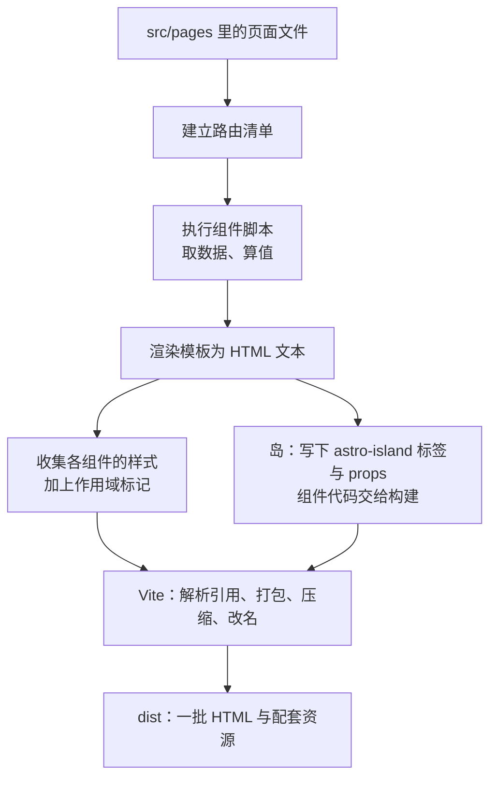

### 7.11.1 Astro 读取页面

构建开始时，Astro 先扫 `src/pages`，把那里的文件按 7.6 的规则整理成一张路由清单——每个地址对应一个页面文件和它的参数。

这一步就是第六章 6.4.4 那句话的实现现场。那一节说「路由系统决定有几个页面，入口是框架生成的，你不需要手写成百个 HTML」：框架不是少生成了 HTML，而是**把这批 HTML 的清单来源改成了目录**。本章实测那五个页面文件变成七个地址，正是这张清单被打印出来的样子。

清单还有一层容易忽略的作用：**它决定了哪些代码会被拉进构建。** 页面文件和组件文件在这里规则相反：组件要靠被某个页面 import 才进入引用关系，没被任何页面引入的组件不会出现在产物里；页面文件不需要被谁引用，它自己按 7.6 的规则就是一个地址。于是两种「文件在、东西却不在」要查的地方不同——地址不在，查页面那一侧（名字、类型、位置，也就是 7.6.1 那三条限制）；代码没进产物，查组件那一侧（有没有人 import 它）。AI 说「这个页面没有进入构建」时两种意思都可能，先问清它说的是地址还是代码。

这一步还能解释一件看起来矛盾的事：**如果有**二十个页面文件而构建日志只打了十四个地址，差额通常落在这三种情况上——文件不是受支持的页面类型、它的名字和已经存在的地址撞了、或者它压根不在 `src/pages` 这棵树里。（这是推理用的例子，本章没有实测过二十个文件的项目。）这类问题的排查顺序因此很固定：先确认文件名，再确认目录，最后才怀疑框架。

### 7.11.2 执行构建时代码

清单建好之后，Astro 逐个页面执行它们的组件脚本。这一步里 `---` 区域被真正运行：模块被 import、数据被读取、`getStaticPaths()` 被调用（7.6.3 那份清单在这里回答「要生成几页」）、props 被组装。

这一步也解释了 7.4.1 那条「不进浏览器」的性质为什么成立：这些代码执行完，留下的只是一段 HTML 字符串，中间用到的变量、导入的模块、发过的请求都不需要被保留。实测里那个只出现在脚本区的标记字符串在整份产物中检索不到（7.4.1 那段检索结果），就是这一刻的直接后果。

顺带一条实践上的推论：这一步发生在开发电脑上。如果某个页面的脚本要读一批大文件或者请求一个接口，**这份开销花在构建时，不花在用户身上**——这正是 7.2.3 那种做法快的一半原因，也是它「内容变了要重新构建」的那一半代价。

还有一条推论：因为这一步真的在执行代码，页面里的错误要到这里才暴露。脚本里访问了一个不存在的字段、取数据的那个地址不通、`getStaticPaths()` 返回了形状不对的参数（7.6.4 实测到的那条报错就是这一刻打印的），都会让构建停下来。这类报错的位置通常指向一个页面文件而不是某个组件。看到这种形状的错误，可以先判断它属于「哪一页在生成时算不下去」，而不是「某个部件写错了」。

### 7.11.3 生成 HTML

模板被求值：花括号里的表达式算完、条件决定哪段结构被生成、`.map()` 决定重复几次、组件被展开、slot 被填上内容。产出的结果是**一段 HTML 文本**。

这里需要接住第二章那条最基础的区分（2.7.1）：HTML 不等于 DOM。Astro 在这一步生成的就是文本，它还没有变成任何树结构——那要等浏览器读完它、解析完它，也就是 2.9.1 那一步。所以当你说「页面已经渲染好了」，在这一层的意思严格来说是「HTML 已经写好了」，页面上看得见东西这件事仍然发生在浏览器里。

也正因如此，模板里的判断是**一次性的**。`{showCard && <StaticCard />}` 在构建时决定卡片存在还是不存在，用户那边没有任何办法让它反过来。这句话听起来多余，但它是区分「服务端逻辑」和「客户端逻辑」最省事的一个测试：这个决定能不能在用户操作之后改变？不能，它就属于这一步。

### 7.11.4 处理 CSS

样式在这一步做两件本章讲过的事：给组件的样式规则加上作用域标记（7.4.4 实测的那三种 `data-astro-cid-*`，以及那条没带标记的 `body` 例外），然后把收集到的样式交给后面的构建环节。

第三件事不属于本章，但在这里点名一句：样式被抽出、合并、压缩、放进产物哪个位置，全部是第六章 6.2.3 和 6.5 讲过的那道工序。框架不重新发明这一步。

还有一条读产物时用得上的性质：作用域标记是**编译时加上去的**。实测那三种标记出现在 HTML 里，也就是说浏览器看到的就是带着属性的普通标签，它不需要知道「这块样式来自哪个组件」——那件事已经在生成阶段被写进选择器了。这个标记不是随机数：本章连着构建三次、再跑一次开发服务器，三个组件拿到的标记始终是同样三个名字。它的性质和 6.7.4 那套产物文件名相同，都由确定的输入决定，稳定到看起来像一个可以引用的名字——但它仍然由组件身份决定，不由你决定，所以手工去改产物里那些带标记的选择器，改的是一件你不持有的东西。

### 7.11.5 处理 Island

如果页面里有被指派接管的框架组件，这一步同时做两件事，而它们方向相反。

朝 HTML 的那一半：在页面上那个部件的位置写入 `<astro-island>` 标签，把组件文件地址、渲染器地址、序列化后的 props 和接管时机都写成属性——同时**服务端渲染好的那段 HTML 也照原样装在里面**（7.8.2 实测那两行对照）。所以这一步的产物里，页面内容已经完整，接管只是附带信息。

朝构建的那一半：把组件自己的代码、对应框架的运行时、渲染器交给 Vite 打包。3.7 讲过 `import` 是静态的、工具可以提前分析。这条能力在这里被用在框架组件上：Astro 知道这个岛需要哪几个文件，是因为它读了那行 import。

实测里这一步的产出量最能说明问题：一个 529 字节的组件，把 212,922 字节的渲染器块和 7,899 字节的共享块一起带进了产物。岛的 HTML 成本几乎为零，JS 成本由框架决定——这两句合起来才是 7.8.8 那条判断链值得走一遍的理由。

### 7.11.6 输出静态文件

最后一步把结果写到 `dist`。本章实测的静态项目里它的形状是七个 HTML 加三个 JS 文件，另有一个从 `public` 原样搬来、保持原名的 `robots.txt`。

这张产物树和第六章 6.1.3 那份裸项目的产物树差在形状，不差在性质：**仍然全是浏览器认识的文件，仍然没有一个 `.astro`**（0.5.2 那句「TypeScript、`.astro` 源文件、依赖目录、配置文件都留在开发工具侧」在这里逐字兑现）。

两处形状上的差别也值得记住，因为它们会影响你之后读构建日志。一是默认按目录格式产出（7.6.2），二是资源集中在 `_astro` 这个目录里（配置项 `build.assets` 的默认值）——第六章那份树里的 `assets/` 在这里换了名字，但角色完全相同。

最后把 7.2.3 和 7.7.2 那条代价说清楚：**这一批文件就是可以被部署的东西**（6.9.4 的结论在这里继续成立）。而「内容变了要重新构建」这句话的实际含义也在这里——你改的是 `src/content` 里一篇文章，产物是 `dist` 里几个 HTML，中间没有任何东西会自动更新。这就是这一层的全部性质：**静态产物的可靠性来自它每次都是重新算出来的，代价是它不会自己变。**

---

## 7.12 L6 知识地图

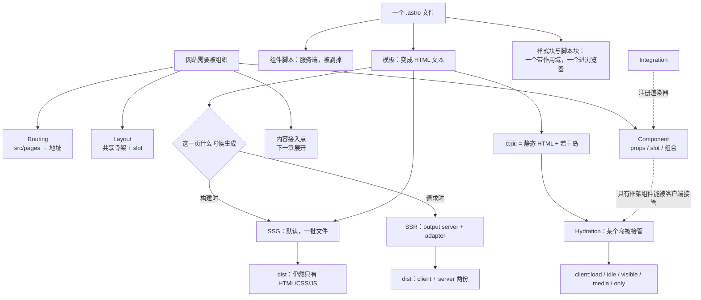

这张图有两条主线。上面一条是**组织线**：四个需求各由一个机制承担，而页面文件把它们串起来——`src/pages` 决定有哪些地址，地址上的页面套同一副骨架，骨架里用组件，内容从旁边那格接进来。下面一条是**时刻线**：同一个页面的结构与它的交互能力分别属于不同时刻，组件脚本在构建时被用完就丢，模板变成 HTML 文本，只有被指派接管的那几个部件会带着 JS 一路坐到浏览器里。

两条线中间有两条虚线，它们是本章最容易搞混的地方，所以特意画成虚：能被客户端指令接管的是框架组件，Astro 组件不在这一类里（它另一条路叫 server island，7.8.1 说过）；框架组件之所以能被引入，靠的是集成替它注册了一个渲染器。右上角那一格「内容接入点」故意不往下接任何东西——本章只把它的位置摆出来，接法属于下一章。

最下面那两格是本章最后的落点：不管走静态还是按需，交出去的都是浏览器认识的文件；区别只在于按需那份还得有个程序在跑。

## 7.13 本章小结

第一条认知是关于**这一层到底管什么**。Astro 不管「源码怎么变成浏览器认识的文件」，那是构建工具那一层的事；它管的是「这个网站有哪些页面、每个页面由哪些零件组成、它们什么时候生成」。这条职责体现在四个具体的地方：一个决定地址的目录、一副共享的骨架、一套可传输入的组件、一个内容的接入位置。看到 AI 在动 `src/pages`、`src/layouts` 或 `astro.config.mjs`，可以立刻判断它动的就是这一层。

第二条认知关于 **Astro 与 Vite 的关系，它不是替代而是站在上面**。框架决定要生成什么，Vite 决定这些文件怎么被转换、打包、压缩。这条关系有一个可核对的证据：本代的 Astro 直接以 Vite 作为开发服务器与生产打包器，配置项里还专门留了一个口子把自己的设置透传给 Vite。所以「Astro 快」和「Vite 快」其实是同一条链上的两个环节，而报错时先分清措辞来自哪一层，能省掉一半无用的排查。

第三条认知是本章最实用的一条：**一个页面的结构与它的交互能力，可以被分开决定。** 结构在构建时就写成 HTML，交互要等浏览器把组件代码加载完、把已经存在的那段界面接管过来。这两件事分属两个时刻、两份文件，所以「静态生成的页面就没有 JavaScript」这种说法在任何一次真实构建产物面前都站不住。而 Astro 给出的具体手段是一串时机选项——立刻、空闲时、被看到时、某个屏幕条件满足时——每一个都只回答「什么时候接管」，不改变「页面已经能用」这个前提。只有 `client:only` 那一档例外：它连内容都要等脚本跑起来才出现，位置先是空的。

第四条认知关于那条边界上的旧说法。这一层的实现变动比前几层快：水合指令的清单、输出方式的取值、Markdown 默认走哪条管线，都在几个大版本里改过。本书因此把正文放在概念坐标上（什么时候生成、谁生成、代价落在谁身上），而把具体取值留给官方文档核对。**读到本书之后仍然要去查一次当前文档的，是那些字符串怎么写；不需要再查的，是这些问题在问什么。**

## 7.14 AI 黑话速查

| AI 常说的话                                    | 实际意思                                                   |
| ---------------------------------------------- | ---------------------------------------------------------- |
| `Add a new page at src/pages/about.astro`      | 新建一个文件就多一个地址；这个目录是路由规则的来源         |
| `Move that into a layout`                      | 把每个页面重复的那段骨架抽成一份，页面通过 slot 往里填内容 |
| `This is an Astro component, it can't hydrate` | `.astro` 组件没有客户端形态，指令写了也会被忽略            |
| `Add client:idle to this component`            | 让浏览器在这个部件上补做接管，但推迟到页面自己忙完         |
| `Set output to server and add an adapter`      | 把页面的生成时机从构建挪到请求，代价是需要一个在运行的服务 |

这一层讲完了「一批文件怎么变成一个有地址、有共享骨架、有交互部件的网站」。可是那个网站最要紧的部分——文章本身——本章一直没有碰：`src/content` 里那批 `.md` 文件是怎么被组织、被读取、最后变成一个个页面地址的。内容是内容型网站的主语，而它有自己的一整套规则：写作格式、头部字段、集合与类型、从文本到 HTML 的转换过程。这就是下一章要处理的东西。
