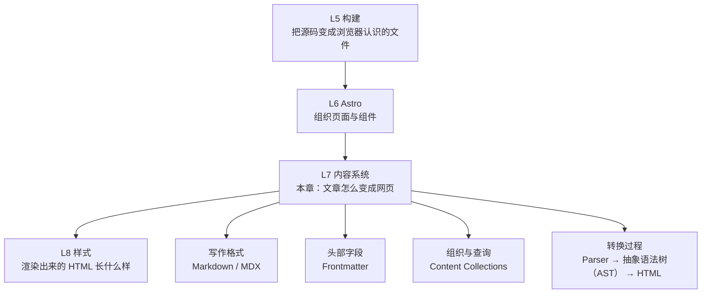
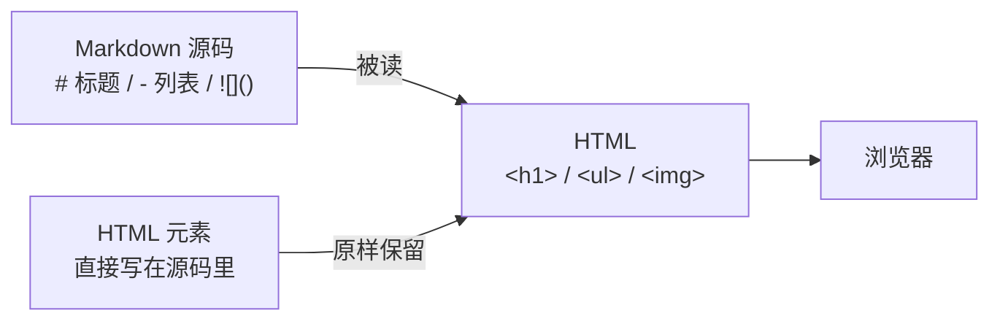
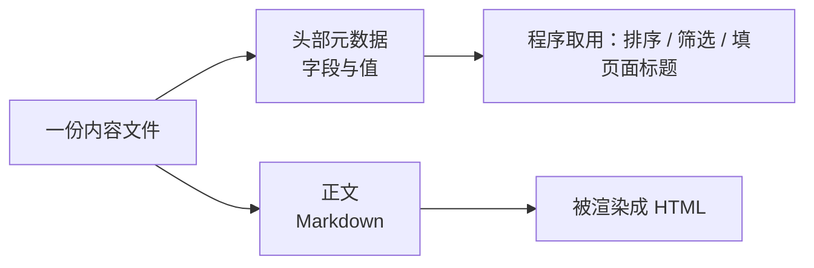
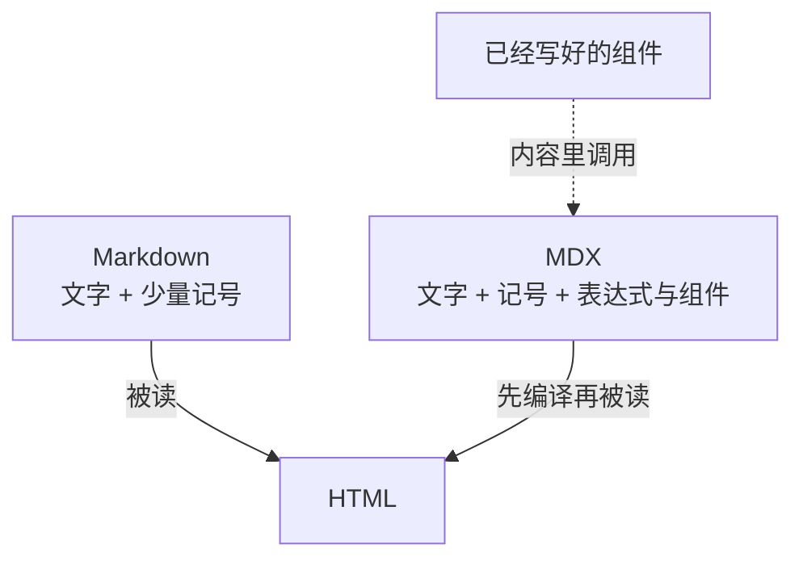
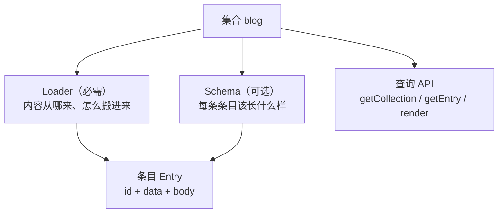
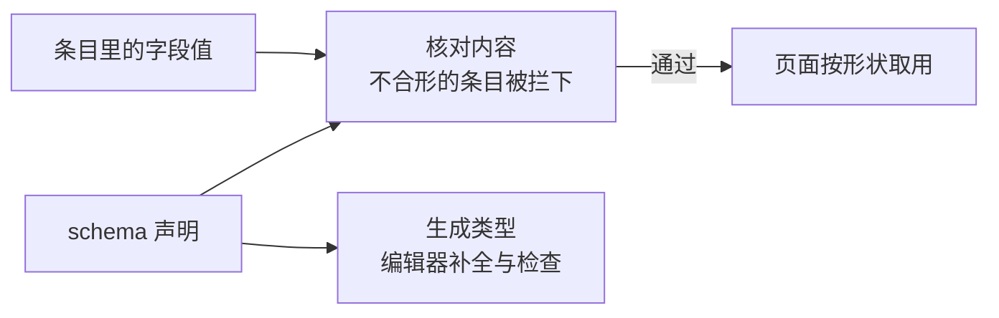
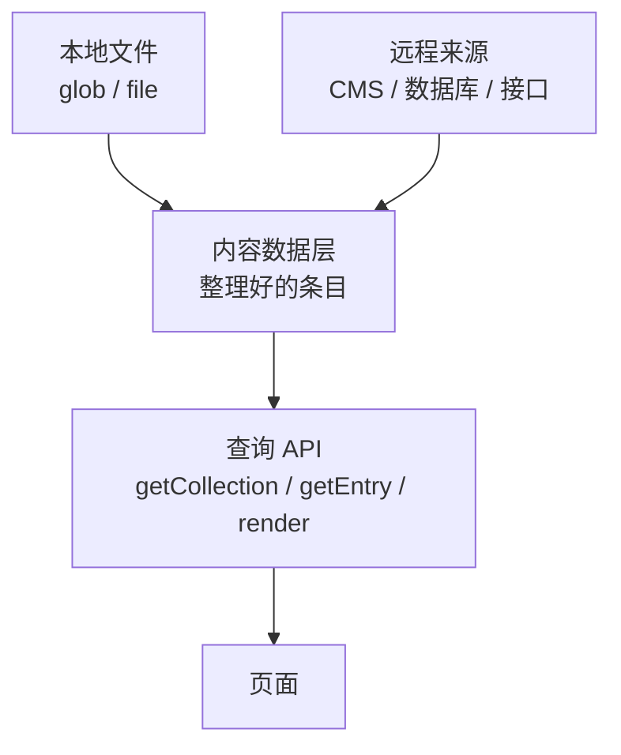
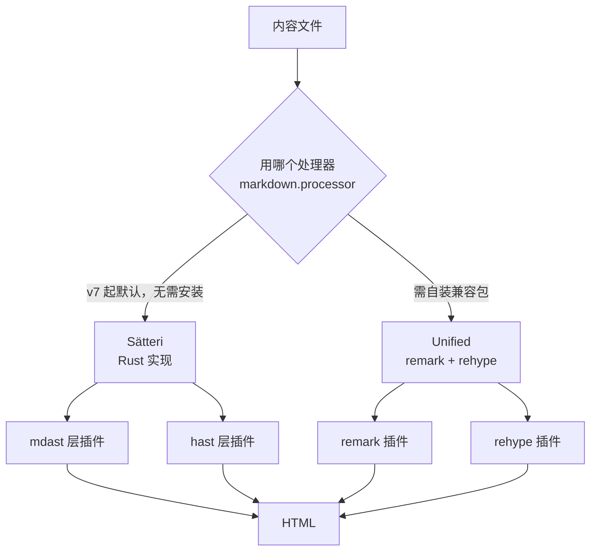
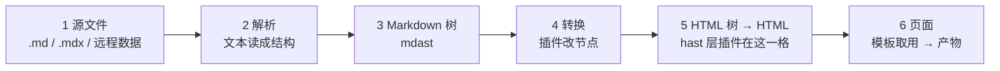
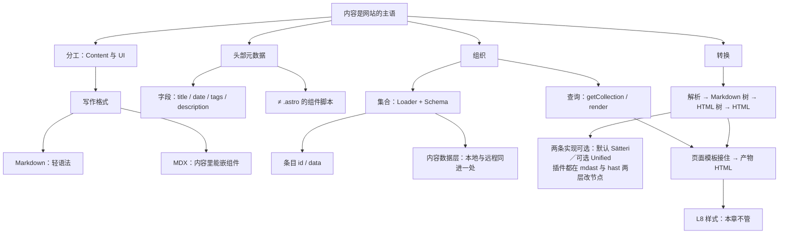

## 本章导读

你让 AI 给博客加一篇文章。它没有打开任何 `.astro` 文件，而是新建了一个 `src/content/blog/` 下面的 `.md`，开头写三行看着不像正文的东西，然后告诉你“the new post will show up in the listing”。你刷新页面，文章确实出现在列表里，标题、日期、标签都对——可是把项目翻一遍，找不到任何一行代码写过这个标题。

第七章讲完了一个网站的骨架：有哪些地址、页面共用哪副壳、交互部件什么时候加载 JavaScript。它把这些讲完就停住了，因为还有一件事没碰：网站真正要装的东西。那批被留在 `src/content` 里的文件是怎么被组织、被读取、最后变成一个个能访问的地址的。

这一章回答的就是这件事。它不是 Markdown 语法手册，也不是内容 API 大全。读完你要能回答四个问题：一份人写的文本凭什么变成网页；那些字段是给谁看的；内容多了以后为什么需要「集合」这种东西；以及 AI 说「加个插件改一下 Markdown」时，它准备动的是哪一层的东西。

还有一条边界要提前说清楚。第〇章讲过，这十三层不是一条严格的依赖链：内容系统不需要交互框架才能工作，很多网站根本不用框架组件。本章里组件出现在两个地方——内容里可以嵌组件，以及渲染出的 HTML 要有地方安放——它们都是可选的加成，不是前提。同样地，这一层最后交出去的仍然是浏览器认识的 HTML，和 6.3.6 的结论一致：换工具不换语言，变的是谁在什么时候把文字读成了结构。

## 本章在技术栈中的位置



上面那条横线是全书的位置：这一层接在把网站组织起来的 L6 之后，往后交给决定样式的 L8。下面四格才是本章的内容，它们对应四个不同的问题——文章**怎么写**、写给谁看的元数据**放哪里**、几十篇文章**怎么组织**、文本**怎么变成 HTML**。第四格那串名字里的 AST 是**抽象语法树（Abstract Syntax Tree）**，指文本被读成结构之后的那棵树，站在 Parser 与 HTML 中间：先把文字读成结构，再把结构写成 HTML。它的正式解释在 8.7.2，这里只要记住它是这条链的中间那一环。

这四格里，前两格是写作者每天接触的部分，后两格是项目变大之后才显出必要的部分。第七章 7.3.5 说过 `src/content` 这个目录不是页面，里面的 `.md` 不会因为躺在项目里就自动成为一个地址。这句话里缺的那一段——谁把它读出来、按什么形状读——正是本章要补的。

## 读完本章，你应该能看懂

- “Create a new markdown file in `src/content/blog/`.”
- “Move these posts into a content collection.”
- “Add a schema so the frontmatter is type-safe.”
- “This post fails validation — the `date` field is missing.”
- “Use MDX here so we can embed the chart component.”
- “Add a remark plugin to auto-generate a table of contents.”
- “Query the collection with `getCollection()`, then `render()` the entry.”

这七句的共同点是：它们都在动**内容和内容之间的关系**，而不是在动页面的样子。读懂这一章之后，你应该能判断出 AI 现在是在改一个写作者的文件、在改一份描述内容形状的配置、还是在换一段把文本读成结构的处理过程。这三件事影响的文件不同，代价也不同，但 AI 说出口时都只有一句轻描淡写的话。

---

## 8.1 内容与代码

一个博客项目里最先写满的不是代码，是文章。可是文章想上到网上，就必须和代码发生关系：谁读它、什么时候读、读完放到哪儿。这一节先建立一个分工，再解释为什么这个分工需要一套专门的机制来维持。

### 8.1.1 Content 与 UI

先分清两样东西。

**UI** 是页面长什么样、由哪些部件拼成、这些部件之间怎么组合。第七章整章都在讲它：地址、骨架、组件、交互部件的加载时机。

**内容（Content）** 是页面里说的那件事。一段文字、一张图、一份价格表、一篇三年前的旧文章。

它们的变化速度不一样，这是分工成立的理由。一副导航可能半年改一次，一篇文章发出去当天就定型了、以后只会被引用。写文章的人和写页面的人往往也不是同一个。如果两件事混在一起，改动频繁的那一份会不断牵动改动稀少的那一份——每发一篇文章都要碰一次代码。

变化频率不同的东西放在一起，还有一个连带后果：一份内容往往要被用在好几个地方。同一篇文章要出现在列表里、出现在按标签聚合的页面上、出现在站内搜索的索引里、出现在订阅源里。这些用法没有一个需要重新写一遍文章，它们需要的都是同一件东西：**能按条件取用的内容**。这句话已经提前说出了本章后面两节要讲的东西——先要有形状（8.3），再要有集合（8.5）。

所以内容系统要做的第一件事，就是把这两者拆开：文章以文章的形态存在，页面以页面的形态存在，中间由一层机制接起来。第七章 7.1.5 说过，框架负责的是「内容怎么被接到页面上」，而不是「内容怎么被写出来」。这句话在本章有了下半场——**「内容怎么被写出来、被存成什么形状」正是内容系统负责的部分**。

### 8.1.2 为什么博客不直接把文章写进组件

反过来说更清楚。假设没有内容系统，一篇文章就写在页面组件里：

```astro
---
// src/pages/posts/astro-intro.astro
---

<h1>Astro 入门</h1>
<p>写了三周，终于把路由和布局搞明白了……</p>
```

这能跑。问题在第三篇文章之后开始出现。

第一，改一个错别字要动代码。而愿意改错别字的人，通常不看代码。

第二，文章列表要显示「所有文章」，你就得知道现在一共有几篇。写进组件意味着这件事只存在于一句一句的 import 里——3.7.7 讲过 `import` 的写法是静态的、必须写在模块顶层，这正是打包工具能提前分析的基础，好处是能分析，坏处是**它只能分析写死在代码里的东西**。新增一篇就要多一行 import，多一段登记。

第三，重复。标题、日期、标签、摘要这些字段每篇都要写一遍，一旦想统一改（比如给所有文章加一个「阅读时间」），要动几十份文件。

第四，也是最容易被忽略的：散文塞进组件之后，代码评审的注意力被冲淡了。一个提交里同时改了布局和改了第三段的措辞，谁也说不清这次改的是什么。

在内容系统里，这些文件有两条合法出路。**一条是放进 `src/pages`**：Astro 会把 `src/pages` 下的任何受支持文件当作一个页面，`.md` 也算——于是这个文件确实有了一个地址，不用写任何组件。这条路的限制很直白：页面结构由 Astro 代劳，你能改的东西有限。

**另一条是放进内容目录，由集合接住**。这条路不自动产生地址，但内容与页面分离得干净：文章只管写，页面模板负责显示，「有哪些文章」这个问题由一次查询回答。官方对这两条路的取舍写得很清楚——集合和把 Markdown 直接 import 进 `.astro` 都可行，但集合提供了「为内容专门优化的查询与渲染 API」，直接把文件放进 `src/pages` 只是图一个方便。

AI 说 “move these posts into a content collection” 时，它做的就是把内容从第一条路挪到第二条路。

### 8.1.3 Structured Content

第二条路带来一个新问题：一旦文章不再是代码，程序就看不懂它了。

一段 Markdown 里，标题、日期、标签、有没有写完，这些信息和「文章正文」混在一起。机器读到 `2026-09-30` 那行字，并不知道它是日期还是文章里的一个数字。

于是有了**结构化内容（Structured Content）**这个说法：内容不只是文字，还带着形状。什么字段必填、什么字段是日期、什么字段是一串标签——形状先定下来，内容按形状填。


这条链解释了本章后半部分为什么需要 schema、集合和校验。而「形状」这件事在别处也有对应物：内容管理系统（CMS）走的是同一条路——官方对它的描述是，CMS 让你在项目之外写内容、管理素材，适合「遵循某种特定结构的内容」，还能把某些字段设成必填以免留下残缺的条目。本章不展开 CMS（那是内容从哪儿来的问题，8.6.4 只提一句它怎么接进来），但它证明了同一件事：**内容要能被批量处理，得先有形状。**

---

## 8.2 Markdown

形状要有人填。填东西的格式，在开发者这一侧最常见的答案是 Markdown。这一节按目录把五种常用写法各过一遍，重点不在记语法，而在看懂「你写的这几个字符，出去的时候变成了什么」。

### 8.2.1 Markdown 是什么

Markdown 是一份纯文本，加上极少量记号：行首的 `#` 表示标题，空行分段，星号夹起来是着重，方括号加圆括号是链接，三个反引号夹起来是代码块。

它解决的问题很具体：写网页说明、写文章、写笔记的人不想要一个「先写标签再写字」的格式。HTML 里一段话要包两层标签，而写作时最贵的成本是打断——手从键盘上离开去够标签，思路就断了。Markdown 把记号压到最少，让文字看起来还是文字。

内容型网站喜欢它还有三个理由。它是纯文本，所以能进 Git、能看 diff（两次改动差在哪几行，一比就看得出来）、两个人改同一段时冲突清清楚楚；它和展示无关，同一份文件可以出成网站、出成书稿、出成邮件；它是给机器读的规整文本，转换这件事可以交给一个函数——这一点在本章后面变成了整章的核心。

也正因为它的记号少，Markdown 有一个初学者迟早会撞上的性质：它不是一种被严格标准化到每个细节的语言，而是一族写法。同一段源码，在不同工具、不同处理器、不同扩展开关之下，产出不完全一样。本章 lab 里就有现成的一例：表格、删除线、任务列表这几样在默认配置下都能用，把 GitHub 风格扩展那个开关关掉之后，它们退回成页面上的字面字符；脚注那一样更难看——它没有退回字面，而是被当成普通链接处理，变成了一个指向脚注定义文字的死链接。所以「Markdown 应该显示成什么样」这个问题，最终要由**这个项目的处理器和它的开关**回答，不是由格式本身回答。

有一件事必须现在就钉住：**Markdown 文件不是浏览器认识的网页。** 第一章 1.8.5 讲过浏览器怎么读 HTML——它读到什么标签就建什么结构；把一份 `.md` 直接发给浏览器，它会把整份文本当字符显示出来，`#` 还是 `#`。Markdown 之所以能在网站上表现为标题、列表、链接，是因为中间有人把它读成了 HTML。8.7 到 8.10 讲的就是这个「有人」。

### 8.2.2 Heading

标题是 Markdown 里最常用、也最容易和别的记号混起来的写法。它只有一条规则：行首若干个 `#` 加一个空格，`#` 的个数表示层级。

| 你写的                | 出去的是         | 看懂什么                 |
| :-------------------- | :--------------- | :----------------------- |
| 一个 `#` 加空格加文字 | `<h1>`           | 页面主标题，一页一个足够 |
| 两个 `#`              | `<h2>`、`<h3>`…… | 层级往下，数字越大越深   |

这一段需要看懂的不是记号，而是**它对应到第二章讲过的那个 HTML 元素上**。`<h1>`–`<h6>` 承担的是文档结构：读者和搜索引擎靠它判断哪些内容并列、哪些从属，屏幕阅读器用它跳章节。第二章 2.2 讲语义化时说过的道理在这里完全成立：标签选错，画面可能看不出差别，结构就错了。

实测里有个细节可以先记下：一篇 `.md` 渲染成 HTML 后，标题上会自动带 `id`。本 lab 把中文标题「一个小节」渲染出去，产物是带 `id="一个小节"` 的标题元素，页内锚点 `<a href="#…">` 直接就能指过去。这也解释了为什么 AI 会说 “the anchor link doesn't work, the heading id changed”——那个 id 是从标题文字算出来的，改了标题文字就等于改了地址。

还有一个常见误区：层级不要靠字号选。`###` 不代表「小一点的标题」，它代表「上一个标题下面一层」。跳级使用不会报错，但结构会散。

### 8.2.3 Paragraph

段落只有一条会让人意外的规则：**在 Markdown 源码里换行，不等于在页面上分段。**

```markdown
第一段写在两行里，
页面上仍然是同一句。

空一行，才是第二段。
```

原因是 Markdown 继承了纯文本写作的习惯：源码里的换行常常只是为了不让一行太长。要分段就得空一行，这个空行是语法的一部分，不是排版偏好。

这一条能解释一类高频困惑：你在源码里明明分了行，页面上却糊成一坨；或者反过来，一句无意的空行把一段话劈成两段，样式上多出一点间距，AI 跑去改 CSS。**这时候问题不在样式，在空行。** 判断方法是看渲染结果——第一章 1.8.5 和第二章 2.9 讲过同一个道理：页面上真实存在的结构是解析之后的结果，源文件只代表你想过什么。

顺带一句：列表项之间空行、段落中间的多余空格，都会影响输出形状，但都属于「知道去哪里查就够了」的细节，本章不列清单。

### 8.2.4 Link

链接是方括号套圆括号：`[文字](地址)`，渲染成带 `href` 的 `<a>`。这里要看的不是写法，是**地址的相对性**。

`[关于](/about/)` 里的路径是浏览器地址栏意义上的路径，和文件在项目里的位置无关——这正是第一章 1.5.5 那条区分（URL 里的路径不是文件系统路径）在内容里的应用。所以把文章从 `src/content/blog/` 挪到别处，页内链接不一定坏；反过来，改了页面的路由规则，几十篇文章里的链接会一起坏。这是内容系统与 L6 那一层真实的耦合点，7.6 讲路由时留的伏笔在这里生效。

另一种写法是直接贴一个裸地址：`https://example.com` 在页面上会自动变成可点的链接。这**不是「随便写个网址都会成链」的通用规则**。原始 Markdown 就支持自动链接，但要求把地址放进尖括号；**裸地址**不写尖括号也能成链，这一条来自 GFM（GitHub 风格的 Markdown 扩展）。本章 8.7 会看到 Astro 默认开着这一族扩展，所以它工作；同一个开关关掉之后那个地址就以纯文本留在页面上——这是本章 lab 实测过的（关掉之后自动链接、表格、删除线、任务列表一起失去）。「能力有来源」这件事，这是最省事的一个例子。

### 8.2.5 Image

图片在方括号前多加一个感叹号：``，出去是一个 ``。

两个点要留神。

第一，那个路径指向的**不是**文章文件旁边的图片，而是网站上的一个地址。第五章 5.9.2 和第七章 7.3.6 都讲过同一件事：`public` 目录里的东西按原样搬运到产物里。所以 `/cover.png` 能不能显示，取决于这个文件在不在 `public` 下面，而不取决于你和文章挨得多近。图片路径错了的表现非常干脆：页面上出现替代文字，或者一个破掉的图标。

第二，替代文字（`alt`）不是可选的装饰。图片加载不上时它是页面上剩下的那句话，读屏软件念的是它，图片搜索认的也是它。AI 如果写了一张图却把 `alt` 留空，这是一个该回一句的遗漏，不是风格问题。

再往上一层的东西——图片尺寸优化、响应式图片、把图片交给专门的组件处理——已经越出内容这一层，本书不在这里展开。

### 8.2.6 Code Block

代码块用围栏包起来：三个反引号开头、后面跟语言名，正文写代码，末尾再来三个反引号。它出去的形状比你想的复杂一点。

实测里，一个标了 `js` 的代码块渲染成了带 `astro-code github-dark` 类名的 `<pre>`，元素上写着背景色、`data-language="js"`，代码本身被拆成一串带颜色的 `<span>`。**这段产物已经没有任何「原始文本」的样子了**——它是完整的 HTML，颜色和主题名都写死在里面。

这件事的用处是让你能判断 AI 在说什么。当它说 “the code block isn't highlighted” 或者 “switch the syntax theme”，它讲的是这段转换过程里的一步：内容处理器把代码交出去、由一个高亮器把代码切成记号（token）再上色。要换的东西在配置里，不在文章里，也不在 CSS 里。反过来，如果你在页面上看到的代码没有上色，第一个该怀疑的是语言名没写对，而不是「样式丢了」。

至于高亮的配置怎么写、主题从哪来、哪些语言会被打包进去，属于「理解到这一层即可」的部分，再往下就是工具专述了。

### 8.2.7 Markdown 与 HTML

把这一节收一下：Markdown 和 HTML 不是两种并列的语言，而是一层薄语法和它所描述的那个东西。



右边那条支线要单独说：Markdown **不禁止**你写 HTML。实测里，一段直接写在文章中间的 `<div class="raw-html">…</div>` 原样出现在产物中。这一点常让人产生「Markdown 不让我用某些标签」的错觉——真话是反过来的：Markdown 是 HTML 的**子集加糖**，糖不够用的时候直接写本体就行。

那为什么不干脆全写 HTML？因为写作时记号越少越好，而 HTML 的记号密度是「每段话两层标签」。Markdown 的全部价值就在这里：**它把最常见的几种结构压缩成几个字符，把不常见的部分留给 HTML。**

由此也能看出这一层的边界。Markdown 里写不出「带交互的按钮」「会变的数字」「从数据里生成的表格」——这些都需要 JS，超出了「一段文本能被读成什么结构」的范围。内容需要表达能力的时候，出路不是把 Markdown 改大，而是换一种文件格式。这就是 8.4 的 MDX。

---

## 8.3 Frontmatter

文章需要被描述，而不只是被书写。这一节讲文件里那块专门用来描述的区域，以及每个字段是给谁看的。

### 8.3.1 Frontmatter 是什么

一份内容文件其实分成两个区域。

```text
---
title: 我看懂 AI 写的网站
date: 2026-09-30
tags: [ai, web]
---
从这里开始是正文。正文里可以再写标题、列表、代码块，
程序不会把它们当字段。
```



上面那对 `---` 夹着的区域叫 **头部元数据（Frontmatter）**。里面写的是「关于这篇文章的事实」，格式通常是 YAML（靠缩进和冒号写「键：值」的一类格式），也支持 TOML（同一类用途的另一种写法）。下面那一整块才是文章本身。

这两个区域的区别不在格式，在**读者**。正文是给人读的；头部元数据是给程序读的——列表页要按日期排、页面标题要填进 `<title>`、相关推荐要看标签，这些都是程序要干的活，而程序需要字段名和字段值，不需要在散文里找。

为什么这一区用 YAML 而不是 JSON？因为它要服务的是写作场景：不用引号包住键名、不用花括号、数组可以写成一行也可以写成缩进列表，多写一个空格少写一个逗号都不至于让整份文件失效。代价是它**靠缩进表达层级**。这正好解释了字段这一类改动最常见的坏法：不是拼错，是缩进错位——字段还在，但它从属于了错误的上一层。AI 说 “the frontmatter is malformed” 时，绝大多数时候要修的是那几行的缩进和对齐。

这件事可以直接验证。本章 lab 里那份 `.md` 的 `title`、`date`、`author` 三个字段，在构建产物里**一次都没有出现**：页面里只有正文渲染出的段落、标题、表格和代码块。元数据没被丢掉，它只是不进正文。

还有一处必须挡住的同名混淆。**`.astro` 文件开头同样有一对 `---`，那里的内容完全是另一回事。** 第七章 7.4.1 讲过：`.astro` 里那一段官方称为**组件脚本**，是一段会在服务端执行的 JavaScript；`.md` 里那一对分隔线之间是一组描述文章的字段，写了不是拿来跑的。两者只是碰巧共用了同一对记号。看到 `---` 先问一句：这个文件是 `.astro` 还是内容文件？

### 8.3.2 title

标题是最容易被重复写的那一个。

正文里通常还有一行大标题；如果又有 `title` 字段，看起来是同一件事写了两遍。但它们服务的对象不同：正文里那行是**页面内容的一部分**，读者看到；`title` 字段是**关于页面的事实**，被这些地方取用——浏览器标签和搜索结果里的页面名、文章列表里的链接文字、分享卡片上的标题、站点地图里的条目。

于是有一类结构问题在这一层很好判断：列表页显示的标题和点进去看到的标题不一致，往往不是「哪一处写错了」，而是两处各自写了各自的。解决办法是把 `title` 当成唯一来源——列表页取字段，文章页也取字段，正文不再重复写一行。

这也解释了为什么 AI 会说 “the h1 is duplicated in the layout”。它的意思是：页面模板已经用 `title` 渲染了一个标题元素，正文里那个 `#` 记号写的标题是第二遍。删掉哪一处取决于你要不要保留正文里的那一行。

### 8.3.3 date

日期字段是内容系统里唯一一个「类型会真的变」的字段，所以它要单独讲。

源码里它是一串字符：`2026-09-30`。但列表要按时间倒序排、归档要按年月分组、订阅源里要有可比的时间——字符串做不到这些：比较时只看字符，不看数字。实测把三个日期字符串放进数组排一次序，`2026-9-3`（少写了前导零的那个 9 月 3 日）落到了 `2026-09-30` 和 `2026-10-01` 的**后面**——最早的一天排在了最后。

如果内容按 8.5 的集合组织、schema 里把日期声明成日期类型，程序拿到手的就是一个真正的日期对象。本章 lab 实测过这一点：`date: 2026-09-28` 写进 `.md`，页面里读出来时它是一个日期对象，打印出来带了本地时区那一串（`GMT+0800`）。**同一串字符，进到系统里换了种类。** 这个变化对写东西的人不可见，但它解释了「为什么我明明写了日期，页面上显示的格式不是那串字符」——格式是展示时另外决定的，字段本身已经不是文本。

日期字段也最容易写出坏数据：写成 `昨天`、写成 `2026年9月30日`、整行漏掉。这类问题在内容系统里的表现很干脆——校验失败，并且三条路都会告诉你（构建、同步、开发服务器），细节见 8.5.3。

### 8.3.4 tags

标签是一个数组：一组短字符串，描述这篇文章属于哪些主题。

它存在的理由只有一个动作：**按条件取内容**。列表页显示全部、某个主题页只显示带这个标签的、文章末尾的「相关阅读」取同标签的另外几篇。没有标签这一层，这些需求都要靠手写清单，而手写清单会在第十篇文章之后开始过期。

因此标签的坑也不在写法，在**取值不受约束**。`ai`、`AI`、`人工智能` 在字符串比较里是三个不同的标签，页面上会长出三个主题页，各装几篇文章。约束的办法是 schema：把标签声明成字符串数组，必要时声明成「只能从固定的几个里选」。这是 8.5.3 会正式讲的事，这里先记住一条：**标签坏掉时，通常不是渲染出了问题，是取值出了问题。**

顺带把分类和标签分一下：分类（category）通常一篇文章只有一个、形成层级；标签（tag）一篇可以有很多个、彼此平级。两者都是数组或字符串字段，机制上没有区别，含义上有。

### 8.3.5 description

描述字段是一句「这篇文章在讲什么」的话，写在这里而不是让程序从正文里抓。

它被取用的地方主要是两处：页面 `<head>` 里那段给搜索引擎和社交平台看的摘要，以及列表页里那条比标题长一点、比正文短的说明。

区别在于**这是有意写的一句话**，不是正文的第一段。让程序截取正文开头当摘要，是 description 缺席时的退路：它会把「我们先把环境装好」这种句子推到搜索结果里当这篇文章的概括。所以这个字段的价值不在信息量，在于它是**从写作目的出发的一句话**。

同一层还有几个常见字段——封面图、作者、是否草稿、更新时间——机制完全相同，都是「描述文章的一个事实」，目录里没有给它们各开一节，本章也不逐个列。只需要知道：它们出现的位置就在这一对分隔线之间，读者是程序。

> **AI 可能会说：**
>
> “Read the post’s title and date from the frontmatter.”
>
> **翻译成人话：**
>
> 它要的是那些字段的值，不是正文。所以它读的是文件开头那一对分隔线之间的东西；要改显示出来的标题，应该改字段，或者改模板里取字段的那一行——改正文里的大标题对这两个值都没有影响。

### 8.3.6 Metadata

把前面四个字段合起来看，它们属于一个更大的概念：**元数据（Metadata）**——描述数据的数据。文章是数据，「标题是什么、什么时候发的、属于哪些主题」是描述这篇文章的数据。

这条区分有三个实际用处。

**一，元数据可以不写在正文里，也可以不在文件里。** 集合的条目本身就带着从别处算出来的字段：本章 lab 里那条 `id` 是按文件名生成的（`alpha.md` 成为 `alpha`），列表页要用的路径来自路由规则。所以「地址上的名字和文件名不一样」不一定是谁改错了：一个来自 id 的生成规则，一个来自路由规则，两条线各自独立。

**二，元数据可以被程序追加。** 内容处理器有一条正当用法就是干这件事：插件在处理正文的同时往元数据里补字段，比如给每篇加一个「阅读时间」，或者把 `title` 拼上站点名。补出来的字段仍然走同一套出口——布局里通过 `Astro.props.frontmatter` 拿，用集合渲染时通过 `remarkPluginFrontmatter` 拿。AI 说 “compute reading time with a plugin” 时，它做的正是这一类事：不是改文章，是给每篇文章多算一个字段。

**三，判断该不该进正文，有一个可用的标准。** 只有这一篇用得上的，进正文；需要跨文章批量取用的，进元数据。「本文的第二个例子用到了 fetch」进正文；「本文涉及 fetch」进字段。混起来的结果是：前者变得不能被程序读取，后者变得读者每篇都要重看一遍。

---

## 8.4 MDX

正文里出现一段 `<div>` 是可以的（8.2.7）。但如果想要的是「一个会随数据变化的部件」，Markdown 里做不到。这一节讲为这件事准备的文件格式，以及它的代价。



两条线汇到同一个出口：浏览器收到的仍然是 HTML。差别在到达那里之前多了一道编译。

名字里那个 X 值得交代一句，否则它容易被当成「Markdown 的某个版本」。这个字母在 JavaScript 生态里表示「这种文件最终会被编译成代码」：JSX 是写成标签形式的 JavaScript，MDX 就是**披着 Markdown 外壳、最终要当代码来编译的文件**。所以它不是 Markdown 的下一代格式，而是把 Markdown 的写作外壳接到了一套需要被编译的语法上——这也解释了它为什么必须有专门的集成才能工作：8.7 那条链上的「解析」这一步，对 MDX 来说要多做一件事。

### 8.4.1 MDX 是什么

官方给 MDX 的说法是一句：“MDX allows you to use variables, JSX expressions and components within Markdown content in Astro.”（它允许你在 Markdown 内容里使用变量、JSX 表达式和组件。）

第七章把这句当作一个集成的说明引过一次。本章要把它拆开——那句话里其实说了三种能力：

**变量**：内容里可以声明一个值，后面反复用。改一次，全文跟着改。

**表达式**：正文中可以直接嵌入一段要计算的东西，写作时算好，出去时是结果。

**组件**：可以把一个已经写好的部件放进文章中间，像插图一样用。

三件事的共性是：**内容不再只是文字，它成了一段能被执行的写法。** 这正是 8.2.7 结尾留下的那道口子——Markdown 写不出会动的、算出来的、复用别的部件的东西，而内容站的实际需求里有这类东西（文档站要在正文里嵌一个可试的示例、教程要给每节课配同一个「本节目标」卡片、产品说明要把一段规格渲染成表）。

它保留 Markdown 的写作外壳，接上 JSX 的表达能力：写作时基本照旧，需要的时候打开一层代码。

### 8.4.2 Markdown 与组件

这一节只看一件事：组件真的能进内容。

本章 lab 里建了一份 `notes.mdx`，正文中写了一句普通的 Markdown 段落，然后放了一个组件调用：

```mdx
---
title: 一份 MDX
---

import Counter from "../components/Counter.astro";

export const year = 2026;

写作年份是 {year}。

<Counter label="组件的入参来自内容" />
```

构建之后，产物里是这两行：

```html
<p>写作年份是 2026。</p>
<span class="counter">组件的入参来自内容</span>
```

需要看懂的是**出去的仍然是 HTML**。`{year}` 这个表达式在构建时被算成了 `2026`，`<Counter …>` 这个组件被渲染成了它自己产生的那段 `<span>`。浏览器收到的东西和一篇普通 Markdown 页面没有种类上的差别——它既不知道有组件存在，也不知道有表达式存在。

这里有一个容易读错的点，必须和第七章的结论对齐：**内容里嵌了组件，不等于页面里多了一个交互部件。** 第七章讲过，Astro 项目里一个部件要真的在浏览器里动起来，靠的是水合指令那一套。把 `.astro` 组件放进 MDX，得到的是它的 HTML 输出；要的是可交互的框架组件，那仍然是指令的事，而且那些组件本身怎么写属于交互框架那一层（第十章），本章不进去。

反过来说，这也是 MDX 最常见的正确用法：把**展示性**的复用部件搬进内容，比如提示卡、术语表、代码示例的装饰外壳。它们本来就只需要在构建时被渲染一次。

### 8.4.3 Markdown 与 MDX 的区别

把这两样东西摆在一起看，差别不只在我会多什么，更在代价上。

|                    | Markdown                    | MDX                             |
| ------------------ | --------------------------- | ------------------------------- |
| 文件后缀           | `.md`                       | `.mdx`                          |
| 谁在读它           | 内容处理器读文本，输出 HTML | 先转成 JSX 一样的写法，再被渲染 |
| 正文里能不能用组件 | 不能（只能写 HTML 元素）    | 能                              |
| 正文里能不能算值   | 不能                        | 能                              |
| 写作者需要会什么   | 几个记号                    | 还要看得懂 import 和 JSX 式写法 |
| 项目需要多做什么   | 开箱可用                    | 要装集成、登记到配置里          |

表里后两行才是这条边界的重点。**MDX 把内容从「文档」推近了一格「代码」**：它坏起来更像代码坏（语法错、导入路径错），它的读者也需要会读代码。一个由非技术同事维护的文章目录，全改成 MDX 之后往往会变成维护负担。这不是格式的问题，是分工的问题：8.1.1 那条「内容与 UI 分开」的原则，在 MDX 这里被部分地又拉回来了一点。

代价还有第二条，而且是更不好发现的那条：**集成没装，什么都不会报。** 本章 lab 实测过这个形状：`src/pages/` 下放了一份 `.mdx`，项目里没登记 MDX 集成，构建照常通过，日志里安静地列着三个页面，`dist` 里根本没有那份文件对应的产物。把 `@astrojs/mdx` 装上、在配置的 `integrations` 里登记之后，同一个文件才产出 `dist/notes/index.html`，页面数从 3 变成 4。

这类「东西不见了而不是构建炸了」的故障是内容这一层的常见形态，8.6.2 里 `glob()` 的匹配模式会造出同一种情形。对付它的办法只有一个：改完数产物。

### 8.4.4 什么时候需要 MDX

给一条能直接用的判断顺序。

先问一句：这篇内容里，有没有必须由程序算出来、或由复用部件渲染出来的东西？

没有——就用 `.md`。绝大多数文章、说明、笔记都属于这一类，它们的差别只在文字。

有，再问：**它是一次性展示的，还是要跨几十篇内容保持一致的？** 一次性的、几行 HTML 元素就能表达的（8.2.7 已经允许直接写 HTML），不必为它换格式。要跨内容保持一致的，才是组件的活，也就才是 MDX 的活。

还有一类情形需要单独认出来：**文档站和教程站**。它们的内容里天然有大量「示例卡片」「可点击的说明框」「同一段话在多处出现」，MDX 的收益最直接，代价也最容易被接受——因为写那些内容的人本来就在读代码。

反过来，判断「不该用」的两个信号：内容里有大量手写的 `import`，或者每篇文章头部都要复制同一段表达式。这两个信号说明你在用内容文件承担组件库的活，那部分逻辑应该退回页面模板里。

> **AI 可能会说：**
>
> “Use MDX here so we can embed the chart component in these docs.”
>
> **翻译成人话：**
>
> 它判断这些内容里有一段无法用文字表达——要的是能渲染数据、能复用部件的东西。于是它准备做三件事：把这些文件的后缀换成 `.mdx`，装上 MDX 集成并登记进配置，然后在正文里像写段落那样写组件调用。
>
> **需要跟着确认的是：**
>
> 写这些内容的人看得懂 `import` 吗？如果这个目录将来由不写代码的人维护，那这个决定不该只按渲染能力来算。换格式之后，内容的坏法会从「字打错了」变成「语法不合法」。

第〇章交代过一条原则：这十三层不是严格的依赖链。放到这一层，它的具体样子是——没有装任何框架集成的项目，一样可以有集合、有 schema、有内容渲染。**内容系统不依赖交互框架。** MDX 让你**可以**在内容里放组件，不是让你**必须**会写组件。

---

## 8.5 Content Collections

「把文章放进一个目录」和「把文章组织成一个集合」不是同一件事。这一节讲后者具体是什么，以及它多了哪几样东西。

### 8.5.1 Collection 是什么

先看没有它的时候是什么样。`src/content/blog/` 里躺着三十份 `.md`，页面要显示列表，就得把文件名一篇篇写进代码，或者用构建工具那种一次导入整个目录的写法（本书不展开）。前者会过期，后者把「内容有什么」这件事钉死在代码里。

**集合（Collection）** 是 Astro 给这个问题准备的答案：一个有名字、有形状、能被查询的内容集合。官方对它的定位是「在任何 Astro 项目里管理成组内容的最好方式——博客文章、产品描述、人物资料、食谱，或者任何结构化内容」。

一个集合的定义落在两样东西上，用起来再加一样：



定义写在一个专门的配置文件里（`src/content.config.ts`），里面用 `defineCollection()` 声明每个集合，最后导出一份 `collections`。这个位置是 Astro 自己找的，不是某个约定俗成的目录——**集合是配置出来的，不是靠文件夹名字生效的**。这一句就是「Collection 和文件夹的区别」的答案：文件夹说明东西放在哪儿，集合说明这些东西是什么、必须长什么样、程序怎么取。

> **AI 可能会说：**
>
> “Move these posts into a content collection and query them in the blog page.”
>
> **翻译成人话：**
>
> 它准备做三件事：把这个文章目录登记成一个有名字的集合（写在那份内容配置里），声明每条文章该有哪些字段，再把页面里那些一篇一篇写死的引用换成一次查询。文章文件本身一般不用动。
>
> **实际发生的是：**
>
> 内容从「一批文件」变成「一份可查询的数据」。以后新增一篇文章不用再碰任何页面代码，也不会出现「文件加了但列表里没有」这种漏登记的后果。

一个项目里可以有几个互不相干的集合：`blog`、`docs`、`authors`、`products`。它们的 loader 指向不同路径，schema 各不相同，查询也各查各的。

条目和文件不是一一对应的两回事，这一点在换成别的加载器时会立刻显出来：一份 JSON 数据文件可以被拆成几十条条目，它们共用一个来源；远程内容根本没有本地文件；反过来，一个文件也不一定只成为一条条目。**条目是内容层的单位，文件是存储层的单位**——把这两者混起来，就会在换数据源时以为页面代码也得跟着重写，而 8.6 的全部意义正是它们不用跟。

### 8.5.2 Entry

集合里的一条内容叫**条目（Entry）**。它不是文件，是一个被组装出来的对象，通常带三部分：

`id` 是这条内容的身份标识。用内置的 `glob()` 加载器时，它是从文件名算出来的、URL 友好的形式——本章 lab 里 `alpha.md` 的条目 `id` 就是 `alpha`，页面路由直接拿它当参数，于是 `/blog/alpha/` 这个地址是**从文件名推出来的**，没有一处代码写着它。另一个内置加载器 `file()` 不自动生成 id，因为它是从一份数据文件里拆出多条条目，得由数据自己的字段决定谁是谁。

`data` 是这条内容的字段。frontmatter 里写的都进这里，schema 声明过的字段也在这里——并且**会带上类型转换后的结果**：8.3.3 实测过 `date` 到手里已经是一个日期对象而不是那串字符。

正文本体也在条目上，但渲染时一般不直接读它，而是走 8.5.5 那个 `render()`。

这里有一条容易踩的性质：条目 `id` 和文件路径不是一回事。改了文件名，`id` 跟着变，指向它的地址就变了；而 `id` 是内部标识，不是你写在地址栏里的形状（那由路由规则和 8.5.5 的取用方式决定）。AI 说 “the entry id changed, so the route broke” 时讲的就是这条链。

### 8.5.3 Schema

第三章 3.9 讲 `JSON.parse` 时说过一句话：**解析成功不代表数据符合预期**——它只保证这是合法 JSON，不保证里面有你要的字段。内容也一样。一份 `.md` 能被读成 HTML，不代表它写了日期；写错了字段名，也不会有任何一处替你发现。

Schema 就是这份「预期」。它声明这个集合里每一条内容的形状：

```ts
import { defineCollection } from "astro:content";
import { glob } from "astro/loaders";
import { z } from "astro/zod";

const blog = defineCollection({
	loader: glob({ pattern: "**/*.md", base: "./src/content/blog" }),
	schema: z.object({
		title: z.string(),
		date: z.coerce.date(),
		tags: z.array(z.string()).default([]),
		draft: z.boolean().default(false),
	}),
});
```

这一段需要看懂的不是怎么设计校验，而是三件事：字段有名字和类型；`.default(...)` 让「可以不写」变成显式的规则；而 `z` 这个工具来自 Astro 自带的一份（`astro/zod`）。你不需要为内容校验单独安装什么，Astro 自己就依赖着它。



不匹配会怎样，本章实测得很干脆。三种坏数据——漏掉 `title`、`date` 写成「昨天」、`tags` 写成裸字符串——报的都是同一个错，形状是：

```text
[InvalidContentEntryDataError] blog → 条目名 data does not match collection schema.
```

后面还跟着一条指向官方错误说明的地址。触发时机是**内容同步这一步**：`astro build` 会报，`astro sync` 会报，`astro dev` 在启动阶段就报（这次实测里开发服务器根本没起来）。也就是说这类校验**早于页面渲染**：它不关心哪个页面用了这条内容，它只保证集合里的东西是完整的。

这条时机要记住，因为它解释了日常开发里一个具体的现象：内容一改，页面还没打开看，终端里已经先红了。而反过来，schema 里没声明的字段也不会给你任何信号：实测在文章里多写一个声明里没有的 `author` 字段，构建不报错、也不提示，但这个字段**不会出现在条目数据里**——模板去读它，拿到的是 `undefined`，页面上就是一处空白。字段没进系统，也不是被谁删掉了：是「有声明才有字段」这条规则本来就把它挡在外面。

> **AI 可能会说：**
>
> “This post fails validation — the `date` field is missing.”
>
> **翻译成人话：**
>
> 它没有说「页面坏了」，它说的是这条内容不符合集合声明的形状。要补的是文章头部那几个字段，或者——如果这类内容本来就不该有日期——是 schema 那条声明写得太严。
>
> **实际发生的是：**
>
> 内容在进入可查询层时被逐个核对，所以报错指向的是某个条目，而不是某个页面。这也是为什么这类报错从来不说「哪个页面坏了」：它不看你在访问哪个地址，它看的是整个集合。

### 8.5.4 类型安全

schema 的第二份回报拿不到眼睛里，只能拿到编辑器里：**类型**。

Astro 在同步内容时会生成一份东西，把集合的字段形状写成类型声明交出去。本章 lab 构建完，生成目录里能看到从 schema 转出来的 JSON Schema（`title` 是字符串、`date` 是带 `date-time` 格式标注的字符串、`tags` 是默认空数组）以及一份给 `astro:content` 用的类型声明。这意味着在页面里打 `post.data.` 的时候，编辑器会列出 `title`、`date`、`tags`、`draft`；写错字段名，编辑器和构建期就会指出。

这条能力和第四章讲的 TypeScript 是同一件事的两个位置：类型检查发生在代码离开你手边之前，浏览器永远看不到它。区别在于这里的类型**不是你手写的**——它是 schema 的推论。所以「内容有哪些字段」这件事只有一个来源：改字段先改 schema，页面里的补全跟着变。

由此也能理解 8.5.3 那条时机之外的另一句官方提示：改了或加了 schema，可能要重启开发服务器，或者手动触发一次内容同步（在开发服务器界面里按 `s` 再回车），否则 `astro:content` 那套模块还是旧的形状。表现为一种很讨厌的现象——字段明明加了，编辑器仍然说它不存在。**这时候不是类型系统坏了，是它读的还是上一版。**

顺带把「schema 与 TypeScript 接口的区别」说清楚：接口只是给编辑器看的约定，运行时没有任何东西按它检查数据；schema 两头都管用——运行时真的校验数据，同时真的推出类型。这就是为什么内容这一层用 schema 而不是用一句「大家按同一个格式写」。

### 8.5.5 内容查询

有了集合，取内容就不需要知道文件在哪了。三个函数管住本章全部需求：

`getCollection("blog")` 拿到整个集合的条目列表，可以带一个过滤条件；`getEntry("blog", id)` 拿一条；`render(entry)` 把一条内容的正文渲染成可以直接放进模板的那块东西，顺带回一份标题清单。

```astro
---
import { getCollection, render } from "astro:content";

const posts = await getCollection("blog", ({ data }) => {
	return import.meta.env.PROD ? data.draft !== true : true;
});

const { entry } = Astro.props;
const { Content, headings } = await render(entry);
---

<Content />
```

这几行要看懂两件事。**第一**，那个过滤条件是普通 JavaScript：这段的意思是「生产构建时过滤掉草稿，开发时全显示」——草稿规则写在查询里，而不是写在文章里，也不靠某个魔法目录。**第二**，`render()` 回来的是一个可以直接当组件用的 `Content`，外加一份 `headings` 清单。8.2.2 实测过标题会自动带 `id`，这份清单就是页内目录的数据来源，不用自己扫正文。

让「内容 → 页面」闭合的是这一步和 7.6 讲过的那套路由机制配合：把集合里的每条条目变成一个动态路由的参数，一个集合就自动铺出一片页面。第七章讲过 `getStaticPaths()`——从数据里生成一组路径，当时它只能凭空举例；现在这个数据源就是集合。这一段的具体形状放在 8.10.6 收拢。

这一节的落点在于：import 只能给你「有哪些文件」，而「按条件取、按字段取、取出来再渲染」这些动作只有数据接口提供得了——这也是官方把集合说成「为内容准备的查询与渲染 API」的原因（8.1.2 已经引过一次）。

> **AI 可能会说：**
>
> “Query the collection with `getCollection()`, then `render()` each entry.”
>
> **翻译成人话：**
>
> 它先向集合要一批条目（可以带条件），再把每条内容的正文渲染成可以放进模板的那块 HTML。整个说法里没有一处提到文件路径——它按名字取内容，不按位置取内容。
>
> **实际发生的是：**
>
> 「有哪些文章」这件事从代码里搬到了数据里。列表页从此不必因为新增一篇文章而改动，这正是 8.1.2 那一串麻烦的解法。

### 8.5.6 Collection 之间的关系

内容多了以后，会出现第二类需求：一篇文章的作者是谁，一个产品属于哪个分类。这类信息和标签不一样——它指向的是**另一条内容**。

最省事的做法是在文章里手写一个作者名字符串。它能跑，代价是这条引用永远不会被检查：作者改名、拼错、或者那位作者的条目被删了，文章里的字符串毫无反应，页面上则是一片空白或错乱。

集合把这件事也当成结构来处理：schema 里可以把某个属性声明成**另一个集合里的条目**——当前的做法是从 `astro:content` 导入 `reference()`，在字段上写明目标集合。声明之后，这个字段就不再是一个自由字符串，而是带着「它的值是 `authors` 集合里的一条」这层含义——注意它约束的是这个值要能被解析成一条作者条目，至于指向的那条已经不存在时会怎样，属于各家版本的具体行为，本章不给结论。

```text
authors 集合            blog 集合
  条目 ada        ←──    一篇条目里的 author 字段指向它
  条目 linus             另一篇指向 linus
```

这一节的深度边界要说清楚：本章只讲到「关系可以是声明出来的」这一层。怎么配置目标解析、多对多怎么写、跨集合的关系数据在加载时怎么补齐，都是具体 API 的事，够理解 AI 的输出就够了——当 AI 说 “make author a reference to the authors collection”，它做的就是把一个字段从字符串改成一条有目标的引用，动的是 schema，不是文章。

关系声明和字符串复制的分别，用一个具体场景就能看出来：作者改了显示名。手写字符串的项目里，你要在所有文章里找出那个旧名字；声明过关系的项目里，被改的只有作者那一格内容，指向它的文章一行都不用动——它们记住的是「那条作者条目」，不是「那个字符串」。

---

## 8.6 Content Layer

前面所有的集合都建立在「内容在文件里」这个假设上。这一节把这个假设也拿掉。

### 8.6.1 内容数据层



Astro 把内容这一层的活拆成两件事：**内容从哪来**，以及**页面怎么取内容**。这两件事之间隔着一个中间层——加载器把内容搬进来，存成一份可查询的数据；页面的 `getCollection()` 只跟这份数据说话。官方对内置加载器的描述里就有这一句：告诉它数据在项目里的或者文件系统上的位置，它会**自动处理这些数据并更新那份持久的内容数据层**。

这件事的直接后果是：**页面代码里没有任何一处提到过文件路径。** 8.5 的所有例子都是这样——查询用的键是集合名和条目 id，不是「去某个目录找 `.md`」。

这一层还解释了本章前面几处生成的东西归谁管。8.5.4 说的类型与 JSON Schema，是从这一层的形状推出来的；8.5.3 的校验，是在内容进这一层时发生的；8.5.2 的条目 id，是这一层的键。所以「内容系统」在 Astro 里不是「Markdown 支持」的另一种说法，它是一个把各种来源的内容统一成一种形状的位置。

### 8.6.2 Loader

**加载器（Loader）** 是那个搬运动作。当前 Astro 内置两个：

`glob()` 从目录里按匹配模式抓一批文件，每个文件成为一条条目。它需要两样东西：匹配什么文件（`pattern`）、从哪里找（`base`）。文件类型支持 Markdown、MDX、Markdoc、JSON、YAML、TOML，条目 id 按文件名自动生成。

`file()` 从**一个**数据文件里拆出多条条目，典型场景是一份 `dogs.json` 里装着几十条记录。它不自动生成 id，因为谁是身份得由数据自己说。

模式匹配用的规则是文件系统里通用的那套 glob 语法，所以上面那行 `pattern` 的含义是「任意子目录下所有 `.md`」。这里藏着本章 lab 里最有代表性的一次失败：**往文章目录里放了一份 `.mdx`，而匹配规则只收 `.md`**——它没有成为条目，不报错，产物里也没有它的页面。要让 MDX 一起进来得把模式写成同时覆盖两种后缀。

这一条和 8.4.3 那个「集成没装」的例子是同一类故障：**loader 的 pattern 决定「什么算内容」，而它不符合预期时的表现是安静。** 对付它的办法还是一样：数产物。

> **AI 可能会说：**
>
> “The loader pattern only matches `.md`, so your `.mdx` files aren’t in the collection.”
>
> **翻译成人话：**
>
> 集合里没有这条内容，不是因为文件坏了或路径写错，而是因为那份配置里「算什么内容」的匹配规则没覆盖它这个后缀。要改的是配置里的模式串，不是文件本身。
>
> **实际发生的是：**
>
> 加载器先按规则挑出一批东西，挑中的才成为条目。规则之外的一切——包括你刚放进目录的那篇——对下游等于不存在，所以列表里、搜索里、地址上都不会有它，而构建照样成功。

「层」这个字在这里不是修辞。它意味着有一处存着已经整理好的内容，页面上任何一处要取内容时面对的都是同一份东西。于是同一份内容可以被列表页、主题页、站内搜索用在不同地方，而它们三个都不知道彼此存在。这和 8.1.1 那条分工是同一件事：内容不是被某个页面读走的，是被这套接口查出来的。

### 8.6.3 本地内容

`src/content/` 这个位置要单独澄清一句：**它不是语法。** 内置加载器的说明里写得很直白，它可以从**文件系统上的任意位置**抓内容。所以「内容必须放在 `src/content`」是一种社区习惯（第七章 7.3 讲目录时说过，哪些目录是 Astro 认的、哪些只是惯例），真正的规则在配置文件里：`base` 指哪儿，内容就在哪儿。

于是几种相邻的存放位置各有其职责，混起来就会出问题：

`src/pages/` 下的 `.md` 会直接成为页面（8.1.2 讲过那条路）；`src/content/` 下的 `.md` 不会，它得先被某个集合的 loader 收进去；`public/` 下的文件按原样搬运、不参与内容处理（第五章 5.9.2、第七章 7.3.6 已定口径）——把 `.md` 放进 `public`，浏览器拿到的就是一篇带 `#` 的纯文本。

「内容多了以后开始分集合」的实际形状就是这样：文章一套、文档一套、作者信息一套，各有各的加载器与形状声明。分的依据不是目录多大、文件多少，而是**形状不同的东西不该混在同一份声明里**。

为什么本地文件也要绕这一层？因为绕了之后，「内容在哪」这件事只出现在一处配置里。8.10 会把这条好处兑现成一句很朴素的话：换内容来源不动页面，换页面不动内容。

### 8.6.4 外部内容

内容层不假设内容在文件里，这一句的用处在这里兑现。

内容也可能在：CMS（8.1.3 提过它在项目之外写内容这条路）、数据库、某个 API 接口、另一个仓库里的数据。

接法有两条。一条用别人写好的：官方列了面向各家 CMS 与服务的集成，社区也有一批加载器可以用。另一条自己写：Astro 开放了一套底层的内容加载器接口，你自己决定怎么取数据、什么时候取（构建时一次，或者每次请求现取），取回来交给内容层。官方对这条路的描述里还有一句重要的安慰：把远程数据抓回来的加载器写出来，下游拿到的就是一个集合，而不是一个临时变量——于是远程内容与本地内容在取用上走同一套接口：`getCollection()`、`render()`、schema 校验。

两条时间线要分一下：构建时加载器把结果写进那份持久的数据层，之后页面读的是已经存好的东西；实时的加载器（live loader）则在请求时才取，官方明确说这样「每次请求都要取数据、也没有数据层持久化」，换来的是内容改动能立刻反映出来——代价落在每次请求上。这个取舍的形状和第七章 7.7 那条「构建时生成 / 请求时生成」的分叉是同一个，只是这里发生在内容侧。

还有一条边界要认出来。官方的说法是：Astro 内部那套 Markdown 处理**不能直接拿来处理你在页面运行时抓回来的远程 Markdown**。但官方紧接着给了第一条出路，而它正是上面那个加载器接口的一部分：自定义加载器里可以拿到一个 `renderMarkdown()`，在装载内容的时候就把远程文本读成 HTML，用的仍然是你为这个项目配好的那套处理。第二条路才是自己装一个解析器去转 HTML——官方特别注明这一条不会继承你配置的 Astro 内建设置。

两条路接住了上一段那句 `render()`：远程正文先由加载器读成 HTML，下游那条查询链才有东西可渲染，本地内容与远程内容「在下游同一套能力」这句话才成立。落到判断上：当 AI 说 “I'll fetch the markdown from the API and render it”，正解通常是「写一个 loader，在里面用 `renderMarkdown()`」，而不是把远程字符串直接塞进 `render()`，也不是自己造一个解析轮子。

CMS 这一路还有第二种时点：有人希望在 CMS 里改了字、不重新发布就能看到效果，那就得走上面那条请求时现取的路，代价已在上一段说过。AI 提到 preview、实时预览、草稿可见这类词时，讨论的正是这条时点选择，而不是页面写法。

### 8.6.5 内容与页面解耦

这一节的落点是一句可以拿去判断的话：**内容和页面各自可以单独换掉。**

把 Markdown 目录换成 CMS，动的是配置文件里的 loader 和（可能）一次字段映射，页面里的 `getCollection()` 与模板不必重写。把文章改版、换布局、换组件，内容一个字不动。8.1.1 那句「框架负责内容怎么被接到页面上，而不是内容怎么被写出来」到这里说完了它的下半场：正因为中间有一层数据形状，两边才能各自变化。

于是有了一组实用的读法：

AI 说 “switch the blog to the CMS loader” 时，它在动 `src/content.config.*`，页面代码大概率不变；说 “add a loader for the JSON file” 时，它在把某份数据搬进内容层，新增的是集合不是页面；说 “map the CMS fields to the schema” 时，两边字段对不上，它在改的是翻译那一层——这三句话指向的文件位置不同，代价也不同，但听起来都一样轻。

这一层的界限到这里也清楚了：本章讲的这一层，管到「内容成为可查询、有形状的条目」为止。条目怎么变成一段 HTML，那是 8.7 到 8.10 的事——而且那件事比看上去有意思得多。

---

## 8.7 Markdown 解析

到这里，「写内容」和「组织内容」都讲完了，剩下那个最实际的问题还悬着：一份 `.md` 是怎么变成页面里那些标签的。答案不是一句「框架会处理」，而是一条有阶段的链。这一节讲这条链的概念层——它跟哪个工具当前正在干活无关，所以先把它立稳。

Astro 组织网站的方式（L6）和它处理内容的方式（L7）之间有一条能落到文件上的分界：前者管有哪些页面、页面由什么拼成；后者管文字怎么被读成可以放进页面的东西。所以「这个改动属于哪一层」在本章是可以直接回答的——动的是 `.md` 或那份内容配置，是 L7；动的是页面、布局、路由，是 L6。

### 8.7.1 Parser

先说名字。这件事在中文里也叫「解析」，而第六章 6.4 里那个「解析（Resolution）」说的是另一件事：把 `import` 里那个字符串换成磁盘上的一个文件。两个词指的动作完全不同，本章说的解析是 **Parsing**：把一串线性文本读成有层级的结构。第六章讲的是「这个名字指哪个文件」，这里讲的是「这份文本是什么意思」。

它其实是你已经见过两次的动作。第一章 1.8.5 说过浏览器拿到 HTML 之后要把它读成一棵结构树；第二章 2.9.1 把这件事拆得更细——字节、字符、记号、节点。浏览器对 HTML 做的事，和工具对 Markdown 做的事，在结构上是同一类：**文本先要变成结构，才谈得上继续转换。**


为什么要变？因为「这一行是标题」这件事，在文本里只是一堆字符。程序没法靠字符本身知道哪一段是段落、哪一段属于上一个列表项、这个 `*` 是着重号还是乘法。解析器带的规则把这些判断做掉，产出一棵有层级的树。

这一层在 Astro 里确实有具体实现，而且它换过。Astro 当前提供两个官方处理器（Markdown processor，官方定义是「解析 Markdown 语法并渲染成 HTML」的东西）：默认的那个叫 **Sätteri**，官方称它是 Astro 的原生 Markdown 管线，实现是一个用 Rust 写的独立开源项目，随 Astro 一起装到你电脑上；另一个叫 **Unified**，是 Astro 早期版本一直用的那条管线。v7 起 Sätteri 成为默认，换过去的公告里有两句要紧的话：不再默认安装旧的兼容包，以及「如果你不用 remark 或 rehype 插件，什么都不用做」。

所以这一层的正确认识是：**「文本→结构→HTML」这个动作是稳定的，做这个动作的实现是可以换的。** 具体哪个实现负责、有哪些开关，属于查当前文档的部分；本章 lab 的实测都发生在 `astro@7.3.5` 上。

把上面几段压成一句可以带走的口径：**Astro 换了处理器，没有换掉「先读成结构才能转换」这件事。**它换掉的是包名、配置键名和插件写法。这一句能挡住本章大部分从旧资料里带进来的错位。

AI 在这一带会说出的词，比你想的更具体：`node`、`visit`、`transform`、`tree`、`plugin`。它们全都指向这一刻——内容已经被读成了结构，还没被写成 HTML。看到 “we transform the AST to add headings IDs”，它说的不是要改文章，也不是要改样式，而是：**在中间那棵树上插一个步骤**。这类改动的好处是可以跨全部内容生效，风险也一样：它作用于所有经过这条链的内容，一处逻辑错，全站的内容一起错。

### 8.7.2 AST

解析的产出那棵树，通称**抽象语法树（AST，Abstract Syntax Tree）**。「抽象」在这里的意思是：它留下的是结构与含义，书写时的细节（哪里有两个空格、这一行排在第几行）不再是重点。位置信息有的实现会挂在节点上，但那是可选项——本章 lab 用到的那套插件 API，要显式开启配置才读得到节点位置。

对程序来说，一段 Markdown、一份 HTML、一段 JavaScript，往往都不该被看成字符串，而应该看成有层级关系的东西。「一个标题包含这段文字」「这个列表项里嵌着一个链接」这类事实，字符串给不了，树给得了。

第二章 2.7.1 那条区分在这里正好可以借用，但别借过头。它说 HTML 是文本、DOM 是内存里的对象树——DOM 也是解析的产物。两者是同一个思想的两次应用，可它们不是同一个东西：DOM 是浏览器里**页面的实体**，改它会立刻改变屏幕；AST 是**文本的表示**，谁都可以拿去算，算完可以写回文本，也可以什么都不做。把 AST 和 DOM 混起来，就会以为「改了 Markdown 的树就等于改了页面」，而实际上中间还隔着写出 HTML、交给浏览器、浏览器再自己解析一遍这几步。

还有一件实测出来的事，很能说明「树是表示，不是某个库的对象」：Sätteri 的树留在 Rust 那一侧，JavaScript 插件拿到的是**只读的视图**，要改结构必须通过它给出的命令（替换节点、插入、包裹、删除）；而 unified 那套管线把树直接作为普通 JavaScript 对象交给插件，插件自己改字段就行。两边处理的都是「同一棵树」，握法完全不同。本章 lab 里，用只读视图那侧改属性是**无效的**（构建通过、内容没变），改成用它的命令才生效——这条差异后面 8.8.4 还会再遇到。

### 8.7.3 Markdown AST

这条链上第一棵树用的是 Markdown 的词汇，惯例的名字写作 **mdast**（Markdown syntax tree）。

它的节点类型说的是内容语义，不是标签：`heading`、`paragraph`、`list` 和 `listItem`、`blockquote`、`code` 和 `inlineCode`、`link`、`image`、`emphasis`、`strong`、`thematicBreak`，最后一路向下到 `text`——真正装着字符的是这种节点。

官方对这一层有一句干净的定义，可以原样留着：“mdast plugins operate on the Markdown syntax tree (mdast) before it is transformed into HTML.”（mdast 插件在 Markdown 被转换成 HTML 之前，作用于那棵 Markdown 语法树。）「之前」这个词很要紧：这棵树上的改动还会影响后面怎么生成 HTML。

这一棵树粗略长这样（只画结构，不画位置信息）：

```text
root
  heading   文字：一个小节
  paragraph
    text      正文第一句用了直引号……
    link      目标：https://astro.build
      text      链接
  list      有序：否
    listItem
      paragraph → text
```

每一行都是一个节点，缩进就是父子关系。所谓「按节点类型挂钩子」，说的就是到这张表的某一类行上去做事。

这一层能判断的东西也带着 Markdown 的味道：一个 `code` 节点知道自己是围栏代码块、知道语言标的是什么；一个 `link` 节点知道文字和目标分开放着，还不知道 `href` 该长什么样——那是下一棵树的事。Sätteri 的插件 API 把这一点摆得很直：插件按节点类型挂钩子，你要处理文本节点就注册 `text`，要处理标题就注册 `heading`，另外还有一文档一次的 `before` / `after`。

还有一处要提前钉住，免得读 8.9 时混起来：hast 是**内容的另一种表示**，不是页面。它和第二章那棵 DOM 树长得像，因为它描述的正是将来会被浏览器读成的那批标签；但它此刻只是转换过程中的中间结构——没有实体、没有布局，也不会因为谁改了它就让屏幕上的东西动一下。

### 8.7.4 HTML AST

第二棵树换成 HTML 的词汇，写作 **hast**。它的节点是元素、属性、文本：`heading` 变成了 `<h2>`，`emphasis` 变成了 `<em>`，链接节点变成了带 `href` 的元素。

为什么要有第二棵？因为「Markdown 的结构」和「HTML 的结构」并不完全同构。`~~文字~~` 在 Markdown 里叫删除，在 HTML 里是 `<del>`；标题要落地成 `h1`–`h6` 中的某一层；列表项是不是任务列表决定了要不要生成那个禁用的复选框；而 class、`id`、`target` 这些属性是 HTML 世界才有的东西。两棵树中间那一步转换，做的正是这些决定——unified 那套里负责这件事的工具名字直接就叫「把 mdast 转成 hast」。

hast 这一层同样开放给插件，官方的说明是「hast 插件在 Markdown 已经转换成 HTML 之后，作用于那棵 HTML 语法树」。本章 lab 里有一条证据同时照出两棵树的分工：一次构建里，先在 Markdown 层把那个专门用来验证插件到底跑没跑的字符串（下文简称哨兵词）换掉，再在 HTML 层给每个段落节点加上一个类名，产物里两处改动同时可见——**它们改的是同一段内容的两棵表示，互不覆盖。**

顺带说一句可验证的观察：默认那套实现里，标题自动得到 `id` 这件事本身就是 hast 层上一个插件做的（Astro 内部的默认能力清单里就有这个插件的名字）。也就是说，Astro 自己用的机制和它开放给你的机制是同一套——这不是巧合，而是这类「按层处理结构」的设计的正常结果。

顺序在这里也不是无关紧要的细节。既然每个插件都在读同一棵树、并且可以改它，那么前一个插件改过的地方，后一个插件看到的就是改过之后的样子。8.9.3 会再遇到这条规则的具体后果。

### 8.7.5 Transform

树有了，改树这一步就叫 **Transform（转换）**。官方对插件的说法是「这些插件可以在处理管线的不同阶段修改语法树」。

为什么改树比改字符串可靠？拿一个真实需求试一下：把文章里所有指向站外的链接加上「新窗口打开」。用字符串做，你得当全文找 `http`——然后会误伤正文里那句「你可以搜 http 这个词」，会漏掉写在 HTML 元素里的链接，也没法知道某个链接是不是在代码块里（代码块里出现 URL 是完全正常的，那不该被动）。

用树做，这三件事都不存在：`link` 节点就是链接，代码块是另一种节点类型，压根不会匹配到；判断「目标是站外」是在读这个节点的属性；加 `target` 是给它写一个属性。**字符串里没有「这是一段代码」这回事，树里有。**

改树的产物仍然是内容，而且改动可以比你想的更靠前地影响读者看到的东西。本章 lab 里最直观的一例不是插件，是默认能力：源码里写着直引号、两个连字符、三个点，产物里是弯引号、en 破折号、省略号单字符——这是智能标点这一步在改文本。有意思的是这条实测结果在两个处理器下不完全一致：Sätteri 给的是一对开闭方向正确的弯引号，换到 unified 管线时中文语境里的开引号被判成了闭引号，破折号也从 en 长变成了 em 长。

这条差异不要求你选边，它给的是一个判断标准：「默认两条管线能力相同」这句官方话讲的是有没有这个功能，不是逐字节产出的结果。所以开关动的是内容本身，验收要看产物。

---

## 8.8 Remark

现在把上一节的通用模型落到那个名字最常被提起的生态上。这一节也是本章最容易写错的地方，所以口径按当前的官方说法与实测来。

这一节和下一节合起来回答一个问题：如果「改树」是通用能力，那 remark 和 rehype 这两个名字具体指什么、今天还该不该按老用法写。答案里有版本成分，所以这两节把新旧两条说法分开摆。

### 8.8.1 Remark 是什么

先给三个包自己的说法。`unified` 说自己做的是「通过语法树来解析、检查、转换并序列化内容」；`remark` 说自己是「unified 集体里那个由插件驱动的 Markdown 处理器」；`rehype` 是同一集体里对应 HTML 的那个。

所以 remark 不是一个算法名字，而是一个生态位：**在 mdast 那棵树上工作的插件体系**。它和 8.7.3 讲的树是一体两面——树是表示，remark 是围绕这种表示组织起来的一整套工具和插件。

在 Astro 里，它的身份在 v7 变了一次。旧身份：Astro 的默认 Markdown 管线就是 remark + rehype，配置项 `markdown.remarkPlugins` 直接接收它们，`@astrojs/markdown-remark` 这个包是 Astro 自带的。新身份：默认实现换成了 Sätteri，而这条管线仍然是 Astro 的两个官方处理器之一，只是**不再默认安装**——要用得自己装上并把处理器显式指过去。官方给的选择理由写得很直白：你需要它那个庞大的插件生态，或者你的 MDX 需要 recma 插件（那是 MDX 被编译成 JavaScript 那一段用的插件），又或者你还没把自己的插件移植过去。

这就是为什么旧资料和 AI 的话里它仍然高频出现：大量教程、大量插件、大量现成配置示例都是这条管线的。本章 lab 的默认依赖清单也印证了这个断代——新装项目里 `remark-*`、`rehype-*` 那套插件包一个都没有，`@astrojs/markdown-remark` 也不在，装着的是 Sätteri 那一套（连它平台相关的原生模块一起）。要说准确：`unified` 本体和 `mdast-util-to-hast`、`hast-util-to-html` 这几个工具包仍会作为辅助依赖被装进来，**但它们不等于那条管线**——默认渲染不走 remark/rehype 插件这一套。

一句可以带走的口径：**remark 是生态名，不是 Astro 当前默认实现的同义词。**

### 8.8.2 Remark Plugin

插件的形状朴素得几乎没什么可讲：一个函数，返回另一个接收整棵树的函数。

```js
export function remarkMarker() {
	return (tree) => {
		// 从这里开始，你可以遍历并修改 tree
		return tree;
	};
}
```

它需要看懂的只有一点：**参数是那棵树，不是你原来的文本。** 插件作者不碰字符流，他在节点上找他要的那种类型。

配置位置才是这一节真正容易出事的地方。当前 Astro 的写法是把插件传给处理器：

```js
import { unified } from "@astrojs/markdown-remark";

export default defineConfig({
	markdown: {
		processor: unified({ remarkPlugins: [remarkMarker] }),
	},
});
```

而旧写法是 `markdown: { remarkPlugins: [...] }`。这条旧路径今天的行为，实测下来要分两层看。

**配置层**：同样写着「改传给处理器」的顶层配置项有五个，都会让构建说点什么，但说的方式和结局分成两种。`markdown.gfm`、`markdown.smartypants` 这类开关**提示照打、键照生效、构建照成功**：本章 lab 在一个只装 `astro`、确认解析不到兼容包的干净项目里写 `markdown: { gfm: false }`，退出码 0，标准错误里那一行写着“`markdown.gfm` is deprecated. Move it onto your processor instead”，产物里表格、删除线、任务列表、自动链接一起退回成字面字符；把这行配置删掉重跑，`<table>` 与 `<del>` 又回来了。而 `markdown.remarkPlugins` 与 `markdown.rehypePlugins`（加上两棵树之间那一步的 `markdown.remarkRehype`）承接的是插件参数，它们跑在那个已不再默认安装的包上，**兼容包不在时构建直接失败**——同一个 lab 第一次做这个实验时的原始输出就记着：配置校验阶段报错点名这三项，并给出安装指令 `npm install @astrojs/markdown-remark`，退出码 1。

顺带一条读日志的方法：那行弃用提示走的是**标准错误**，不是标准输出。本 lab 就因为它只出现在标准错误里、自己只翻了标准输出，一度把它读成「没有提示」。**装了包，才降级成一行提示**：点明选项弃用、让你把参数改传给 `unified({...})`，然后照常构建。官方升级指南的措辞与这个顺序一致：这些选项仍然可用，但从此需要你先把那个包装上。

**插件层**：真正把本章 lab 骗过去的，是形状。unified 要的插件是「返回 transformer 的工厂」；写成直接接收 tree 的裸函数，这行提示会照打、构建会照过、内容一个字符都不会变。把同一个逻辑改成工厂形状，那处替换就真的发生了——同一份配置、同一份内容，只改形状，结果就翻了过来。那次误判还留下一条方法上的教训，本章后面还要用：构建失败时上一次的产物仍留在原地，只翻 `dist` 就会把「没跑成」读成「没效果」。所以每次实验都得先删掉上一次的结果。

所以这条旧路径有两处坑：包没装时它会当面拦你，包装上之后它又会放过写错的插件形状。后者更难发现，因为它和 8.4.3 那个没登记的集成一样——什么都不发生。

这就是「AI 说的没错，但版本不对」的一个标准样本。要判断只需两步：先看这个项目的 Astro 主版本，再看 `package.json` 里有没有那个兼容包——因为这条链上还有一个真实约束。本 lab 里还有一个更早的失败，发生在加载配置阶段：“Cannot find module '@astrojs/markdown-satteri'”。原因是**处理器包不是项目的直接依赖**——在 pnpm 这种严格按依赖清单布局的环境里，配置想 import 它，就得先把它加进自己的依赖清单（换成 npm 那种把所有包摊平的布局，这类 import 常常还能解析，但那不是保证，别把它当成可行做法）。换句话说，一句 “add a remark plugin” 背后可能同时是三件事：加依赖、改配置、写插件文件。

> **AI 可能会说：**
>
> “Add a remark plugin to auto-generate a table of contents.”
>
> **翻译成人话：**
>
> 它想在内容被读成 Markdown 树之后、变成 HTML 之前插一步：扫一遍标题节点，攒出一份目录数据，让页面直接拿来用。改的是处理管线，不是一篇一篇文章，也不需要你在正文里手写目录。
>
> **实际发生的是：**
>
> 目录不再和正文走岔——改了标题，目录跟着变。代价是每次处理内容都多走一遍这段逻辑，而且这个插件只在它对应的那棵树上生效。
>
> **需要顺手确认的是：**
>
> 这个项目当前用的是哪条管线。remark 这个说法属于 unified 那条；如果项目在跑默认实现，同样的需求要用另一套键名和另一套插件写法，从别处抄来的插件不一定能直接用。

看到这类改动时要核对的是它有没有把 Markdown 处理这一层换成第二条管线——那是一项项目级的决定，不是某个页面的局部修饰。

### 8.8.3 Markdown 转换阶段

把 unified 的自我描述拆开，它把一次处理分成三段：**解析（parse）** 把文本变成树；**转换（transform）** 由一串插件依次改这棵树；**序列化（stringify）** 把树写回字符串。8.7 那条链正是这个模型的 Markdown 版本：`remark-parse` 生成 mdast，插件在 mdast 上工作，然后交给转换与序列化去产出 HTML。

这个三段模型值得单独讲，是因为它解释了一件事：**为什么很多能力可以叠加而不冲突。** 每个插件都只在树上做自己能看懂的那一小步——一个负责给标题算 id，一个负责把外链加 `target`，一个负责把 emoji 补上可读的标签——它们不知道彼此存在，顺序决定结果。官方文档里就有一条这样的顺序说明：给标题生成 id 的那个 hast 插件，必须排在依赖这些 id 的插件前面，否则后面那个插件看到的树上还没有 id。

上面提到的 recma 也要说清楚，因为它是本章几处「两条管线并不完全等价」里最明显的一处。在 Markdown/HTML 之外，MDX 的内容最后还要被编译成 JavaScript，unified 生态里管这一段叫 recma。Astro 的说法是：默认处理器不支持 recma 插件；确实需要它，就留在 unified 这条管线上。实测的形态比听起来温和——往默认处理器的配置里塞一个 recma 插件，不报错，构建照常完成。需要说清的是那次实验能证明什么：塞进去的插件本身是个空操作，所以能确认的只有「这个键被接受了、构建没失败」，日志里看不出任何差别。**没有报错不代表这条路通了**。本章走到这里，这种「什么都没发生」已经遇见过三次：没登记的集成（8.4.3）、没覆盖到的匹配模式（8.6.2）、写错的插件形状（8.8.2），recma 是第四次。

### 8.8.4 修改 AST

这一节把「改树」这件事做实。下面是本章 lab 里真的跑通过的那个插件的骨架：递归走进树，遇到 `text` 节点、并且文字里含某个哨兵词，就把值替换掉。

```js
function walk(node) {
	if (!node || typeof node !== "object") return;
	if (node.type === "text" && node.value.includes("REMARK-IN")) {
		node.value = node.value.replace(/REMARK-IN/g, "REMARK-OUT");
	}
	for (const key of Object.keys(node)) {
		if (Array.isArray(node[key])) node[key].forEach(walk);
	}
}
```

产物里 `REMARK-IN` 归零、`REMARK-OUT` 各命中一次，说明改动确实发生在内容被渲染之前。这个插件本身没有任何实用价值，它存在的目的只是证明那句话：**插件动的是节点，不是字符串。**

真实场景里，插件在这棵树上做的事大致三类，正好覆盖 8.2 讲过的几种内容需求：给结构补元信息（标题算 id、生成目录数据）、把 Markdown 表达不了的属性补上（外链加 `rel`、图片加懒加载与解码提示）、以及把正文里算出来的东西写回字段（8.3.6 讲的那个阅读时间）。

还要回到 8.7.2 埋的那条差异，因为它对读者有用。同一种「改文字」的需求，在两条管线上的写法不一样：unified 这边可以直接给 `node.value` 赋值；Sätteri 那边节点是只读视图，得调用它给的替换命令，本 lab 里直接赋值的版本构建通过但什么都没改。**结论不是哪边更好，而是「改树的插件不通用」。** 这正是 8.8.1 那条身份说明的实际后果：换处理器意味着插件也要跟着换，旧生态里那些现成插件不能指望即插即用。

---

## 8.9 Rehype

### 8.9.1 Rehype 是什么

rehype 是同一集体里在 HTML 那棵树上工作的那一半：一个由插件驱动的 HTML 处理器。它和 remark 共用三段模型、共用「插件改树」的写法，唯一区别是它面对的结构已经是 HTML 词汇——元素、属性、子节点。

为什么需要单独一层？因为很多事只能在 HTML 这一侧做。「给所有外部链接加 `target`」需要一个「元素 + 属性」的概念，Markdown 树里的链接节点还没有 `target` 这个东西；「允许正文里出现原始 HTML 并把它接进结构」更是明显的 HTML 层任务（unified 那条管线的兼容包里就带着做这件事的插件）。反过来，「统计有多少个标题」这种事在 Markdown 层做更自然，因为那时标题还叫 `heading`，语义没被摊平进六种标签。

两层的名字也解释了本章开头那句最容易混淆的官方话：mdast 插件和 hast 插件说的是**位置**，remark 和 rehype 是 unified 给这两个位置上的插件起的**名字**。

这一层的存在还有个副作用要说出来：Markdown 层里没被表达的东西，全在这层被补齐了。标题的 `id`、段落的类名、外部链接要不要带 `rel`、任务列表里那个复选框该写成什么属性——都是在这一层被决定并写进节点的。所以「Markdown 没提供的地方想加东西」这类需求，落点通常在这里，而不是在正文里手写 HTML。

### 8.9.2 HTML AST

8.7.4 已经给过这棵树的定义，这里只补一句它作为工作对象的手感：hast 节点是带 `tagName` 和 `properties` 的元素，文本是它的子节点；改一个 class，就是往那个节点的属性对象里写一个值。

8.7.4 里那次实验做的就是这件事：在 hast 层给每个 `p` 元素写一个类名，产物里那些段落就带上了这个类名；同一次构建里文字替换发生在另一棵树上，两处互不影响。

需要警惕的是别把这层当成 CSS 的入口。在内容树上写类名是**内容处理**——它决定了 HTML 上带着什么；这些类名值多少钱、样式怎么定义，属于样式那一层的事（第九章）。这一层的判断只是：如果你想在内容里给某些元素挂一个 class 好让样式找得到它们，那这是插件干的活还是模板干的活——能写在模板里的，不该塞进插件。

### 8.9.3 Rehype Plugin

配置形状和 8.8.2 完全对称，只是键名换成 hast 那一侧：处理器选项里给 `rehypePlugins`（unified 管线上是这个名字，默认那套管线上是 `hastPlugins`），数组里排插件，需要参数的按各自 API 传。

> **AI 可能会说：**
>
> “Add a rehype plugin so external links open in a new tab.”
>
> **翻译成人话：**
>
> 它要在 HTML 那一层给链接元素补一个属性。这件事没得在 Markdown 层做——「在新窗口打开」是 HTML 才有的概念；也没必要在正文里手写了事，那样每篇都要写、还会漏。
>
> **实际发生的是：**
>
> 每条链接在变成页面之前被统一检查一次，站外的补上属性，站内的不动。这类「所有 X 都要带上同一个属性」的需求，几乎都是这一层的活。
>
> **一个判断点：**
>
> 如果发现自己在 CSS 里找 `target`，那走错了方向：属性是内容处理写上去的，样式只负责读它。

这一层唯一要多讲的规则是**顺序**。两层的顺序含义不同：mdast 层的插件在「HTML 还不存在」的时候工作，所以它没法处理只有 HTML 才有的属性；hast 层的插件在「文字已经不再是 Markdown 记号」的时候工作，所以它没法回头去判断「这段斜体当初是 `_` 还是 `*`」。而同一层内部，排在前面的插件改动会被后面的看见——8.8.3 里那条「生成 id 的插件要排在依赖 id 的插件之前」就是这个意思，它同时也是排查顺序问题的入口：某插件说找不到标题 id，八成是它的顺序排错了。

### 8.9.4 Remark 与 Rehype 的关系

把这一节当整段的收束来讲。

第一条关系：**它们是同一条链上的两段，不是两个可以互换的方案。** 一条完整的“Markdown → HTML”处理必然是 remark 在前、rehype 在后，中间那一步是树换了词汇（8.7.4）。旧管线之所以常被写成一条链，是因为它把这两段都实现成了具体的包，`remark → rehype` 这个说法从那里来。

第二条关系：在 Astro 里，它们今天的身份取决于项目选了哪个处理器。默认处理器 Sätteri 仍然按这两层开放插件（`mdastPlugins` / `hastPlugins`），但它不是 remark 和 rehype 这两个包；要用那套生态，就得显式换到 unified 管线并接受它带来的兼容包。也就是说「Astro 用不用 remark」这个问题，答案不在 Astro 的文档里，在**你这个项目的配置和依赖清单**里。

第三条最实用：读 AI 关于内容处理的说法时，先问它在说哪一层。

```text
「需要一个 remark 插件」
  → 它想改的是 Markdown 层的那棵树
  → 顺便要确认：这个项目当前用的是哪条管线
「加个 rehype 插件给外链加 target」
  → 它想改的是 HTML 层的属性
  → 这一步和样式无关，别去 CSS 里找
「给内容算一个阅读时间」
  → 大概率是插件补元数据（8.3.6），不是改正文
```



这张图是本章最想让你记住的形状：分叉点在配置里，两棵树在两条管线上都在，只是名字和写法不同。读任何关于内容处理的说法时，先在这张图上找到它站的位置。

这个读法背后是本章最想立住的那个模型：**内容处理是一条「文本 → 结构 → 改结构 → 文本」的链，两棵树是它的中间表示，Astro 只是在这条链上换过一次实现。** 换实现会换掉包名、配置键和插件写法；不换掉树，也不换掉「先读成结构才能转换」这件事本身。

链讲完之前，还有一句话要说在前头。旧资料、旧教程和 AI 的嘴里，会高频出现一种断言：

> **AI 可能会说：**
>
> “Astro renders Markdown with remark, so we can use any remark plugin.”
>
> **翻译成人话：**
>
> 它多半是在按自己见过的教程说话，而那套描述已经不作数了。这句话在 v7 之前是准确的，现在是「可能准确」——取决于这个项目有没有把处理器显式换成那条管线。
>
> **判断方式：**
>
> 看两样东西就够：配置里 `markdown.processor` 写了什么，以及依赖清单里有没有那个兼容包。两样都没有，那就是默认那套，说法里的插件类型要跟着换。

---

## 8.10 从 Markdown 到 HTML

前面七节是零件。这一节把它们串成一条完整的链：一个文件从躺在项目里，到成为浏览器收到的那批字节，中间经过哪几格。



顺带把「渲染」这个词交代清楚，因为本章它在两个地方出现，含义不同：处理器把内容变成 HTML 这一步（8.7 到 8.10 这条链），以及页面把内容与骨架拼成一份 HTML（第七章那一层）。还有第三种含义是浏览器把 HTML 画成画面，第二章讲过，本章不再用它。两处都叫渲染，失败的位置却完全不同。

### 8.10.1 Markdown Source

起点是一份源文件，或者一段远程数据。它有两块内容在一起：头部元数据区，和正文区（8.3）。这一刻它还是一份纯文本——任何编辑器都能打开它，Git 能 diff 它，浏览器不能读它。

来源不一定是文件。8.6 讲过加载器可以从 CMS、数据库、接口那里把内容搬进同一层，搬进来之后就都长成条目。所以这条链的第 1 格真正要表达的是「内容进入了系统」，而不是「某个文件被打开」。

### 8.10.2 Parse

第 2 格只做一件事：**把内容读成有形状的东西**。frontmatter 被从正文里分离出来、变成字段，正文则按规则被读成标题、段落、列表这些节点。这就是 8.7.1 那个动作，做它的实现当前默认是 Sätteri。

字段齐不齐、日期能不能变成日期、有没有默认值——那套核对不在这格，它发生在内容进入可查询层的那一刻（8.5.3、8.6.1）。所以坏数据不会有「有的页面能显示、有的不能」这种表现：它一出现就是整个集合的问题，和你在访问哪个地址无关。这条先后也解释了 8.5.3 那条实测——坏数据在构建、同步、开发服务器三条路上报的都是同一个错，而那时页面还一个都没生成。

### 8.10.3 AST

第 3 格就是 8.7.2 讲过的那棵树，在这条链上它占一格，作用是让后面几步有东西可改。链走到这里，「文本」已经不再是文本了：含义改由节点类型来表达——这是标题、这是链接、这是代码块。字符串里那些「哪里有缩进、哪里换行」的细节不再要紧，需要时才回头看位置。

### 8.10.4 Transform

第 4 格是插件的落点：在 Markdown 树上改节点的那类插件工作在这里。换树之后还有一次改写机会，落在第 5 格——8.7.4 那次实验一次照齐了两处：mdast 层换字、hast 层加类名，同批生效、互不覆盖。

还有一件事不宜算作插件：GFM 那族开关（8.2.4 见过）和智能标点（8.7.5 见过）属于第 2 格那一层的配置，给标题算 id 才是第 5 格上的一个默认插件。这条划分对默认那套成立；换到 unified 管线上，智能标点本身就是它 mdast 阶段的一个插件，落点从第 2 格挪到第 4 格——又一次说明「格子是模型的，名字是各家起的」。它们共同说明一句：这些能力不是「Astro 内部的魔法」，而是同一条链上默认开着的那几步。

需要留意的是这一步的可变性：它可能改变读者看到的字符（8.7.5 那条引号实测），也可能只改属性、改结构。凡是动到这一格的改动，验收方式都是看产物 HTML，而不是看配置有没有红字。

### 8.10.5 HTML

把这条链的两端并排放，最能看出「转换」二字指什么。左边是文件里的字符，右边是产物里的字符——同一份内容，两种完全不同的东西。

```text
源码                                        产物
支持 ~~删除线~~，还有脚注[^1]          →    支持 <del>删除线</del>，还有脚注<sup>…</sup>
| 名称 | 用途 |                           →    <table><thead><tr><th>…
三个反引号加语言名包住的一段代码        →    带类名与语言标注的 <pre>，内部被拆成一串片段
```

这里要停一下的是第三行：源码里那几行围栏，出去之后成了一段带类名、带语言标注、内部已经被拆开的结构。**没有人手写这些标签，它们是被算出来的。** 这就是 8.7 整节存在的理由。

第 5 格，树被写成字符串。到这一刻，内容已经是完整的 HTML：标题带着 `id`，表格是 `<table>` 而不是那几根竖线，代码块已经被拆成一串带颜色的片段，直接写在正文里的 HTML 元素原样保留。

这一格里还决定了内容的两个出口：渲染出来的部分（一个可以直接放进模板的组件，加上标题清单），以及没被渲染的那部分——头部元数据。本章 lab 里那三个字段在产物中零命中，正是这条分界的证据：它们不是消失了，而是走另一条路给模板用。

还剩一条接缝要说清楚，因为它连着 7.7 那条分叉。内容什么时候被读进来，和页面什么时候被生成，是两个独立的时间点：构建时加载器会把内容固化成一份数据，之后不管页面是构建时生成的还是请求时生成的，读的都是那份已经备好的东西——这意味着**改了文章，按需渲染的页面也不会自动看到新内容**，它得先重新走一次构建。要内容一改就立刻可见，得换成在请求时现取的加载器，代价回到 8.6.4 那句：每次请求都要等一次外部系统。

### 8.10.6 Astro Page

第六格回到第七章的世界。页面模板拿到条目之后做三件事：从字段里取标题、日期、标签填进骨架的空位；把渲染出来的内容放进正文容器；用标题清单生成页内目录。

而「这些页面各自在哪个地址上」仍然是路由的事。第七章 7.6 那种动态路由（一个参数占位符代表一批页面）配上 8.5.5 的查询，就是这条链最常见的收口：从集合里取出全部条目，每条生成一个路径，页面在构建时被渲染成一份份 HTML 文件。

这一格也要把边界划清楚。本章 lab 里那条 `.md` 直接放进 `src/pages` 的路，产物是一段没有外层骨架的 HTML——一个字符集声明加渲染出来的正文，没有 `<html>`、没有 `<head>` 里那些元信息。这不是缺陷，它说明的是：内容系统负责把文字变成 HTML，页面长什么样、带哪些 `<head>` 信息、样式从哪来，是 L6 和 L8 的事。一条链走到这里交棒：文章已经成了能显示的页面，可它还难看。

---

## 8.11 L7 知识地图



这张图有三条线。**上面两条**是写作者每天接触的部分：格式和字段。它们的共同规则是「内容与展示分开」，MDX 则是这条规则上的一处例外——为了让内容能复用部件，写作者要付出的代价是格式开始像代码（8.4.3）。

**中间那条**是内容变多之后才出现的：集合。它把「有哪些内容」这件事从目录结构里挪进了配置，代价是多了一份要维护的形状声明，回报是查询、校验、类型三样同时到位。内容数据层再把来源这一维也抽掉，于是本地文件和远程数据在下游长得一样。

**下面那条**是本章的认知核心：文本先被读成结构，改结构，再写回文本。这条链不属于任何一个库——它有两棵树、两个可改的位置，而 Astro 在 v7 换掉了执行它的实现。所以 8.8 和 8.9 的身份不是「当前事实」，而是「一条仍然官方、仍然在用、但需要你显式选择的管线」。

## 8.12 本章小结

第一条认知：**内容系统存在的理由是变化速度不同。** 文章天天写，页面几个月改一次；把两者放进同一种文件里，改动频繁的那一份就会不停牵动另一份。拆开之后，写内容的人不用碰代码，写页面的人不用知道有几篇文章——这条分工是整个 L7 的立足点，也是 AI 说 “move these posts into a content collection” 时真正在做的事。

第二条认知：**头部元数据不是正文，但它是内容的一部分。** 那对分隔线之间的字段给程序读：排序、筛选、页面标题、分享摘要。它们不进正文，实测里三个字段在产物中一次都没出现。同时记住 `.astro` 文件开头那对同样的分隔线里装的是会执行的组件脚本，两者只是共用了记号。

第三条认知：**内容一多，就需要形状，而不只是文件夹。** 集合由加载器和 schema 两样东西定义：前者决定什么算内容，后者决定每条内容必须长什么样。校验发生在内容进入可查询层的时候，早于渲染；schema 还顺手生成了编辑器用的类型和 JSON Schema——所以改字段先改 schema，页面里的自动补全会跟着变。

第四条认知：**从文本到 HTML 是一条有阶段的链。** 读成结构、在两种树上改节点、写成 HTML、交给页面模板；字段那套形状核对不在链上，它更早，发生在内容进入可查询层的那一刻。两棵树分别对应内容语义和 HTML 语义，因此「remark 还是 rehype」首先是一个位置问题，然后才是一个工具问题。

第五条认知是关于这一层的故障形状，也是本章 lab 里最该带走的东西：**内容这一层出问题，多数表现为「东西不见了」，而不是「构建炸了」。** 实测确认的三种「东西不见了」是：`.mdx` 页面没登记集成、匹配模式没覆盖那种后缀、在弃用键下面把插件写成了错误的形状。前两种终端完全干净；第三种会留下一行提示，但那行提示是弃用键带来的，与形状无关——如果用的是新键 `processor`，形状写错连这行提示都没有。三者都构建成功，只是产物里少了你以为会有的那部分。
挨着这条线的另两种就不是安静了：配置里用了弃用键而兼容包没装，构建在配置校验阶段直接失败；内容不符合 schema，也一样失败，而且报错直指某一条条目。所以这一层的验收只有一条：先删掉上一次的产物再跑，然后去数新产物里有没有那个文件、那段内容——本章 lab 里那次误判，正是栽在读旧产物上。

## 8.13 AI 黑话速查

| AI 常说的话                                      | 实际意思                                                             |
| ------------------------------------------------ | -------------------------------------------------------------------- |
| `Move these posts into a content collection`     | 把散文件升级为有名字、有形状、能查询的数据集，动的是内容配置不是页面 |
| `Add a schema so the frontmatter is type-safe`   | 声明字段与类型：运行时校验，同时生成编辑器用的类型                   |
| `Use MDX here so we can embed the component`     | 换文件格式以获得在内容里用组件的能力，需要装并登记集成               |
| `Add a remark plugin to generate the TOC`        | 在 Markdown 那棵树上加一个处理步骤；先确认项目用的是哪条管线         |
| `The post is missing a date — validation failed` | 内容不符 schema，报错来自内容同步阶段，不是页面渲染                  |

到这里，网站的主语有了：文章能以文章的形态存在，被声明、被查询、被读成结构，最后落到一个个地址上。剩下的问题从产物那边递过来——那些渲染出来的 HTML，凭什么看起来像一个有配色、有字号、有栅格的整体，而不是默认样式的一页纸。那是样式那一层的事，也是下一章要处理的东西。
