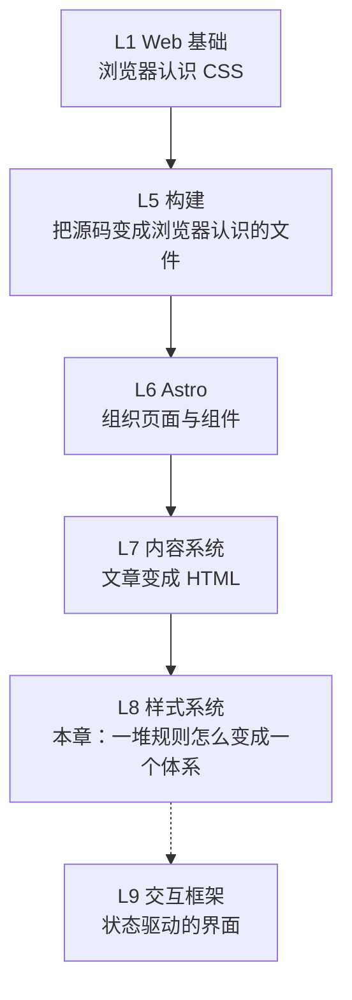
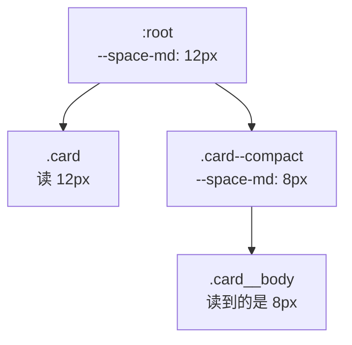
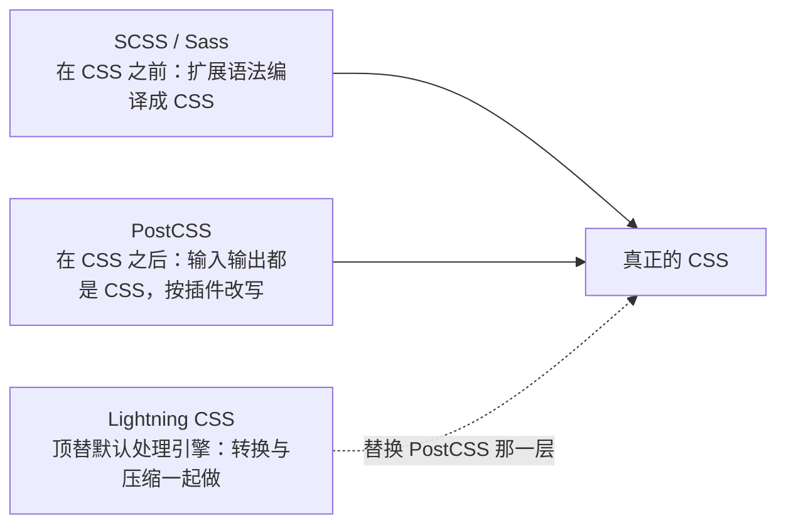
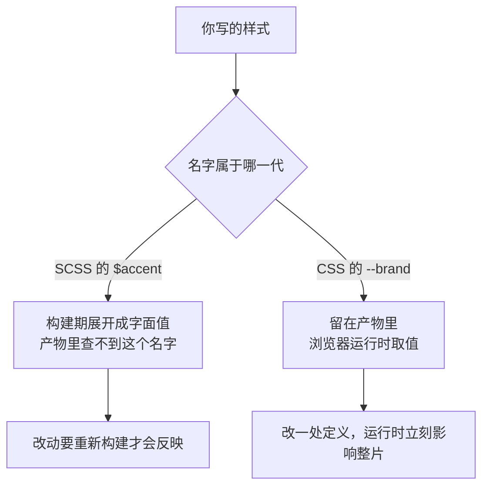
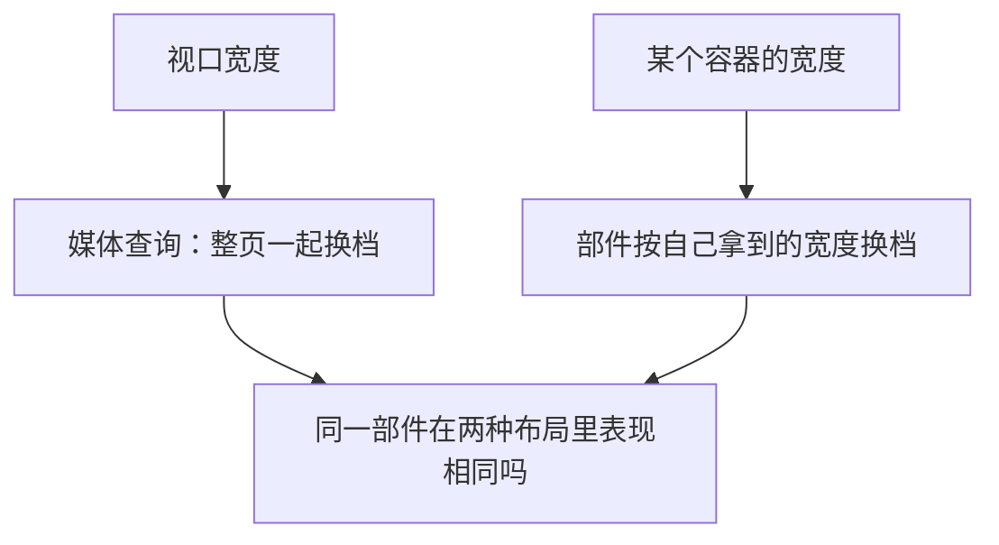
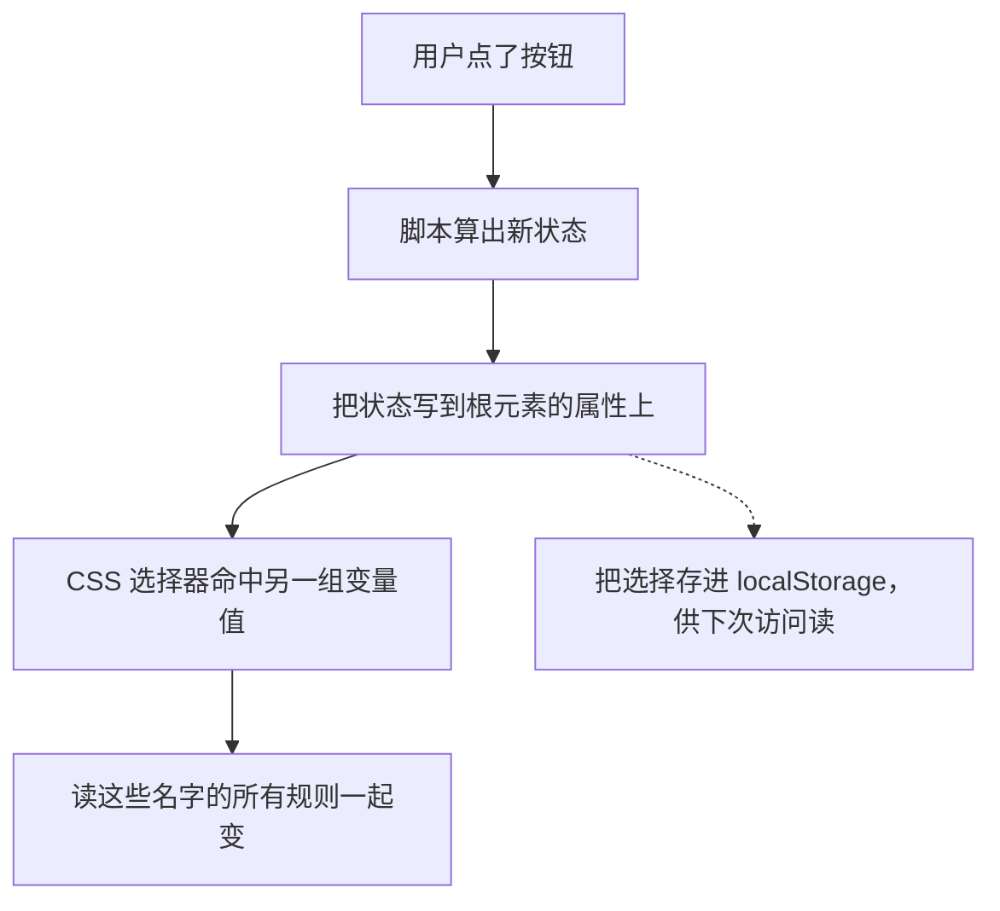
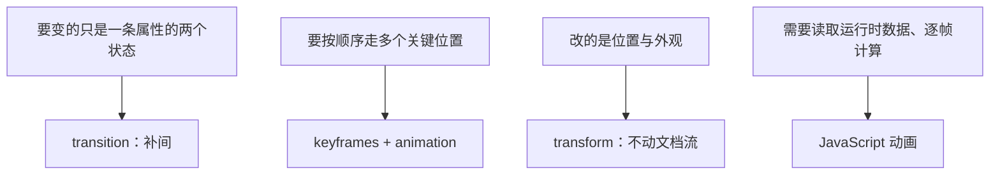
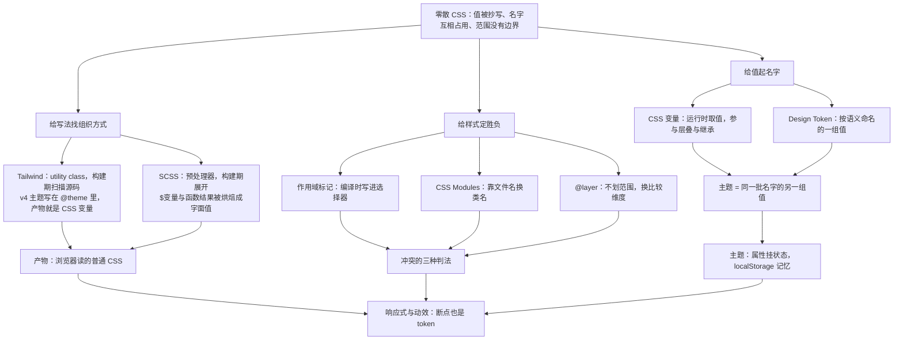

## 本章导读

你让 AI 把网站的蓝色换成另一种蓝。它回了一句“I've moved the palette into CSS variables and updated the components to use them”，然后项目里多出几行 `--color-primary`，几十个文件里的 `#3b82f6` 不见了。你打开浏览器，颜色确实变了。但你大概会卡在一个问题上：**它到底做了什么？** 那些 `--` 开头的东西是 JavaScript 变量吗？为什么改一处，整片界面都跟着改？为什么同一个项目里有的样式写在 `.css` 里、有的写成一长串 class、还有几个文件是 `.scss`，浏览器明明只认 CSS？

这一章讲的就是这套安排，它要兑的是第六章的两张欠条。6.2.3 讲样式在构建里有三件事——合并、转换、边界——关于转换它留了一句「至于由哪个部件来做、能不能做，取决于配置，那属于第九章」；关于边界又留了一句「把样式限定在某个组件里，不让它污染全局——这件事有专门的机制，属于第九章的内容」。两句话加起来正好是本章的范围：一个项目的样式怎么被组织、复用、约束，最后怎么变成浏览器读到的那批 CSS。

要先把话说清楚，免得走偏：这一章不是 CSS 语法续集。选择器、盒模型、Flexbox、Grid、`position`、层叠与优先级、媒体查询，第二章都讲过了（2.3 到 2.6）。本章默认你会用它们，讲的是**另一层问题**：当项目里有三十个文件、几百条规则、五六个人同时改的时候，光「会写 CSS」不够用。

还有一条边界要提前定好。第〇章 0.5.1 说过这十三层不是严格的依赖链，这句话在这一章同样成立：样式系统不需要交互框架。Tailwind 扫描文件里的字符串，SCSS 在构建期编译成 CSS，CSS 变量由浏览器运行时解析——三件事都不要求页面里有框架组件。本章所有实测都是在一个没有任何框架组件的 Astro 项目里跑出来的。

## 本章在技术栈中的位置



上面这条线是全书的位置：这一层在内容之后、交互框架之前。它上面的一切都已经把「浏览器要读的那份 CSS」交到你手上了——第六章管抽取、合并、压缩，第七章管给组件样式加作用域标记，第八章管把内容渲染成 HTML；这一层管的是这些 CSS 应该由什么组成、名字从哪来、谁能改谁。

`L9` 那条虚线是刻意画成虚线的：样式系统不依赖交互框架，很多网站从来没有框架组件也照样有一整套设计体系。反过来倒成立——页面里有了框架组件之后，样式多了两种新麻烦（组件的样式怎么带进去、状态变化怎么反映到外观上），那部分留给第十章。

本章要回答的问题可以排成一条链，后面各节就是沿着它往下走的：

```text
零散 CSS（值抄几十遍、名字随口起、谁都能碰谁）
  ↓ 值要有名字        CSS 变量、设计令牌（9.2、9.3）
  ↓ 名字活在哪个阶段   构建期写死，还是运行时解析（贯穿全章）
  ↓ 写法要组织        utility class 或 SCSS（9.4、9.5）
  ↓ 范围要有边界      Global / Scoped / Component / Module（9.6）
  ↓ 再叠上场景        响应式、主题、动效（9.7、9.8、9.9）
```

这条链就是本章的走法，括号里是对应的小节。它不是又一张关系图：每一格都要等你读完相应小节才兑现得了，所以放在位置图之后当目录用。

## 读完本章，你应该能看懂

- “Move this value into a CSS variable.”
- “Use a design token instead of a hard-coded hex.”
- “Convert these styles to Tailwind utilities.”
- “Add a responsive variant so it stacks on mobile.”
- “Extract these repeated classes into a component.”
- “This SCSS variable is resolved at build time, so the theme can’t change at runtime.”
- “Use scoped styles so this component doesn’t leak its CSS.”
- “Add dark mode styles with `prefers-color-scheme` and remember the choice in `localStorage`.”

这八句的共同点是：它们说的都不是「这个页面长什么样」，而是「这个项目里样式的**来源和边界**应该怎么安排」。同一句 「把颜色抽出来」 可能意味着三种完全不同的改动：在 CSS 里加一组自定义属性、在 SCSS 里加一个 `$` 变量、或者改 Tailwind 的主题。前两者一个留在运行时、一个在构建期就被吃掉，第三种会决定产物里生成哪些 class。AI 说出口时都只有十个词，落到项目里是三套不同的东西。

---

## 9.1 样式系统

一个项目的样式，早期都是一路「抄」出来的：这段看着顺眼，把背景色复制过来；那个间距合适，宽度也照抄。到第十个文件的时候，同一个蓝色在项目里出现了四十七次。样式系统不是某个工具的名字，它是为解决这类局面而存在的一整套安排：值叫什么、写法从哪来、影响范围到哪为止。

这一节先把三件事分清楚，后面八节各自展开其中一件。

### 9.1.1 Style System 是什么

**样式系统（Style System）** 是一个项目里关于样式的约定的总和：有哪些可用的值、这些值叫什么名字、规则怎么写、写在哪儿、能影响到哪一片页面。它不由某个库提供，也不体现在某一个文件里——你看一个项目的 `src/styles`、它的 CSS 变量清单、它的构建配置、它的 class 命名习惯，才能把这个体系读出来。

这个概念容易被误解成「用了 Tailwind 就有了样式系统」或者「建了一份设计令牌（Design Token）文件就有了」。设计令牌说的是给颜色、间距这类设计决定起一个可复用的名字，9.3.1 正式展开。倒过来更准确：样式系统解决的是「改动是否可控」。一次改动需要碰多少个文件、会不会误伤别处、改完之后各处是否还长得一样——这三个问题的答案，就是这个项目样式系统的实际形状。工具只是给答案的一种手段。

回指第二章：那一层告诉你「这条规则会生效吗、谁压过谁」，是**语言规则**；这一层告诉你「这些规则应该怎么摆放」，是**工程安排**。同一段 `color: #3b82f6`，第二章关心它能不能被覆盖，本章关心它为什么抄了四十七遍、该不该有个名字。

### 9.1.2 为什么大型项目不能随意写 CSS

随意写 CSS 的代价不是「不好看」，而是**改不动**，以及**改一处坏多处**。三类具体问题各有来源。

**第一类：值被抄写。** 一个颜色、一个圆角、一个字号，写死在每条规则里时，它就是四十七个互不相干的字面量。设计要求「主色深一点」，就得改四十七处，而且没人能保证四十七处一次改齐——漏掉两处不会报错，只会让人后来觉得「这两块颜色怎么不一样」。这类问题有专门的解法，就是 9.2 那一节：给值起名字。

**第二类：靠名字维系的约定守不住。** CSS 的选择器是全局的：任何文件里的 `.card` 都是同一个类。项目一大，名字开始互相占用，两个人各自写了 `.card`，谁也没想过要避让。第二章 2.3.7 讲过优先级怎么决定谁赢，但优先级解决不了「本来就不该撞」。这类问题的解法在 9.6：让样式的**影响范围**有边界，而不是靠事后比谁写得狠。

**第三类：同一件事有四种写法。** 一部分样式在 `.css` 里，一部分是 HTML 上的 class，一部分在 `.scss` 里，还有一部分是 HTML 元素上的 `style` 属性。它们最终都会变成浏览器读到的 CSS 声明，但**处理阶段不一样**：SCSS 的变量在构建期就被替换掉，CSS 自定义属性留在运行时由浏览器解析，内联样式则直接附着在元素上（第三章 3.5.3 讲过脚本也能改它）。同一个项目里混着放，代价是「改一处颜色到底该改哪个文件」变成了需要经验才能回答的问题。

> **AI 可能会说：**
>
> “These buttons all repeat the same styles — let’s extract them into a shared class / component.”
>
> **翻译成人话：**
>
> 它看到同一段外观在多处重复，准备把这些声明搬去一个共同的名字下面，然后让各处引用这个名字。它赌的是「以后要改的是这段外观整体，而不是某一处」。

搬成 class 还是搬成 CSS 变量，不是一回事：class 搬的是**一整组声明**（谁符合这个条件），变量搬的是**单个值**（这个值叫什么）。这个区分看起来细，但它决定了 AI 改完之后你能不能只动一处就换掉颜色——9.2 和 9.3 会把它说透。

### 9.1.3 一致性与复用

样式系统的两个收益经常被并成一句「可维护」，其实它们在拉不同的方向。

**一致性**要求同一个设计意图在项目里只有一个来源。它的实现方式是「给值一个名字，然后各处都读这个名字」：名字改一次，读它的地方全变。这是 CSS 变量、设计令牌、Tailwind 主题共同的立足点，也是本章 9.2、9.3、9.4.6 三处的核心论证。

**复用**要求同一段样式描述只写一遍。它的实现方式是「把一组声明收进一个可引用的东西里」：可以是一个 class，可以是 SCSS 的 mixin（9.5.5），可以是框架组件的样式，也可以是一串 utility class 的组合（9.4.3）。

两个方向会打架，这一点值得提前知道。**过度复用会伤一致性**：如果为了少写几行，把「卡片」和「提示框」并成一个 `.box`，那么当设计希望它们长得不一样时，这个共用名字就成了阻碍——改它会影响两者。反过来，**只追一致会造成滥用**：把 `--color-primary` 当成「凡是蓝色的地方都用它」，那么将来想让某个按钮换个蓝，就得先拆开一段历史。这类取舍没有工具能替你做。

工具的选择也照这条链看。本章后面三条路线——原生 CSS 加变量（9.2、9.3）、Tailwind（9.4）、SCSS（9.5）——**不是三选一的路标**，而是三种互补的压缩方式：前一种给值起名字，第二种给声明组合起名字，第三种给写 CSS 这件事本身加抽象。真实项目里常见的是混用：变量做主题底座，Tailwind 处理布局与间距，某几个历史目录留着 `.scss`。看到混合状态不等于项目「乱」，需要问的是这三处各自管到哪一层。不过要记下 Tailwind 官方并不推荐把预处理器叠在它上面：兼容性那一页明写 “Tailwind CSS v4.0 is a full-featured CSS build tool designed for a specific workflow, and is not designed to be used with CSS preprocessors like Sass, Less, or Stylus”，接着还有一句更直的 “Think of Tailwind CSS itself as your preprocessor”，理由是嵌套、变量、厂商前缀、打包导入这几件事它自己已经做了。所以「混用」是一种存在的项目状态，不是一种推荐做法：读到 Tailwind 与 Sass 并存时，该问的是那批 `.scss` 究竟还在做哪一件 Tailwind 已经做掉的事。

---

## 9.2 CSS Variables

样式系统要解决的第一件事，是**让值有名字**。浏览器其实早就提供了一层原生能力做这件事：CSS 自定义属性。它不是构建工具的功能，不是框架的功能，也不是 Sass 的功能——它是 CSS 这门语言自己的特性，因此它在浏览器运行时仍然有效，这一点决定了本章后面所有的对比。

### 9.2.1 Custom Property

MDN 给这个特性的定义可以直接用作工作定义：“Custom properties (sometimes referred to as CSS variables or cascading variables) are entities defined by CSS authors that represent specific values to be reused throughout a document.”（自定义属性，有时也叫 CSS 变量或层叠变量，是由 CSS 作者定义的、代表某个值以便在整个文档里复用的实体。）

它的写法有两个部分：定义时用两个连字符开头的名字，读用时用 `var()`。

```css
:root {
	--color-primary: #3b82f6;
}

.button {
	background-color: var(--color-primary);
}
```

需要看懂的是三件事。第一，`--color-primary` 是**属性的名字**，不是某个库的语法；第二条规则里的 `var()` 读它。第二，这一对可以出现在同一个文件，也可以隔三个文件、隔四层目录——它们的关系不靠 import，靠的是**元素在文档树里的位置**。第三，名字区分大小写：第二章 2.3.3 结尾提醒过「自定义属性（`--my-color`）和类名是区分大小写的」，写成 `--Color-Primary` 就是另一个属性。

它不是 JavaScript 变量。这是本章最容易长错的一层认知，要单独说明。一个 JS 变量活在一个执行环境里，读它的是代码；一个 CSS 自定义属性**活在层叠里**，它没有「被赋值的那一刻」，只有「在这个元素上按层叠规则算出来是什么」。MDN 那句定义里带着“cascading variables”这个别名，同一页正文写得更直接：custom properties “subject to the cascade and inherit their value from their parent”（受层叠支配，并且从父元素继承它们的值）。

这三个后果是本章后面反复要用到的：

- 它参与层叠：同一名字可以在不同选择器上给不同值，谁生效按第二章 2.3.7 判。
- 它会被继承：在祖先上定义一次，整棵子树都读得到——这就是 9.2.4 局部变量的原理。
- 它晚到运行时：浏览器解析样式时才取值，所以换主题只要换名字上的值。

第三条正是它和 SCSS 变量分岔的地方，9.5.3 会拿同一份产物对照。

### 9.2.2 `var()`

`var()` 的作用只有一个：在这里插入某个自定义属性当前算出来的值。

```css
.card {
	border-color: var(--color-primary);
	padding: var(--space-md, 12px);
}
```

第二行给出的是**回退值（fallback）**：当 `--space-md` 在当前元素上算不出值（没定义，或者定义在一个不会继承到它的元素上，见 9.2.4）时，用逗号后面那个值。这个形状在真实项目里承担一个具体用途——**新变量先带个默认值上线**，不至于因为漏定义就让整片布局塌成默认。

三处容易被 AI 生成代码绕进去的地方，先记下：

`var()` 只能出现在**属性值**里，不能出现在选择器里，所以「用变量拼出一个 class 名」这种想法在 CSS 里不成立。第二，`var()` 取到的是一段未解析的文本，浏览器把它塞进这个属性值再按该属性的规则校验；因此把 `--gap: 4px 8px` 用在 `gap: var(--gap)` 上可以，而把同一个值用在 `width` 上就整条声明无效。第三，如果这个属性自己也没值、又没有回退，这条声明直接无效——表现是「这条样式没生效」，不是构建失败。排查时回到第二章 2.9.1 那条教训：看解析之后的结果，别只看源文件。

这一节不需要更多语法。要紧的只有一句：`var()` 让「值」和「使用值的地方」之间有了引用关系，而这个关系要到浏览器算样式的时候才落地。

### 9.2.3 全局变量

自定义属性写在哪个选择器上，决定了谁能读到它——因为它靠继承传播。挂在 `:root`（也就是文档根元素）上，等于挂在全树顶端，所有元素都读得到：这就是本章通称的「全局变量」。

```css
:root {
	--color-primary: #3b82f6;
	--space-md: 12px;
	--radius-card: 12px;
}
```

本章 lab 里这条路径有直接的产物证据。9.8 那个页面源码里写的是 `:root { color-scheme: light; --bg: #ffffff; --fg: #111111 }`，构建后变成 `:root{color-scheme:light;--bg:#fff;--fg:#111}`——`color-scheme` 是源码里本来就有的，压缩器只是把值缩短、把空白去掉，`.theme-page{background:var(--bg)}` 也还在。要注意的是这两件事同时发生：**值被压缩器改写过形态**（六位十六进制缩成三位、空白去掉），但**名字和 `var()` 引用原样保留**，没有任何预处理器把 `--bg` 这个名字吃掉。换句话说，这些名字到了浏览器手里还在，运行时才定值——这才是本节要用的那条结论。

在 Astro 项目里还有第二条常见入口，是 9.2.4 那条「局部」的对称面：Astro 组件的 `<style>` 里可以直接读页面上任何已有的自定义属性，官方文档的说法是 “The Astro `<style>` can reference any CSS variables available on the page. You can also pass CSS variables directly from your component frontmatter using the `define:vars` directive.”（`define:vars` 把组件脚本里算出来的值传成样式能用的变量。）这条路径把「模板算出来的数据」接到了 CSS 变量上，但它不改变自定义属性的运行时性质——`define:vars` 只是把值挂到一个变量上，读它的仍然是浏览器。

什么时候值得用全局变量？判据不是「被用了几次」，而是**它是不是一个全站的设计决定**：主色、正文色、间距步进、圆角、层级。反过来说，一个只在某个卡片里有意义的尺寸挂到 `:root`，就是在给全局命名空间添一次占用——这类做法的代价，正好由 9.6.5 的样式冲突那一节收。

### 9.2.4 局部变量

把定义的位置往下挪一层，作用域就跟着变窄：写在某个容器上的自定义属性，只有那棵子树读得到。

```css
.card--compact {
	--space-md: 8px;
}

.card__body {
	padding: var(--space-md);
}
```

这两行合起来是主题化与组件化的共同底座：`--space-md` 的名字在全局仍然只有一个，但它在这个卡片里的值被局部覆盖了，而且只有这棵子树里的 `.card__body` 读到新值。这就是 9.2.1 里「参与层叠 + 会被继承」两条性质合起来的效果。



图里要看的不是四个框，而是那条**从祖先往下传的线**：值不需要往下复制，读的时候自然找到最近的定义。这跟 JavaScript 里沿作用域往上找变量更像，跟「构建时做一次文本替换」完全不像——这个「像与不像」的分别是 9.5.3 的全部内容。

局部变量还有一个不太显眼但很有用的性质：**它是运行时可以改的**。脚本可以改一个元素上的自定义属性，浏览器随后重算这棵子树的样式；这比逐个改元素的样式属性（第三章 3.5.3 那种写法）要小得多的一次改动，作用面却更大。本章的实测项目里没有引入任何框架组件，9.8 的主题切换也只用了一段脚本改一个属性——「改一个值换一片外观」这件事不需要任何交互框架支持。

### 9.2.5 Theme

**主题（Theme）** 这个词在样式语境里有一个很具体的意思：一组自定义属性在同一批元素上取的一组值。深色主题不是「一套新的 CSS 文件」，而是「同一批名字，另一组值」。这是 CSS 变量给主题化带来的最实际的简化：页面上成百条规则里读的都是 `--bg`、`--fg`、`--color-primary` 这些名字，换主题时一条规则都不用改，只要让这批名字换一组值。

```css
:root {
	--bg: #ffffff;
	--fg: #111111;
}

:root[data-theme="dark"] {
	--bg: #0b0b0f;
	--fg: #f3f3f5;
}
```

这两块放在一起才是「主题」的完整形状：同一批变量名，两组值，由某个条件（这里是元素上的一个属性）决定当前取哪一组。9.8 会把这三样各自展开——两组值怎么组织（9.8.1、9.8.2）、由系统还是由用户决定取哪组（9.8.3）、决定之后把结果挂到哪里（9.8.4）。

> **AI 可能会说：**
>
> “The palette is duplicated across components — I’ll expose it as CSS custom properties on `:root`.”
>
> **翻译成人话：**
>
> 它打算把重复的色值集中成一组带名字的自定义属性，挂到全树顶端，各处改成读这些名字。以后换配色只改一处定义。
>
> **实际发生的是：**
>
> 值的**所有者**换了。以前每个组件各自持有一个色值，现在组件只持有一个名字。这件事在构建产物里看得很清楚：色值集中出现在 `:root` 的变量块里，组件的规则变成一串 `var(...)`。

需要提醒一处名字撞车，本章后面会遇到两次“Theme”。这一节讲的是**机制**——一组变量取一组值；9.4.6 讲的是 Tailwind 把主题存在哪（当前是 CSS 里一个 `@theme` 块，它决定的是「项目里有哪些 utility」）；9.8 讲的是**落地场景**——深浅色、切换与记忆。同一个词在三处指的是不同的东西，读到「改 theme」时先问它在说哪一层，这也是本章反复练习的那个动作。

---

## 9.3 Design Tokens

给值起名字这件事，9.2 用 CSS 自定义属性做了一遍。但「名字」本身是有讲究的：一个名字可以只描述**这个值长什么样**（`--blue-500`），也可以描述**它在这里是干什么的**（`--color-primary`）。后一种命名的集合，行业里有一个共同的名字。

### 9.3.1 Token 是什么

**设计令牌（Design Token）** 是把设计决定——颜色、间距、圆角、字号、阴影、时长——从它的具体数值里抽出来，用一个可复用的名字代表。它描述的是「这个界面里主要操作的颜色」，而不是「`#3b82f6`」。

这三层关系是本章会反复用到的一个形状：

```text
具体值      #3b82f6
↓ 命名
语义名      --color-primary
↓ 使用
界面各处    background-color: var(--color-primary)
```

有了中间那一层，改动就分成两种性质：**这个语义本身要换**（主色不再用蓝色）只改一处定义；**这一处不符合体系**（某个按钮不该用主色）改那个元素引用的名字。这两种情况在没有 token 的世界里长得一模一样，都是「改一行样式」。

代价也要如实说：token 多一层间接。读代码的人看到 `--color-primary` 得先找到定义才知道它是什么颜色；体系越大，「这个语义到底该不该用在这里」越需要约定和文档。这也是为什么本章只讲到「为什么需要给值起名字、命名要按语义而不是按外观」这一层，再往上的 token 体系怎么分类、怎么跨端交付，属于设计体系的专门话题。

### 9.3.2 Color Token

颜色是最先被 token 化的一类值，因为它数量最多、也最容易抄来抄去。实践中有两套命名法并存，读 AI 代码时得先分辨它在用哪套。

一套是**色阶名**：把一色相拆成一串明度台阶，命名成 `--color-blue-50` 到 `--color-blue-900`。它的好处是「同一色相的深浅关系」是显式的，做 hover、禁用、边框这些派生状态时可以直接取相邻一档。本章 lab 里 Tailwind 生成的产物就是这一套：`:root,:host{…--color-cyan-700:oklch(52% .105 223.128);--color-white:#fff…}`。

另一套是**语义名**：`--color-primary`、`--color-danger`、`--color-surface`、`--color-text-muted`。它说的是「这个界面里这个角色用什么颜色」。

两套通常不是替代关系而是叠着用：色阶名做原料，语义名做接口，语义指向色阶。这样换主题时只动语义那一层的指向，原料一整套留着。看到 AI 直接把 `--color-blue-500` 用在一堆按钮上时，要问一句：**这个项目有没有语义那一层？** 有，说明它打算以后换主色；没有，说明这次改动只是把重复的字面值集中了一下。

### 9.3.3 Typography Token

字号、行高、字重常被当成三个独立的值，实际它们**必须成组**。原因很具体：一个字号离开配套的行高就没有意义，正文 16px 配 1.5 和标题 24px 配 1.5 是两种不同的东西。

Tailwind 的产物把这件事演示得很直接。本章 lab 里写了一个 `text-2xl`，产物给了两条变量和一条把它们用上的规则：

```css
:root {
	--text-2xl: 1.5rem;
	--text-2xl--line-height: calc(2 / 1.5);
}
.text-2xl {
	font-size: var(--text-2xl);
	line-height: var(--tw-leading, var(--text-2xl--line-height));
}
```

需要看懂的是那个 `--text-2xl--line-height`：行高是作为这一档字号的一部分被定义的，用了这个字号就自动带上配套行高，除非显式覆盖。这是「token 成组」的最好例子——一个设计决定不是一个值，而是一组互相约束的值。

### 9.3.4 Spacing Token

间距的 token 化通常做成**步进（scale）**：不是一堆零散的 `8px`、`14px`、`22px`，而是一个基准单位乘以整数。Tailwind 的做法在产物里一眼能看出来：

```css
:root {
	--spacing: 0.25rem;
}
.p-6 {
	padding: calc(var(--spacing) * 6);
}
```

`p-6` 不是“24px”的别名，而是「基准单位乘 6」。这条写法把「间距体系」这件事写进了产物本身：调整基准值，全站间距按同一比例缩放；某个地方要一个不在步进上的数，是显式破坏步进，会留下痕迹。这类痕迹正是评审时该看的——它意味着有人在这里偏离了体系，该问一句为什么。

### 9.3.5 Radius 与 Shadow

圆角和阴影是「质感」那一层的值：单看没意义，成组看才是一套设计。它们的 token 化通常取名字化 + 少数几档的形状（比如 `--radius-sm/md/lg`、`--shadow-xs/sm/md`），并且常常被**组合进更高层的 token**——一个「卡片」的外观，其实是圆角、阴影、内边距、背景色四个 token 的一次搭配。

Tailwind 官方给「把这些搭配写成可复用样式」留了一个正式位置：在 `@layer components` 里写一个组件类，类里读 token。这里的 `@layer` 是浏览器自己认识的分层语法，用来给样式分组、决定谁跟谁比——它和「把样式圈在组件里」不是一回事，机制放在 9.6.5：

```css
@layer components {
	.card {
		background-color: var(--color-white);
		border-radius: var(--radius-lg);
		box-shadow: var(--shadow-xl);
	}
}
```

这一格真正要留下的判断是：圆角和阴影本身不是设计决定，「哪几档是允许用的」才是。所以这类 token 的价值不在封装 `12px`，而在把「只能用这三档」这件事变成可读的约定。

### 9.3.6 Token 与 CSS Variables

两件事经常被并成一句，实际上分工不同。

**Token 是命名约定**：它说的是「这个项目里有哪些设计决定，它们叫什么」，是一种文档性质的东西——它可以被落在 CSS 变量里，也可以被落在构建期的常量、一个 JSON 文件、或者某个框架的主题配置里。CSS 自定义属性是浏览器运行时的机制：它负责层叠、继承和取值。

两者的接点很直白：token 需要一种「在 CSS 里能被引用」的落地形式，自定义属性就是这一种。9.2.4 讲的局部覆盖同时也是 token 的局部豁免手段——某个元素确实需要破例，就在它或它的祖先上重新定义那个名字，而不是新写一条更狠的选择器。

Tailwind 把这三者的关系说得最干净，留到 9.4.6 用官方原话展开一次：它把 token 存在**主题变量**里，而主题变量本身就是 CSS 变量。

---

## 9.4 Tailwind CSS

样式系统的第二条路线，不是给值起名字，而是**给声明的组合起名字**——而且这个「名字」由工具生成，不由人命名。这一节是本章第二大核心，也是本章最容易因为版本变化而写错的一节。

### 9.4.1 Tailwind 是什么

官方定义句很朴素：“You style things with Tailwind by combining many single-purpose presentational classes (utility classes) directly in your markup”（用 Tailwind 写样式，就是在你写的标记里组合许多只管一件事的展示型类）。

它和普通 CSS 的差别不在「用了什么语言」，而在**谁写规则**：普通 CSS 里规则由你写、由你命名；Tailwind 里规则是一批预先定义好的小类，你的工作变成在元素上组合它们。所以「Tailwind 是不是一堆缩写 class」这个说法只描述了它的表面，没说明它的立场：把「这段元素长什么样」的答案留在元素旁边，而不是搬到另一个文件里靠命名去对应。

当前版本是 Tailwind CSS v4（本章写作时 npm 上最新为 4.3.3），在 Astro 里的接入方式是这样的：装 `tailwindcss` 与 `@tailwindcss/vite`，把插件挂进 Vite 配置，然后在一份 CSS 入口文件里写一行 `@import "tailwindcss";`。本章 lab 按这条路跑通，构建退出码 0，**项目里没有任何 `tailwind.config.js`，也没有 `postcss.config.*`**，样式产物是一个 5,522 字节的 CSS 文件（这是本章这次构建的数字，你的项目大小会随用到的类数量变）。

这里必须做一次断代，因为旧形状在 AI 输出里仍然常常见到——旧项目都在那里，模型见过的手写样式也大多是那一代。要分两类看。

**JavaScript 配置**：官方原话是 “JavaScript config files are still supported for backward compatibility, but they are no longer detected automatically in v4.”（仍然为向后兼容而支持，但 v4 不再自动检测它们。）也就是 `tailwind.config.js` 与里面的 `content: [...]`、`theme.extend` 读得懂、可用，但要入口 CSS 里显式写一行 `@config` 才生效，**不加载时一声不响**（9.4.6 给实测）。

**`@tailwind` 三行**：这一类不是「需要显式加载」，官方升级指南给它的小节标题就是 “Removed @tailwind directives”——v4 用一句普通的 `@import "tailwindcss"` 取代那三行。所以 AI 若给你 `@tailwind base; @tailwind components; @tailwind utilities;`，正确的判断不是「再配一下就好」，而是**入口写错了代**，产物里几乎不会有东西（9.4.6 第三行实测）。

> **AI 可能会说：**
>
> “I’ve added `tailwind.config.js` with your brand colors and set `content` to scan your components.”
>
> **翻译成人话：**
>
> 它按 v3 的习惯建了一份 JavaScript 配置，把品牌色写进去，并声明要扫描哪些文件。
>
> **实际发生的是：**
>
> 这份配置在当前默认管线里**不会被自动读取**。要么按 v4 的做法把颜色写进入口 CSS 的 `@theme` 块，要么显式加一行 `@config` 指过去。听到这句话，要回去确认项目里装的是 v3 还是 v4——配置文件的形状和主版本必须对上，对不上就是「写了但不生效」。

### 9.4.2 Utility Class

一条 utility class 只做一件事。`p-6` 只设内边距，`flex` 只设 `display`，`rounded-xl` 只设圆角。它们不是简写，每条在产物里都对应一条真实的 CSS 规则。

从本章 lab 的产物里挑三条出来，可以看清这层关系：

```css
.bg-brand {
	background-color: var(--color-brand);
}
.p-6 {
	padding: calc(var(--spacing) * 6);
}
.text-2xl {
	font-size: var(--text-2xl);
	line-height: var(--tw-leading, var(--text-2xl--line-height));
}
```

三条都是普通 CSS 规则：一个选择器，一组声明。`:`、`[` 这类字符可以出现在选择器里（伪类、属性选择器就是靠它们），但不能直接当作类名的一部分来用，所以产物里把它们转义了——你在 HTML 里看到 `hover:underline`、`md:flex`，在 CSS 里对应的是 `.hover\:underline`、`.md\:flex`。看到反斜杠不用慌，那是名字的组成部分。

「class 为什么这么多」是这一层最直观的疑问。一个卡片元素上挂七八个类是常态：宽度、内边距、圆角、背景、阴影、边框、暗色下的颜色各一条。原因是这套办法的粒度就是一条一个事实——它拒绝把七件事预先打包成一个 `.card`，因为打包之后，任何一个卡片想只改其中一件就得再加一个类或写覆盖规则，而那些「只改一件」的需求最后还是得各自占一个名字。所以 utility 的写法是把「组合」这一步交到了每个元素上，代价是标记变长（9.4.3 谈这笔账）。

### 9.4.3 Utility-first

Utility-first 的立场可以写成一句问题：为什么有些项目宁愿在标记里组合现成的小类，也不愿为每个小样式新建一个 CSS 选择器？

因为新建选择器要付三笔成本：起一个不撞车的名字（在 CSS 里全局不撞名，见 9.6）；把这条规则放对文件；以后读代码时从元素跳到样式表再跳回来。这三笔成本在每个新样式上都付一次，且第二笔是长期负担——名字是全局的，两年后没人记得 `.card-title-inner` 为什么存在。Tailwind 的选择是：这三笔不付了，改为在标记里把外观直接写清楚，读元素的时候就读到全部样式。

一句常见误解要当场挡住：这不等于内联样式。官方先承认「在某种意义上确实是」，再给出区别：“using inline styles, every value is a magic number. With utilities, you’re choosing styles from a predefined design system”（用内联样式，每个值都是凭空写的数字；用 utility，你是在一套预定义的设计体系里挑）。这条区别恰好接上 9.3：凡是带值的那一类 utility，名字背后都指向一个 token（产物里的 `var(--spacing)`、`var(--text-2xl)` 就是证据），而 `style="padding: 24px"` 不指向任何东西。

Utility-first 也不是「永远不写自己的 CSS」。官方明确留着口子：“While Tailwind is designed to handle the bulk of your styling needs, there is nothing stopping you from just writing plain CSS when you need to”（见 9.4.7）。把它读成「用了 Tailwind 就不许写 CSS」是把工具的策略当成了规则。

> **AI 可能会说：**
>
> “These same five utilities are repeated on twelve cards — extract them into a component.”
>
> **翻译成人话：**
>
> 它看到同一串类组合反复出现，准备把这串组合固定下来：要么抽成一个组件，要么写成一个自己的 class。它赌的是「以后这一组会一起变」。
>
> **实际发生的是：**
>
> 复用的单位从「一条声明」升到了「一组声明」。这不违背 utility-first——重复的是**组合**而不是**值**，值仍然来自同一套 token。要留意的反而是第二种做法：如果它为此新写了一个 CSS class，那需要确认这个新名字会不会和别处撞（9.6.5）。

### 9.4.4 Responsive Variant

Tailwind 里响应式不是一个子系统，而是给任何 utility 加一个**条件前缀**的机制。官方对断点体系的定位是一句：“Tailwind uses a mobile-first breakpoint system”，并且未加前缀的类在所有宽度都生效，加前缀的只在断点及以上生效。

```html
<div class="flex flex-col md:flex-row gap-4"></div>
```

读这三段的顺序就够：默认是窄屏的样子（上下堆叠），到 `md` 及以上换成横排。这正是第二章 2.6.2 那套媒体查询在写法上的另一种组织：不是「先写宽的，再在窄屏覆盖」，而是「先写窄的，再往宽加条件」。

产物形状能印证这个「前缀即条件」。本章 lab 的页面里写了 `md:flex`，构建后 CSS 里出现的是一条真媒体查询：

```css
@media (width >= 48rem) {
	.md\:flex {
		display: flex;
	}
}
```

两处要注意。一是 `width >= 48rem` 是媒体查询的**范围写法**（Media Queries Level 4 语法），不是旧式 `min-width: 768px`；它读起来更像条件本身，但依赖较新的浏览器语法支持。二是 `48rem` 这个数从哪来——断点本身是 token，官方给的是用 `--breakpoint-*` 主题变量定制。也就是说 9.3 那条「值要有名字」在这里同样成立，只不过名字管的是宽度阈值。要注意它和颜色那一族的差别：这一族名字到构建期就被展开成媒体查询里的字面量，产物里查不到 `--breakpoint-*`，运行时覆盖它没有意义（9.7.1 再展开）。

> **AI 可能会说：**
>
> “Add a responsive variant so this grid stacks on small screens.”
>
> **翻译成人话：**
>
> 它准备给某个已有类加一个宽度条件前缀，让窄屏用默认样子、宽屏用新样子。改动就在 class 上，不需要新增 CSS 文件，也不需要想名字。
>
> **实际发生的是：**
>
> 产物里多出一条带媒体查询的规则。要看的是前缀的方向对不对：`md:` 是「md 及以上生效」，窄屏那一档由没前缀的那条兜住，所以想反过来只在窄屏生效，需要另一种写法（9.7.3）。宽屏时两条都会命中同一个元素：不冲突的属性各自生效，冲突的那个由后生效的那条赢（9.7.2 展开）。

### 9.4.5 State Variant

同一套前缀机制也用来表达**状态**。官方的说法是一条通用规则：“Every utility class in Tailwind can be applied conditionally by adding a variant to the beginning of the class name that describes the condition you want to target.”（每一条 utility 都可以通过在类名前加一个描述条件的 variant 来按条件生效。）

```html
<button
	class="bg-brand text-white hover:bg-brand/90 focus-visible:outline-2"
></button>
```

这一节只讲三件事的边界。第一，`hover:`、`focus:`、`focus-visible:`、`disabled:`、`open:`、`group-hover:` 这些前缀在产物里都变成普通的选择器或条件规则——lab 产物里的 `hover:underline` 就编译成 `.hover\:underline:hover{text-decoration-line:underline}`。第二，第三章 3.5.3 讲过「样式写在样式表里，JavaScript 只负责切换状态」，第二章 2.1.1 也定过「外观归 CSS 管」——这里就是那句话的自动化：状态写在 class 上，浏览器自己判断什么时候用哪条规则，不需要脚本去 `classList.toggle`。第三，v4 的 hover 行为改过，这是本章「旧教程不能照抄」的又一处实证：官方写明 “In v4 we've updated the hover variant to only apply when the primary input device supports hover”，产物里 `hover:underline` 被包在 `@media (hover: hover)` 里。这个改动会让「靠触屏点按触发 hover 效果」的旧设计失效，而且不报错。

`dark:` 也是这套前缀机制里的一个，它是 9.8 主题那一节的入口之一，这里只登记位置。

### 9.4.6 Theme

Tailwind 的主题这一格，是本章第二条主线（值→名字→体系）与第二条路线（utility）的接点。官方对这个特性的定位可以整段引下来：“These low-level design decisions are often called design tokens, and in Tailwind projects you store those values in theme variables.” 以及：“Theme variables are special CSS variables defined using the `@theme` directive that influence which utility classes exist in your project.”

这里有一个初学者容易漏掉的层次：主题变量不只决定值，它决定哪些 utility 存在。定义了 `--color-mint-500`，`bg-mint-500`、`text-mint-500`、`fill-mint-500` 这些类才成立；没定义，就没有这些类。这与 v3 时代「主题在 JS 配置里，产物里是一堆写死的值」有性质差别。

本章 lab 的产物把这条链看得很清楚。在入口 CSS 里写：

```css
@import "tailwindcss";
@theme {
	--color-brand: oklch(0.72 0.11 178);
	--radius-card: 0.875rem;
}
```

构建后 CSS 里的产物是：

```css
@layer theme {
	:root,
	:host {
		--color-brand: oklch(72% 0.11 178);
		--radius-card: 0.875rem;
	}
}
.bg-brand {
	background-color: var(--color-brand);
}
.rounded-card {
	border-radius: var(--radius-card);
}
```

三格连起来正是 9.2 讲过的机制：`@theme` 的值进了 `:root` 的自定义属性块；utility 规则里读的是 `var(...)`；所以这个「主题」在浏览器运行时仍然可以被覆盖——在某个祖先上重新定义 `--color-brand`，这棵子树里所有 `bg-brand` 都跟着变（9.2.4 的局部覆盖在 Tailwind 上照样成立）。同一份产物里还有 `@property --tw-border-style{syntax:"*";inherits:false;initial-value:solid}` 这类注册语句：v4 依赖 `@property`、`color-mix()` 这些较新的平台能力，官方也据此定了浏览器门槛（Safari 16.4、Chrome 111、Firefox 128），并直说 “Tailwind CSS v4.0 will not work in older browsers.”

旧形状在这一格里也有实测结果，是本章「静默失效」最清楚的一例。同一个项目、同一段源码，只改配置文件与入口 CSS 的关系：

| 做法                                                        | 构建退出码 | 产物里的表现                                                                                                                                                                                                                        |
| ----------------------------------------------------------- | ---------- | ----------------------------------------------------------------------------------------------------------------------------------------------------------------------------------------------------------------------------------- |
| 项目根放一个 `tailwind.config.js`（v3 形状），入口不引用它  | 0          | 自定义色对应的类**不存在**，日志里也没有一句提示                                                                                                                                                                                    |
| 入口 CSS 里加 `@config "../../tailwind.config.js"` 显式加载 | 0          | 类生成了，但值是**烘焙的字面值**：`.bg-legacy-only{background-color:#c0ffee}`，产物里没有 `--color-legacy-only`                                                                                                                     |
| 入口用 v3 的三行 `@tailwind` 指令                           | 0          | 没有独立的 `.css` 文件；每页内联的 `<style>` 里只剩 Tailwind 的脚手架与不靠主题变量的少数规则（`.border`、`.outline`、`hover:underline`）。`bg-brand`、`p-6`、`text-2xl`、`md:flex` 四类规则在七个页面的产物里逐项查过，全部 0 命中 |
| 走 legacy 集成（`@astrojs/tailwind` + `tailwindcss@3`）     | 0          | 构建成功，产物是 v3 形状：`--tw-*` 助手变量，没有 `--color-*` 主题变量、没有 `@layer`、没有 `@property`                                                                                                                             |

第 1、3 行是同一句读法：**这一层出错，多数不是构建炸了，而是样式不见了**。配置放了没引用、入口用错代，退出码都是 0，日志里一声不响。第 2 行不是没生效——类生成了，只是值被写死，运行时改不动它。第 4 行也不是失效，只是还在另一代里跑：样式照样完整，只是形状是 v3 的。所以「项目里有 `@astrojs/tailwind`」不等于坏了，要不要迁移是另一道题。不过这一代的官方身份也写在那里：Astro 给这个集成单独留的那一页，顶部现在就标着 Deprecated，说在 Astro 里用 Tailwind 4 的首选是那个 Vite 插件；而样式指南那一页里，`tailwindcss@3` 配这个集成的装法仍然作为 Legacy Tailwind 3 support 保留着。两句合起来读才准确：旧路线可以在，但它不再是官方推荐的新装法。

于是这一层的判断动作是固定的：先看产物落在哪一代的形状上（有没有那批 `var(--color-*)` 与 `@layer`），再谈有没有生效。终端有没有红字，两次都帮不了你。

### 9.4.7 Tailwind 与普通 CSS

先把最要紧的一句话摆出来：Tailwind 生成的仍然是 CSS。它的产物是普通的规则、普通的自定义属性、普通的媒体查询，浏览器完全按第二章那一套层叠与优先级来处理。它不是一门新语言，也不是运行时库，这一层的特殊性全部发生在**构建期**：工具得先知道哪些类名出现在你的文件里，才知道该生成哪些规则。

这也解释了「Tailwind 为什么必须扫描」。本章 lab 里有一条很干脆的证据：把某个类名只写在一个被项目 `.gitignore` 覆盖的目录里的文件中，默认构建产物**没有**这条规则；在入口 CSS 里用 `@source` 把那个目录显式登记回来之后，规则出现了——而对应页面的 HTML 里根本没有这个元素。也就是说 Tailwind 的输入是**文件系统里的文本**，不是页面的 import 关系。官方列的忽略清单是：在 `.gitignore` 里的文件、`node_modules`、二进制文件、CSS 文件、常见包管理器锁文件；扫描起点是当前工作目录。

由这条机制直接派生出本章最实用的一条读代码规则。官方原话：“Since Tailwind scans your source files as plain text, it has no way of understanding string concatenation or interpolation in the programming language you're using.”，并给出一条判据：“As long as you always use complete class names in your code, Tailwind will generate all of your CSS perfectly every time.” 反例长这样：

```html
<!-- 拼出来的类名扫不到：产物里没有对应的规则 -->
<div class="text-{{ color }}-600"></div>
```

官方对这种写法的结果说得很直白：那些拼出来的字符串在项目里不存在，所以 “Tailwind will not generate those classes.” 现象就是「样式没生效，但没有任何报错」。读到 AI 生成 `class={\`bg-${tone}-500\`}` 这类模板字符串时，要确认的是完整的类名有没有在某处以字面形式出现过——这是这一层独有的排查点：普通 CSS 的规则是你自己写全的，不会因为拼名字而少生成一条。

那什么时候该写普通 CSS？官方的许可是一句：“there is nothing stopping you from just writing plain CSS when you need to”，常见的三种情形是：这段样式不属于任何设计决定（一次性适配）、要写的东西 utility 表达不了（复杂选择器、伪元素内容）、以及给内容区（比如渲染出来的 Markdown）统一铺样式。写普通 CSS 时还要知道一件事：Tailwind 把自己的规则放在**层叠分层（cascade layer）** 里，而分层规则与不分层规则之间的优先级由平台规定——MDN 的原文是 “all normal declarations within CSS layers have a lower priority than declarations declared outside of a layer”（同一来源里，分层内的普通声明优先级低于分层外的声明）。这也解释了两种相反的症状为什么都可能出现：组件里不分层的规则可以**压过** utility（层外的普通声明高于层内），而写进 `@layer components` 的组件类又会**输给** utility（后声明的层高于先声明的层，Tailwind 的层序正是为此排的）。两种情况都与 specificity 无关，比较发生在层这一维度上（9.6.5 展开）。

最后留一句读产物的习惯。实测那个页面里，样式出现在两个位置：内联进 HTML 的 `<style>`，以及 `<link>` 引入的那份 CSS。Astro 的默认策略是小组件样式内联、超过阈值的走外链（`build.inlineStylesheets` 默认 `auto`）。所以「HTML 里怎么有 `<style>`」不是 AI 写错了，两种位置都是正常形状。

---

## 9.5 SCSS

样式系统的第三条路线不给你新的值，也不给你新的类，它给你**写 CSS 的另一种写法**——一种需要先被翻译成 CSS 才轮到浏览器过目的写法。这一节要防的误区和前面两节不同：不是「Sass 是现代项目必需的升级版 CSS」，而是反过来把它的来路讲清楚。

### 9.5.1 CSS Preprocessor

**预处理器（CSS Preprocessor）** 是一个在 CSS 之前工作的程序：你写的是一种扩展语法，它读进去，输出真正的 CSS 文件。这个名字里的「之前」是有位置的——第六章 6.2 那几节（6.2.2、6.2.3、6.2.4）把 `.ts`、`import` 进来的图片、以及「样式里那些需要理解规则本身才能完成的改写」都归进「浏览器读不懂、必须由工具转换」那一类，预处理器就在这一类里。

这里顺手把本章会撞见的三个工具名各归一位，避免读 AI 输出时把它们当成同一层的东西：



**PostCSS** 不是「必须装」的运行时。Vite 的规矩是：“If the project contains valid PostCSS config (any format supported by postcss-load-config, e.g. `postcss.config.js`), it will be automatically applied to all imported CSS.”——有配置它就参与，没配置它就闲着。本章 lab 验过这条：往项目根放一个只做一件事的 PostCSS 插件（给某个规则追加一条标记声明），构建产物里出现了那条声明；只把处理引擎换成 Lightning CSS 再构建一次，**标记消失**，同时原生嵌套被展平成了普通选择器。这两件事合起来说明：Lightning CSS 是**整层替换**处理引擎，而不是在 PostCSS 之上多加一步。

**Autoprefixer** 是一个 PostCSS 插件，负责按目标浏览器给属性加厂商前缀。它在旧教程里出现频率极高，因为 v3 时代的 Tailwind 工作流默认配着它。Tailwind v4 官方把这件事收了回去：“in v4 imports and vendor prefixing is now handled for you automatically, so you can remove `postcss-import` and `autoprefixer` if they are in your project”。所以「装 Tailwind 就得装 autoprefixer」今天不成立；看到这份配置，先确认项目用的是哪一代。

至于默认管线到底由谁跑，第六章 6.6.3 已经落过口径（Vite 处理 CSS 的默认引擎是 PostCSS，Lightning CSS 默认接管压缩），这次重新核对仍然成立：Vite 的 `css.transformer` 默认值是 `postcss`，`build.cssMinify` 的默认值是 `lightningcss`。听到工具名时先问它做的是处理还是压缩，这一条判断在本章同样管用。

### 9.5.2 SCSS 是什么

**Sass** 的官方自我定位是一句话：“Sass is a stylesheet language that’s compiled to CSS. It allows you to use variables, nested rules, mixins, functions, and more, all with a fully CSS-compatible syntax.”（Sass 是一门要编译成 CSS 的样式语言，让你在完全兼容 CSS 的语法里使用变量、嵌套规则、mixin、函数等。）

“Sass”和“SCSS”不是同义词，也不是两种互相竞争的语言，而是**同一门语言的两种语法**。官方说法：`.sass` 用的是**缩进语法**，它是 Sass 最初的语法；“The indented syntax supports all the same features as SCSS, but it uses indentation instead of curly braces and semicolons to describe the format of the document.”——`.scss` 用花括号和分号、看起来像 CSS，`.sass` 用缩进、看起来不像 CSS，能力相同。本章 lab 与 AI 常见输出里遇到的是 `.scss`；读到 `.sass` 文件时不必以为那是另一种语言。

实现层面，当前唯一主力实现是 **Dart Sass**（npm 上 `sass` 与 `sass-embedded` 同版本发布）。官方文档在讲版本差异的那一句里把 LibSass、Ruby Sass 并称为 deprecated Sass implementation，提醒用旧实现会有行为差异——注意这句是出现在“ Older Versions”那段里的兼容性提示，不是一份废弃公告。这一点对读代码有实际影响：网上大量 Sass 教程是围着早已废弃的实现写的，遇到「照做却不一样」先怀疑代际，再怀疑自己。

在 Astro 里用它是**装一个包 + 标一个语言**两件事：官方给的是 `npm install sass`，然后在 `.astro` 文件里写 `<style lang="scss">`（或 `lang="sass"`）；框架组件里的 `<style lang="scss">` 同样成立，那部分归第十章。这里不需要任何独立命令行——构建工具直接调用这个包，第六章讲的「转换」那一步替你做完了。「Sass 必须靠一个单独的编译命令行」是十年前工具链的说法。

### 9.5.3 Variable

9.2.1 立的那条认知在这里换个方向：真正容易长的错，是把 `$x` 和 `--x` 当成同一样东西的新旧两代。它们其实活在不同时期。

- SCSS 变量（`$accent`）：构建期被替换成字面值，产物里没有这个名字。
- CSS 变量（`--brand`）：名字留在产物里，浏览器解析时才定值，参与层叠与继承。

本章 lab 把两者放在同一个组件里跑了一次。输入是这一段：

```scss
$accent: #3b82f6;

.scss-card {
	color: $accent;
	--brand-runtime: #3b82f6;
}
```

产物是这一条规则（连同 Astro 的作用域标记）：

```css
.scss-card[data-astro-cid-tpwdwgjg] {
	color: #3b82f6;
	--brand-runtime: #3b82f6;
}
```

要看的是两个名字的**存活情况**：`$accent` 在产物里出现 **0 次**，它的值被写进了 `color`；`--brand-runtime` 原名保留，仍然是一个可以被 `var()` 读、可以被上层覆盖的属性。SCSS 的函数同样是构建期算完的：同一份源码里 `darken($accent, 10%)` 的结果直接是 `#0b63f3`，产物里没有“darken”这件事的痕迹。



这个区别决定了**什么值该放哪里**。凡是「以后可能要换、而且换的时候希望全站一起变」的值——主题色、深浅色配色、密度档位——应该放 CSS 变量，因为它在浏览器里仍然是活的（9.2.4 的局部覆盖、9.8 的主题切换都靠这一点）。凡是「只是不想在项目里抄二十遍同一个数、换不换都无所谓」的值，SCSS 变量也够用，而且它还能参与 Sass 自己的运算（函数、循环、条件）。

> **AI 可能会说：**
>
> “This variable is resolved at build time, so switching themes won’t update it.”
>
> **翻译成人话：**
>
> 它注意到某个值是用 `$` 定义的：它在构建阶段就被写死进产物了。所以运行时换主题（改一组 CSS 变量的值）对它没有影响，它保持编译时那个样子。
>
> **实际发生的是：**
>
> 要让它跟着主题变，改动是把定义从 `$x` 挪成 `--x`，然后把所有读它的地方从 `$x` 改成 `var(--x)`。这是一次真实的迁移，不是改个名字。

### 9.5.4 Nesting

嵌套是 Sass 最早流行起来的理由之一：把规则写在规则里面，用 `&` 指代外层选择器，读起来和结构一致。

今天要说清楚的是：这件事不再需要 Sass 才做得到。MDN 对 `&` 嵌套选择器的兼容性判定是“well established … available across browsers since December 2023”（同一页另标了一句：该特性的部分子特性支持程度仍有差异）；同一页讲原生嵌套的指南里还留了一句专门的分界：“CSS nesting is different from CSS preprocessors such as Sass in that it is parsed by the browser rather than being pre-compiled by a CSS preprocessor.”

所以「CSS 不支持嵌套，所以要用 Sass」这句话已经过时，而「两种嵌套只是写法一样、其实不是一回事」仍然成立——**差别在处理阶段**：Sass 的嵌套在构建期被展平成普通选择器，原生的嵌套原样送到浏览器、由浏览器解析。本章 lab 里这两种写法同时跑在同一套构建上，产物形状一眼可分：

| 源码写法                                                | 产物里的形状                                                             | `&:hover` 是否还在 |
| ------------------------------------------------------- | ------------------------------------------------------------------------ | ------------------ |
| SCSS：`.scss-card { .scss-body { … } }`                 | `.scss-card[…] .scss-body[…] { margin: 0 }`                              | 0 次（已展平）     |
| 原生 CSS：`.native-nest { &:hover { … } .child { … } }` | `.native-nest { color: var(--plain-var); &:hover { … } & .child { … } }` | 1 次（原样送出）   |

顺带一条实测细节：把处理引擎换成 Lightning CSS（9.5.1），原生那条嵌套**也会在产物里被展平**。也就是说「产物里看到展平」不能反推「源码写的是 SCSS」——它可能是构建期被降级的原生嵌套。读产物时把这两种可能都留着。

两者的语法也不宜完全互等：原生嵌套对 `&` 的位置、以及嵌套哪些规则更严一些，具体差异以 MDN 那几页为准，本章不展开成语法对照表。要留下的判断是：遇到「嵌套」这个词，先问它说的是编译时的写法还是运行时的能力，因为答案会影响「改了要不要重新构建」。

### 9.5.5 Mixin

**Mixin** 是 Sass 里最接近「可复用的样式片段」的东西：定义一组声明，可以带参数，在需要它的地方用 `@include` 展开。

```scss
@mixin focus-ring($color: var(--color-primary)) {
	outline: 2px solid $color;
	outline-offset: 2px;
}

.button {
	@include focus-ring;
}
.input {
	@include focus-ring($color: #f0f);
}
```

需要看懂的是它和 9.1.2 那个「抽成 class」的动作的区别：mixin 在构建期把声明复制进每个使用它的规则里，class 是让多个元素共同引用一条规则。前者的产物没有共享点——两处展开后各自独立，之后要统一改动得回到 mixin 重新构建；后者的产物是同一个名字，运行时一改都改（这也正是 9.3.6 那层区分在 SCSS 里的对应物）。mixin 的价值在于**生成**规则：需要参数、需要条件、需要按调用点算出不同值的时候，class 表达不了，mixin 可以。

`@extend` 也是同一片区域里的常见写法，本章不展开语法，只需知道它同样发生在构建期。

### 9.5.6 SCSS 最终仍然是 CSS

这一节收本章最重要的一条判断：`.scss` 文件本身不会进网站，进网站的是它编译出来的 CSS。构建之后，浏览器读到的是普通 CSS——上面 9.5.3 那次实测的产物里，色值是字面的、嵌套是展平的、函数结果是算好的。本章 lab 那个没有任何框架组件的 Astro 页面，产物里那段样式与手写的 CSS 没有可分辨的区别。

还有一条读日志的本事。Sass 的弃用提示走的是**标准错误输出**，构建退出码仍然是 0。同一次实测里 stderr 连着出现三条：

```text
DEPRECATION WARNING [import]: Sass @import rules are deprecated and will be removed in Dart Sass 3.0.0.
DEPRECATION WARNING [global-builtin]: Global built-in functions are deprecated and will be removed in Dart Sass 3.0.0.
DEPRECATION WARNING [color-functions]: darken() is deprecated.
```

第一条对应官方那句明确的时间线：“As of Dart Sass 1.80.0, the @import rule is deprecated and will be removed from the language in Dart Sass 3.0.0. Prefer the @use rule instead.” 为什么官方弃用它，理由恰好是本章反复在讲的那个问题：@import 把所有变量、mixin、函数都变成全局可访问，于是库必须给成员加前缀避让——这正是 9.6 那一节要解决的「全局占用」。而 `@use` 的模块制把这份可见性收回到显式的命名空间里。

读旧项目时，`@import` 仍然在工作，只是每次构建都在 stderr 里说话；判断它是不是问题，取决于你要不要在这次改动里把可见性收回。看到这类提示，别把它读成「装个东西就能消掉」——它标记的是一处历史约定，收不收由项目决定。

---

## 9.6 样式作用域

第六章 6.2.3 留下的那张欠条在这一节兑现：「把样式限定在某个组件里，不让它污染全局——这件事有专门的机制」。CSS 的默认性质是**全局生效**：任何一条规则都可能碰到页面上任何元素。这一节讲的是两种把范围收窄的办法（作用域标记、换类名），外加一种不收窄范围、只换比较维度的办法（`@layer`，在 9.6.5）。

### 9.6.1 Global CSS

先承认全局层存在的必要。有四类样式天生就该是全局的：把浏览器默认差异抹平的重置（`box-sizing`、margin 归零）；9.2.3 那种挂在 `:root` 上的变量定义；正文/标题这一类排版基线；以及第三方库发出来的整份样式表。Tailwind 的产物也照样需要一个全局层——它把重置放进 `@layer base`，本章 lab 的产物里就有这个块。

一个项目里全局样式有两条常见入口，代价并不一样。一条是 `import` 进来的样式文件：它进入构建，被抽取、合并、压缩。另一条是把 CSS 放进 `public/` 再用 `<link>` 指过去，Astro 官方的说法是它 “skips the normal CSS processing, bundling and optimizations that are provided by Astro”——整条处理链都绕开了。同样是「一个全局样式文件」，走 import 的会被改写，走 `public/` 的原样送达。

全局层的风险也一句话能说清：全局类名是一种共享资源。谁都能定义 `.card`，就没有人拥有 `.card`。9.1.2 第二类问题（命名互相占用）就发生在这里，解法在下面几节。

### 9.6.2 Scoped Style

Scoped Style（作用域样式） 的思路是：规则本身不变，**选择器变严**——加一个只属于这个组件的标记，让这条规则只命中这个组件里的元素。

Astro 的默认行为正是它，官方两句原话是：“Astro `<style>` CSS rules are automatically scoped by default.” 与 “Scoped styles don’t leak and won’t impact the rest of your site.” 第七章 7.4.4 已经实测过产物里的三种 `data-astro-cid-*` 标记以及那条不带标记的例外，也在 7.11.4 落了一条性质：**这些标记是编译时写进选择器的**，由组件身份决定，不由你决定。本章沿用那组结论，只把「为什么需要它」补完：因为组件的样式和模板一起写在一起，作者期待它的范围也和模板一致。

本章 lab 用三个组件写同一个类名验了一次：三条 `.widget` 规则各自带一个不同的标记共存于同一份产物，互不干扰。这已经不是第七章 7.4.4 那次的形状，而是它的结论在「同类名撞车」这个场景里成立——这三个组件在页面里互不嵌套，所以三条规则的**适用集合不相交**，根本走不到比优先级那一步。（父子嵌套时另一回事：子元素会同时被算进父组件的作用域，见 9.6.3。）

新的是两个退出口，同一份产物里可以直接读：写了 `is:global` 的那条规则产物里不带任何标记（`.g_widget{outline:3px dashed purple}`，等于回到全局层），而 `:global()` 那种混合写法只给外层加标记、括号里的选择器不加（`.mix[data-astro-cid-j4rpjcih] .inner{color:teal}`）。

为什么不靠命名约定（比如给每个组件的类名都加前缀）？因为约定不是机制。加前缀确实能避免撞车，但它要求每个人每次都不出错；作用域机制则由构建过程强制成立，写代码的人不需要记住任何全局事实。「靠约定」和「靠机制」的差别，在改动量变大时才显出来。

### 9.6.3 Component Style

Component Style（组件样式） 不是一个新机制，它是一种组织方式：**样式的归属跟着部件走**——这个部件长什么样，就写在它自己旁边。上面那节讲的作用域是它最常见的实现。

它带来的三个具体问题，各有一条明确的边界：

子部件要不要继承父部件的样式？Astro 的答案是「可能会」，官方原话：**“Because the `data-astro-cid-*` attribute includes the child in its parent’s scope, it is possible for styles to cascade from parent to child.”**——子组件被算进父组件的作用域，所以父组件的规则可以渗下去，官方给的对策是子组件用唯一类名。这条机制这次没有单独实测；实测里能看见的是**另一条**路径：父组件用 `:global()` 显式放弃作用域，得到 `.mix[data-astro-cid-j4rpjcih] .inner { color: teal }`，那条规则确实命中了子组件的元素，但它是靠 `:global()` 做到的（9.6.2 末尾讲过这种混合写法的形状）。两条路径都能让「父组件影响到子组件」成立：一条由平台决定（子元素在父作用域里），一条由你显式放弃作用域（`:global()`）。

**样式跨不过组件边界怎么办？** 常见做法两种：把要控制的元素包一层由你持有的容器再给那层写样式，或者显式用 `:global()` 放弃这一格的作用域。两者都是把「边界」这个决定挑明，而不是靠提高优先级硬压（第二章 2.3.7 那条路径的代价，9.6.5 再收）。

没有框架组件时还要不要组件样式？要。Astro 自己的 `.astro` 文件就是组件，上面那次实测全程没有任何框架组件。更进一步：这一层的麻烦（谁拥有这个类名）与页面里有没有 React 无关——框架组件带来的只是多几种样式携带方式，那部分属于第十章。

### 9.6.4 CSS Module 的基本概念

**CSS Module** 是另一种边界机制，它不收窄选择器，而是**改类名**：写的时候用一个普通名字，构建时换成一个带文件来源的唯一名字。

它是构建工具层的能力，不是某个框架的特性，判据来自 Vite 官方：“Any CSS file ending with `.module.css` is considered a CSS modules file. Importing such a file will return the corresponding module object”——文件名里那个 `.module` 就是开关；导入它拿到的不是一段 CSS，而是一个「源码类名 → 产物类名」的映射表。

本章 lab 里这条链的形状可以直接看：源码写 `.cardTitle { … }` 和 `.card-body { … }`，产物里是

```css
._cardTitle_1byub_1 {
	letter-spacing: 0.08em;
}
._card-body_1byub_5 {
	padding: 8px;
}
```

而 HTML 上的 `class` 已经是那个被改过的名字。名字里的 `1byub` 这一段来自样式文件本身，末尾的数字来自声明的位置——所以两个文件里各写一个 `.cardTitle`，会拿到两个不同的产物名字——这一条是从名字的构成（文件段 + 声明所在行号）推出来的——本章只在一个文件里验了两个类名。但方向是明确的：不撞名不靠人守约定，靠生成规则。

它和 9.6.2 的区别要写清：作用域标记靠「加限定条件」，CSS Modules 靠「换名字」。前者在 HTML 上多一个属性，后者在 HTML 上多一串看不出语义的字符，读产物时后者更难反查。Astro 文档里这条路径主要出现在框架组件那一段（`.module.css`，用 Sass 时是 `.module.scss` / `.module.sass`）；本章只需要认出这个后缀代表什么，不需要在 `.astro` 文件里推荐用它。

### 9.6.5 样式冲突

样式没按预期生效，是这一层最常见的故障。项目里有三种解法在同时起作用，知道它们的分工比记住任何一条语法有用：

```text
比谁更 Specific      →  第二章 2.3.7：选择器权重、!important          （能用，但会越攒越狠）
比谁的作用范围窄      →  9.6.2 标记 / 9.6.4 改名                      （放进不相交的集合：改名无条件成立，标记只在互不嵌套时成立）
比谁在哪个层         →  平台机制 @layer（cascade layers）             （按层的顺序定胜负，不看具体权重）
```

第三种是近十年新增的、本章前面几处都见过它的（9.3.5 给的是官方写法，9.4.6 与 9.6.1 的产物里都有）：Tailwind 把自己的规则分层放好（那五层：`properties`、`theme`、`base`、`components`、`utilities`）。它的规则要引全，MDN 的原文是：“all normal declarations within CSS layers have a lower priority than declarations declared outside of a layer”，并且对 `!important` 反过来：层内的 important 压过层外的 important。

这条规则解释了两件看起来都没有 bug 的事，方向正好相反。

**组件的规则压过 utility。** v4 默认入口下 Tailwind 的规则都在层里，Astro 组件的样式不分层——按刚引的那句，层外的普通声明高于层内，所以组件里一条很普通的规则不需要更大权重就能盖住 utility。（旧形状不分层，那时两边都回到第二章的权重与顺序，见 9.4.6 表格第 3、4 行。）

**组件类输给 utility。** 当组件类被写进 `@layer components`（9.3.5 那个官方示例就是这么写的），比较就变成了层与层之间的事：后声明的层赢，而 Tailwind 排的正是 properties → theme → base → components → utilities。

两种都跟 specificity 无关：一个是层内与层外比，一个是层与层按先后比。看到「样式没生效」，先分清是哪一种，再回到第二章那套优先级。

> **AI 可能会说：**
>
> “This component’s styles are leaking into other pages — let’s scope them.”
>
> **翻译成人话：**
>
> 它判断某个类名或某条选择器影响到了不该影响的地方，准备给这份样式加边界。加的方式有三种：改成带作用域标记的组件样式、把文件改成 CSS Module、或者把类名改得更唯一。
>
> **实际发生的是：**
>
> 项目里少了一个全局名字。要看的是它选了哪种机制——用标记还是改名，产物形状完全不同（9.6.2 与 9.6.4）；如果只是把 `.card` 换成 `.page-4-card`，那是回到命名约定，没有引入机制。

最后一条排查顺序，可以按形状记：**先确认这条规则到没到浏览器**（DevTools 里看得到吗——第二章 2.9.1 那条「看解析之后的结果」在这里同样适用）；**再到没到该到的元素**（作用域标记或改名是否匹配）；**最后才比谁赢**（层、优先级、顺序）。跳过前两步直接加 `!important`，是把范围问题当强度问题解决，代价由后来人付。

---

## 9.7 响应式设计

第二章 2.6 已经把机制讲完了：视口 meta 决定媒体查询按哪个宽度判断（2.6.1），`@media` 是条件、断点就是条件里那个阈值（2.6.2），弹性与移动端适配的坑在 2.6.3、2.6.4。这一节不管这些，管的是**一个项目里响应式规则怎么组织**：阈值从哪来、默认值给谁、组件层怎么办。

### 9.7.1 Breakpoint

断点在语法上只是一个数字，在项目里它是一组**共享的约定**。三件事决定了它是不是体系：

**第一，它有没有名字。** Tailwind 把断点做成主题变量（`--breakpoint-sm` 这一族，官方给的方式是在 `@theme` 里改它们），产物里就是一条按变量值生成的媒体查询——本章实测里 `md:flex` 编译成 `@media (width >= 48rem){…}`。断点于是也进入了 9.3 那套命名体系：改一处定义，全站所有 `md:` 前缀一起改。但要看清它和颜色那一族的差别：**断点在构建期就被展开成字面量写进了媒体查询**（实测产物里没有 `--breakpoint-*` 这些名字），运行时覆盖它没有意义；能运行时改的是颜色那一类值。这条区分正是 9.5.3 那套判据在响应式上的应用。

**第二，档位是不是有限。** 项目里出现 `640px / 768px / 1024px / 1280px` 和出现 `640 / 700 / 900 / 1100 / 1300 / 1500` 是两种状态，后者意味着有人在逐个页面调阈值。

**第三，端点问题有没有被想过。** 第二章 2.6.2 结尾留过一句：`min-` 与 `max-` 都包含端点，所以 `max-width: 320px` 和 `min-width: 320px` 会在 320px 同时成立、样式互相打架。这一条在体系层面同样成立，只是形式变成「两档前缀会不会重叠」。断点选哪几个值没有标准答案（2.6.2 说过取决于内容什么时候开始挤），但**选定之后就应该只有这一组**——这是 9.1.2 那条「值被抄写」的问题在宽度维度上的复现。

### 9.7.2 Mobile-first

Mobile-first 是一种**方向约定**，不是一门语法。它的内容是一句话：默认样式给窄屏，宽屏用条件加上去。

Tailwind 的实现把方向写得很直白——官方说法是 “Tailwind uses a mobile-first breakpoint system”，并且未加前缀的 utility 在所有宽度都生效，加前缀的只在断点及以上生效。所以 `class="flex flex-col md:flex-row"` 读出来就是：默认竖排，宽一点改横排。产物里也只有一条向上加条件的媒体查询（`width >= 48rem`）。

这个方向首先是个现实判断：窄屏那份布局最容易坏，而默认档就是它的兜底。工程上还有一条更实际的好处：**旧规则不用删也不用改**，它在不满足条件的宽度上继续生效，只是在同一个属性上，宽屏那一条会顶掉它。反过来做（把宽屏的样子写成默认档），每加一档都要重新算哪些地方被覆盖了。

代价是阅读方向反直觉：在 Tailwind 代码里搜不到 `max-width`，因为窄屏的样子就是**没有前缀**的那一份。读到一串 class 里既有一个基础值又有一个 `lg:` 值时，大屏上两条都会命中同一个元素：不冲突的属性各自生效，冲突的那个属性由大屏那一条赢。

### 9.7.3 Desktop-first

Desktop-first 是同一个约定的反方向：默认样式为宽屏写，窄屏用向下条件覆盖（`max-width: 767px` 这一族）。旧的 CSS 教程与一些老框架（用 `col-sm-*`、`visible-*` 那套命名习惯的项目）常是这种形状，所以你在旧代码里遇到它，需要知道它是什么而不是照抄。

今天它不再是默认推荐方向，原因不是「错了」，而是两条现实：默认值给宽屏意味着触屏与小屏设备要靠覆盖拿到可用布局，只要有一处忘记覆盖，问题就在最大的用户群上暴露；而且媒体查询按包含端点比较（2.6.2），上下两套条件之间容易留缝或者重叠。

它仍然合理的地方是：桌面为主的重交互界面（编辑器、后台表格、大屏数据），基础布局本来就是宽的那套，往窄降级反而更省事。判断标准还是 9.1.2 那条：看项目实际服务的设备分布，以及谁负责补覆盖。

### 9.7.4 Responsive Component

到这一格，「响应式」的主语从页面换成了**部件**。区别很具体：视口宽度是全局的，一个部件的可用宽度不是——同一个卡片放在单栏正文里是一整屏宽，放在三栏网格里只有三分之一屏。



图里从「视口宽度」出发的那条线是第二章讲过、也是断点体系默认的线；从「某个容器的宽度」出发的那条才是组件级响应式要解决的问题。平台为后一条另有机制，叫容器查询：判断条件不再是视口，而是最近的、被声明过可作为查询容器的祖先元素（MDN 的容器查询指南就是这么描述这套机制的）。本章不展开它的语法，只留一个判读：「响应式」这个词有两套坐标，看代码时先确认它按哪一套变。

在没有容器查询的年代，同一件事有三种土办法，你至今还会在 AI 的输出里看到：让父布局决定给部件传哪个类（父层用媒体查询改子层的类名）、用弹性与网格让部件自己伸缩（第二章 2.6.3 那条「弹性本身往往比断点更重要」正是这个意思）、以及把部件拆成两个变体按布局选用。三者都能用，共同代价是**部件不自己决定外观**，所以它在别处被复用时可能不带正确的尺寸反应。

> **AI 可能会说：**
>
> “Make this responsive.”
>
> **翻译成人话：**
>
> 这句话本身不足以动手。它可能指三件事：给某个类加一个断点前缀、把固定宽度换成弹性尺寸、或者让部件按容器宽度而不是屏幕宽度换样式。
>
> **实际发生的是：**
>
> 需要跟着确认的是三件：**默认档给谁**（9.7.2）、**用哪一组阈值**（9.7.1）、**坐标是视口还是容器**。这三个问题一旦回答，改动位置就确定了；不回答就让它去做，最常见的结果是项目里多出第四套没人认领的阈值。

---

## 9.8 主题系统

主题这一层是本章前面所有机制的一次合流：一组命名的值（9.3）、按语义切换这组值（9.2）、有边界地生效（9.6）、并且能按用户的偏好选一组（这一节）。

### 9.8.1 Light Mode

先纠正一个说法：浅色模式不是一个主题，它是站点在没有其他决定时用的那组值。一个网站的「默认长相」= 浏览器自己的默认样式 + 作者写的第一组规则。第二章 2.3.5 讲过层叠的来源顺序：浏览器自己的默认样式排在作者样式之下，所以「默认长相」从来是两方共同的结果。

这件事在主题语境里有一个具体的落点：`color-scheme`。MDN 的定义是 “The `color-scheme` CSS property allows an element to indicate which color schemes it can comfortably be rendered in.”，浏览器会据此调整画布底色、默认文字色、表单控件、滚动条这些它自己画出来的部分。这个属性可用的时间也很早（MDN：available across browsers since January 2022）。

为什么这件事要在主题的第一节讲：只改自己写的颜色，浏览器代画的那部分不会跟着变。背景涂黑却没声明 `color-scheme: dark` 的页面，会有不配套的滚动条和原生下拉框——这是「深色模式没做干净」最常见的症状，而且它不是配色问题。

### 9.8.2 Dark Mode

深色模式在实现上的定义很朴素：同一批变量名的第二组值。不是把颜色反过来、不是再写一套样式表，而是让每个语义角色（`--bg`、`--fg`、`--color-primary`、`--shadow`）各有一个深色下的取值。

```css
:root {
	--bg: #ffffff;
	--fg: #111111;
	--surface: #f5f5f7;
}
:root[data-theme="dark"] {
	--bg: #0b0b0f;
	--fg: #f3f3f5;
	--surface: #17171c;
}
```

两块的变量名完全一致，这就是主题能成立的原因：页面里所有读这些名字的地方不需要知道自己正在被换主题。这是 9.2.1 那三性质（参与层叠、会被继承、运行时取值）合起来才能做到的事——如果这些值在构建期就被烘焙成字面量（9.5.3），换主题就得重新构建或准备两份 CSS。

代价也真实：深色不是「更黑的浅色」。图片在深色背景上会显得过重、阴影基本失效要靠边框补、彩色文本的对比度要重新验。这些是设计问题，本章只登记「换主题会连带影响这些」这一条事实，具体配色规则不展开。

平台也准备了一块专用语法：`light-dark()` 接受两个颜色，按当前配色取其中一个。MDN 给它的兼容性标注是 **Baseline 2024 Newly available（since May 2024）**——Baseline 是 MDN 给一个特性标的「在主流浏览器里可用到什么程度」，官方只分两档：widely available 与 newly available，两档都不到的归入 limited availability。`Newly available` 是较新那一档，MDN 在同一个页面上的措辞是「自 2024 年 5 月起，这个特性在最新的设备与浏览器版本上可用，老设备或老浏览器上可能不行」。也就是说它比本章另外两个特性新得多：`color-scheme` 是 2022 年 1 月（9.8.1 刚提过），`prefers-color-scheme` 是 2020 年 1 月（9.8.3 会讲）。属于「AI 可能用它、你要知道它是新东西」那一档。

### 9.8.3 prefers-color-scheme

系统偏好是主题的第一个来源：“The `prefers-color-scheme` CSS media feature is used to detect if a user has requested light or dark color themes.”（用户通过操作系统或浏览器设置表达偏好。）它是媒体特性，读法与第二章 2.6.2 的媒体查询完全一样，只是条件不是宽度而是这个偏好。

本章 lab 的产物里这一段是三层结构，正好是这一节最该留下的形状：

```css
:root {
	color-scheme: light;
	--bg: #fff;
	--fg: #111;
}
:root[data-theme="dark"] {
	color-scheme: dark;
	--bg: #0b0b0f;
	--fg: #f3f3f5;
}
@media (prefers-color-scheme: dark) {
	:root:not([data-theme]) {
		--bg: #0b0b0f;
		--fg: #f3f3f5;
	}
}
```

读这三段的顺序就是判读的要点：第一块定浅色基线；第三块在「系统说深色」且「这个页面没有用户手动选择」（`:root:not([data-theme])`）时才生效；属性一旦被挂上，第三块的选择器就不再匹配：挂的是 `dark` 时轮到第二块，挂的是 `light` 时两块深色规则都不匹配，回到第一块那组默认值。于是三层兜底自然成立：用户在这个站上的选择优先，其次系统偏好，最后站点默认。这里没有用任何 JS 判断，纯靠选择器与层叠完成——第二章 2.3.7 那套规则在这里的用法和别的样式没区别。这份产物里同时留着一处真实的缺口：第三块只换了 `--bg` 与 `--fg`，没有一起换 `color-scheme`，于是「系统说深色、用户没在这个站上选过」这条路径上，内容是深色的，滚动条和原生下拉框仍按 light 画——正是 9.8.1 说的那个「深色模式没做干净」。三层结构管的是谁生效，管不到浏览器代画的那一部分。

Tailwind 的 `dark:` 前缀默认也挂在这个特性上，官方一句 “By default this uses the `prefers-color-scheme` CSS media feature, but you can also build sites that support toggling dark mode manually by overriding the dark variant.”，手动切换的写法是 `@custom-variant dark (&:where(.dark, .dark *));`——把条件从「系统偏好」换成「某个祖先上有 `.dark` 类」，剩下的活由层叠去做。

一条限制要说清楚：这个特性反映的是设备/浏览器的设置，不反映用户在你这个站上做过什么选择。两者不是一回事，混用会得出「我切了深色，刷新又回去」的观感——这就是下一节和再下一节要分别解决的两件事。

### 9.8.4 Theme Toggle

主题切换按第三章 3.1.1 那个三分工来看最清楚：HTML 造出按钮，CSS 备好两套值，JavaScript 决定当前算哪一套并把状态挂到页面上。这一节只管第三件事的两个问题：**挂在哪里**和**什么时候挂**。

挂在哪里？答案是一个属性——`data-theme`（或一个类名），挂在文档根元素上。这个选择要理由：**它是全局唯一的一个点**，9.8.2 那套变量都定义在 `:root` 上，改根元素等于改整棵树；挂在别的元素上就变成局部覆盖（9.2.4），只能管那片子树。

什么时候挂？这一处有本章少见的、由产物形状给出的提示。本章 lab 那个页面的脚本没被拆成外部文件：`dist/p9/index.html` 里出现的是 `<script type="module">…</script>`，产物里没有任何 `.js` 文件。而 `type="module"` 的脚本不阻塞解析、执行在文档解析之后——按 HTML 与 JavaScript 的规则（第三章 3.7 讲过模块的这一层性质），这意味着脚本改属性这个动作**可能晚于首次绘制**，于是深色下的浅色一帧（常称 FOUC 或「主题闪烁」）。这是按规则推得的时序结论，本章没有做渲染验证；实践中把它消掉的常见做法是把那一小段设置脚本放在文档早期执行的位置，而不是靠框架。

值得留住的判断是：这是一个时机问题，不是一个配色问题。看到「深色模式先闪一下白色」，先问的是那段脚本什么时候跑，而不是颜色哪里写错。



这条链上脚本只占中间两格：算出新状态、把它写成根元素的一个属性。后面两格没有脚本的事——CSS 的选择器命中另一组变量值，读这些名字的规则一起变。虚线那一格是记忆，它只影响下一次访问，不参与这一次的绘制。

> **AI 可能会说：**
>
> “Add dark mode styles and a theme toggle.”
>
> **翻译成人话：**
>
> 它准备做三件事：为深色补一组变量值（不是新写一套样式）、在页面上加一个能改根元素属性的按钮、以及把用户的选择存起来。
>
> **实际发生的是：**
>
> 站点多了「用户选择」这一层，它不是靠权重赢过系统偏好，而是靠选择器条件把系统那一组值排除掉（9.8.3）。要看清的是**它把状态挂在哪里**（属性还是类名）以及 **CSS 有没有按同一个位置读它**——两边名字对不上，就是按钮点了没反应。

顺带一条边界：这件事**不需要交互框架**。整个实测项目里没有任何框架组件、没有 `client:*` 指令、没有水合，切换照样成立。第〇章 0.5.1 那句「十三层不是严格依赖链」在这里就是字面意思（框架组件能更好地管理这类状态，那是第十章的话题）。

### 9.8.5 localStorage 与主题记忆

系统的 `prefers-color-scheme` 每次都会重新读，用户的手动选择却必须存在别处——这就是主题记忆（theme persistence）要解决的事。第二章 2.8.6 讲过 `localStorage` 是什么：同源、按站点存、关掉页面还在、有容量上限。用在这里正合适：这份数据只给这一台设备上的这个浏览器看，不需要同步到任何地方。

```js
localStorage.setItem("theme", "dark"); // 记下选择
const saved = localStorage.getItem("theme"); // 下次访问时读回来，挂到根元素上
```

三处判断跟着这条链走：

优先级必须先定。记忆和系统偏好谁赢，取决于那两条规则怎么组织——9.8.3 那个 `:root:not([data-theme])` 的写法就是把「有选择时不听系统的」这件事交给选择器完成。这类逻辑写成选择器条件比写成 JS 分支少一处可能不一致的地方。

没有 JS 时它应该仍然可用。静态产物对所有访客是同一份（第七章 7.2.3 那条性质），这里没有服务端可以替某个人先决定配色；`prefers-color-scheme` 那条媒体查询在 CSS 里，浏览器不执行脚本也能命中，因此「脚本坏了/禁用了」的退化状态是**跟随系统、但不跟随记忆**。这是一个合理的设计目标，值得在读到「加主题记忆」时确认 AI 有没有把系统那条兜底留着。

存的东西很小，而且不能同步。换设备、清数据、开无痕窗口都会丢。这类值不适合承担任何不可再生的东西；主题显然不是。

最后把「为什么不放 Cookie 或服务端」一句话说完：放 Cookie 会让每次请求都带着这个纯显示用的值；放服务端需要账号体系，为记住深浅色列一个账号是不成比例的代价。看到这类选择时，判据一直是**这份数据属于哪一层**：显示偏好属于设备上的浏览器，而不是属于用户或服务端。

---

## 9.9 动画基础

样式系统里还有一类值：**时间**。颜色、间距是空间上的决定，动效是「从一个状态到另一个状态要花多久、怎么走」。这一节只把四个词的分工说清，不做动效设计。



四行说的是四种不同的决定：前两行是 CSS 自己就能做的补间与时间线；第三行不是「怎么变」而是「变什么」——用 `transform` 挪位置可以不惊动文档流；第四行才是真的需要脚本逐帧算的那一格。下面五节按词分：`transition`、`transform`、`@keyframes`、`animation` 各一节，最后一节说脚本那一格的边界在哪里。

### 9.9.1 Transition

**过渡（Transition）** 解决的是最小的一种情况：某个属性本来就会变（hover、focus、主题切换、加一个类），但不想让它瞬间跳过去。声明「这个属性变化时用 200 毫秒补间」就够了：

```css
.card {
	transition: transform 200ms ease-out;
}
.card:hover {
	transform: translateY(-4px);
}
```

要看的是这个机制**没有自己的时间线**：它只在属性因别的原因发生变化时起作用。第二章 2.6.2 那套条件（媒体查询）、9.4.5 的 variant、9.8 的 `data-theme` 切换，都可以是那个「别的原因」。这也是 AI 说 “add a transition here” 时最通常的含义：不是让元素动起来，是让已有变化变得不突兀——改动只有两行声明，不涉及脚本。

### 9.9.2 Transform

**变换（Transform）** 是「改变元素的几何外观但不改变它在文档流里占的位置」的一类属性：平移、缩放、旋转、倾斜。第二章 2.5.5 在讲定位时用它做过一件事——带 `transform` 的祖先会成为绝对定位的包含块；2.9.6 在讲渲染流水线时又用它做过另一件事——改 `transform` 与 `opacity` 可以跳过重新布局，所以动效优先用这两个属性而不是 `width`、`top`、`margin`。那两条结论这里全部沿用，不重证。

对本章新增的部分只有一条：`transform` 是一个属性，但它的值是一串函数（`translate()`、`scale()`、`rotate()` 可以并列写在同一个声明里，也可以分别用 `translate`/`scale`/`rotate` 这些独立属性），而它经常被做成 token——「这个按钮 hover 时抬起来 4px」这种反复出现的位移，和颜色一样会遇到 9.1.2 的抄写问题。

### 9.9.3 Keyframes

**关键帧（Keyframes）** 是为「动画自己带时间线」准备的那块语法：把要经过的状态写成一组带百分比的规则，然后交给某个元素去跑。

```css
@keyframes fade-up {
	from {
		opacity: 0;
		transform: translateY(8px);
	}
	to {
		opacity: 1;
		transform: none;
	}
}
```

关键帧块本身不会动任何东西——它只是把一条时间线的形状定义下来，谁引用谁才跑。这一层「定义」与「使用」分开，是 `@keyframes` 与 `transition` 最本质的区别：后者的目的地由别的规则给，前者的整条路径都由自己给。

### 9.9.4 CSS Animation

**CSS 动画** 就是把上面那条时间线跑起来的属性：`animation: fade-up 300ms ease-out both;`。这一行里四段各管一件事——跑哪个关键帧、多长、什么速度曲线、以及动画开始前与结束后要不要把值套在元素上。它可以重复（次数或 `infinite`）、可以反向、可以延迟，因此轮播指示、加载中的骨架屏、入场动画这一类「有自己节奏」的效果不需要 JavaScript。

顺带一条平台提供的开关：系统层面有 `prefers-color-scheme`，也有一个作用类似、但管的是动效的媒体特性 `prefers-reduced-motion`——用户可以在设备上表达「少给我动效」。它的用法与第二章 2.6.2 的媒体查询完全同构，读到这类写法时知道它是在**减弱动效**而不是在改布局即可。

### 9.9.5 JavaScript Animation

最后一种情况才轮到脚本：**动效的内容需要在运行时才知道**。跟着滚动位置走、跟随指针、物理模拟、读接口数据画一段过程——这些的目标值在样式写好的那一刻还不存在，只能逐帧算。

浏览器的入口有两个：`requestAnimationFrame` 按屏幕刷新节奏一帧一次地回调你（每帧里你改属性），以及 `element.animate(keyframes, options)` 把 9.9.3 那条时间线整个交给浏览器。差别是「谁按帧干活」，后者通常更省，因为脚本不必每帧回来；至于跑在哪一层，仍然由动的属性决定——只改 `transform`、`opacity` 这一类时才留在合成侧（9.9.2 回指的那张 2.9.6 判据表）。

```js
// 读法：每帧向浏览器要一次机会，把这帧的进度写进一个 CSS 变量
function frame(t) {
	document.documentElement.style.setProperty(
		"--progress",
		String(Math.min(t / 2000, 1)),
	);
	requestAnimationFrame(frame);
}
requestAnimationFrame(frame); // 起始调用：不点火，这个循环一次都不会跑
```

这段不需要跟着写，只需要认出一个形状：脚本改的是变量的值，样式表负责读它。这条分工就是第三章 3.5.3 与 9.2.4 那条原则在动效里的样子——「能交给 CSS 的动效不要交给 JS」，交不出去的那部分再让 JS 逐帧算。

再往上一层是动画库（时间线编排、滚动驱动、跨页面过渡等），那是第十一章的内容；让状态驱动外观又是第十章的内容。本章到「知道有这两个入口、知道判断标准是需要不需要运行时数据」为止。

---

## 9.10 L8 知识地图



这张图有三条线。**第一条**是全章的起点：值需要名字。它分出 CSS 变量与 token 两格，前者是浏览器机制，后者是命名约定，合起来才撑起主题——换一组值而不是换一套样式。

**第二条**是两种组织写法。它们不是互斥路线，而是各自压缩不同的东西：Tailwind 压缩「为每组声明起名」这件事，代价是标记变长且必须让工具扫文件；SCSS 压缩「写 CSS 的语言本身」，代价是产物里查不到名字、改动要重新构建。两条线在图里都汇到同一格：浏览器读到的仍然是普通 CSS。

**第三条**是本章给样式定胜负的地方，也是第六章那张欠条的兑现处。三种判法各比的东西不一样：限定条件与改名字这两种在划边界，`@layer` 那一种只是把比较换到层的维度上——所以 AI 说「加个作用域」时，把它排进另一个层不等于划了范围。**最下面两格**是体系往上长出来的部分：主题、响应式、动效，都建立在「值有名字、改动有边界」这两条上。

## 9.11 本章小结

第一条认知：样式系统管的是改动是否可控，不管页面好不好看。一个项目样式的好赖由设计决定，但「换一次主色要碰多少个文件」「一个组件的样式会不会渗到别的页面」由样式系统决定。这也是为什么这一层的东西大多不在页面上——它藏在变量清单、构建配置和类名策略里。

第二条认知：CSS 变量是浏览器运行时的机制，不是构建工具的语法。它参与层叠、会被继承、在浏览器算样式时才取值。这三条性质合起来才有主题这件事：同一批名字换一组值，读它们的规则一条都不用动。它与 SCSS 变量的分岔点在**处理阶段**，不在符号：`$x` 在产物里查不到，`--x` 原名留着。

第三条认知：Tailwind 和 SCSS 不是二选一，它们压缩的是不同的东西。前者把「为每组声明起一个不撞车的名字」这一步交给工具，后者把「写 CSS 时的抽象能力」加在 CSS 之前。真实项目里两者和原生 CSS 常常并存，判据只有一个：值在构建期被写死，还是留在运行时仍然可变。

第四条认知：Tailwind v4 与 v3 的差别必须记住形状。`@theme` 写在 CSS 里、产物是 CSS 变量、工具自动扫文件、没有 JS 配置——这是当前。旧形状分两类：`tailwind.config.js` 与 `content` 数组官方仍为兼容保留，但**不再自动检测**，要 `@config` 显式加载；入口 CSS 的 `@tailwind` 三行则被升级指南列为 Removed，v4 里换的是那句 `@import "tailwindcss"`。旧形状最坑的地方在于**它不报错**：配置放了没引用、入口用错代，构建都成功，只是产物里没有你以为会有的那些规则。所以这一层先判断产物落在哪一代的形状上（有没有那批 `var(--color-*)` 与 `@layer`），再谈有没有生效——终端的红字在这两层都帮不了你。

第五条认知：样式冲突有三种判法，各比的东西不一样。作用域标记比的是谁的作用范围窄，CSS Modules 比的是名字是否相同，`@layer` 比的是谁在哪个层——前两种在划边界，第三种只是换了一个比较维度。三者会同时出现在一个项目里。看到「样式没生效」，先确认它到没到浏览器、再到没到该到的元素，最后才轮到比谁赢。

第六条认知：这一层不需要交互框架。主题切换、响应式、动效全部由 CSS 与一小段脚本完成，本章实测的整个项目里没有框架组件、没有水合。第十章会加进来的是「状态由数据驱动时样式怎么跟着变」，那是另一件事。

## 9.12 AI 黑话速查

| AI 常说的话                                    | 实际意思                                                                                                            |
| ---------------------------------------------- | ------------------------------------------------------------------------------------------------------------------- |
| `Move this value into a CSS variable`          | 把一个被反复抄写的值改成带名字的引用：定义处一处，其余读它，运行时仍可覆盖                                          |
| `Convert these styles to Tailwind utilities`   | 不再新写 CSS 规则，改用工具已有的小类组合；改动在标记上，样式表少一份                                               |
| `Add a responsive variant`                     | 给某个类加宽度条件前缀：默认档给窄屏，宽屏时换成新值                                                                |
| `This SCSS variable is resolved at build time` | 那个 `$` 值在构建期已被写死进产物，运行时改不动它，换主题要靠 CSS 变量                                              |
| `Scope these styles so they don't leak`        | 给这份样式加边界：编译时的作用域标记，或 `.module` 文件名换类名（把它排进另一个 `@layer` 是换比较维度，不是划范围） |

到这里，浏览器读到的那批 CSS 是从哪来的、名字归谁、改一处会牵动哪里，都说清了。剩下的是另一类问题：页面上一块区域需要根据数据不断变化——点一下展开、输入时校验、切标签页换内容。那已经不只是样式能安排的事，需要一套让界面跟着状态走的办法，这就是下一章要讲的交互框架。
